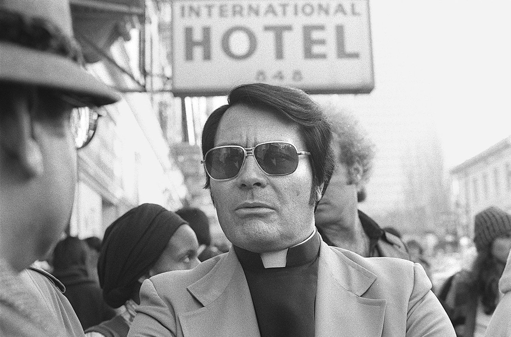
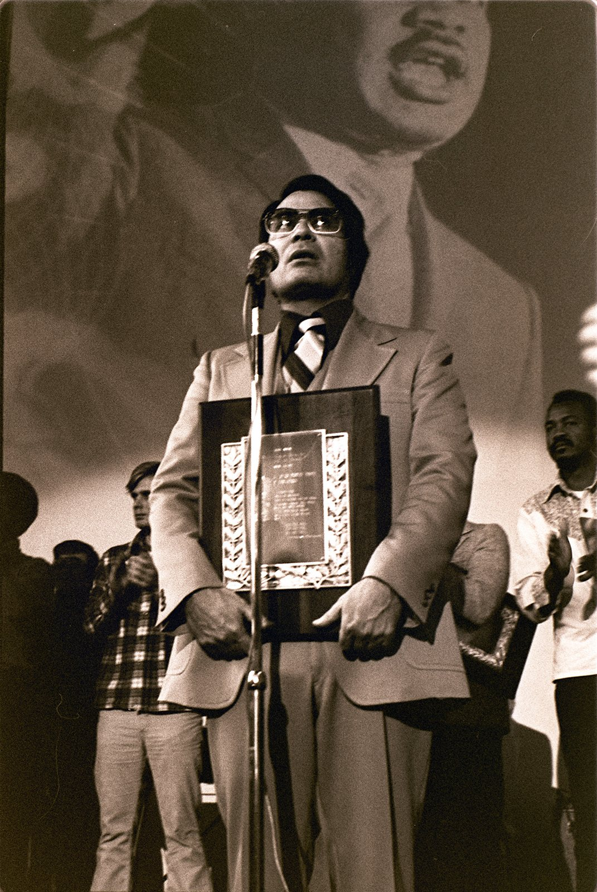
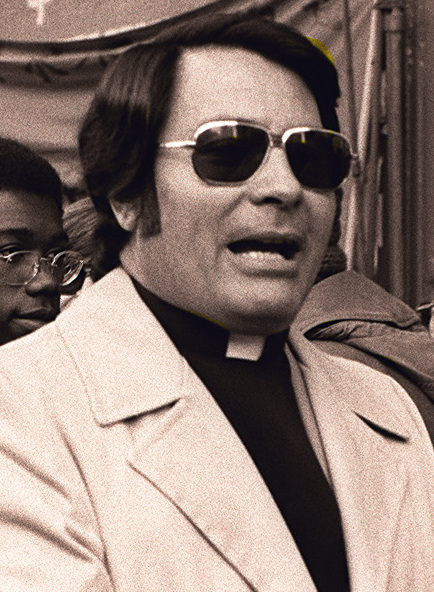

48 years ago today, November 18, 1978, the world learned of an unimaginable tragedy in the dense jungles of Guyana. A total of 918 people lost their lives in a coordinated mass murder-suicide orchestrated by cult leader Jim Jones, ending the Peoples Temple in one of the darkest chapters of American history.

## The Rise of Jim Jones and the Peoples Temple

The roots of the catastrophe reached back to 1955, when James Warren Jones founded the Peoples Temple in Indianapolis, Indiana. In an era marked by deep racial divisions, Jones distinguished his ministry by preaching racial integration and civil rights, attracting a heavily African American congregation. He blended traditional religious revivalism with radical socialist rhetoric, calling his doctrine 'Apostolic Socialism.' Over the years, the organization claimed thousands of members, eventually establishing formal affiliation with the Christian Church (Disciples of Christ) in 1964.

## A Move West and Growing Political Influence

In 1965, Jones relocated the congregation to California, later establishing headquarters in San Francisco. During the 1970s, the Temple became a formidable political force through community outreach and volunteer mobilization. Jones developed close ties with prominent California political leaders, culminating in his appointment as Chairman of the San Francisco Housing Authority Commission in 1975. However, former members and investigative journalists soon began reporting disturbing accounts of physical abuse, financial exploitation, and severe psychological control inside the group.

*JIM JONES in 1977 — Photo: Nancy Wong / CC BY-SA 4.0*

## Flight into the Guyanese Jungle

Facing intensifying media scrutiny and defector accusations, Jones moved to establish a remote agricultural mission in Guyana. In 1974, the Peoples Temple leased land from the Guyanese government, promoting the settlement as a self-sufficient socialist paradise free from American oppression. Hundreds of followers surrendered their life savings, homes, and passports to join Jones at the commune, known informally as Jonestown. In reality, the settlement operated as a totalitarian enclosure where Jones exercised absolute authority, cutting off residents from communication with their families in the United States.

*Jim Jones, 1977 — Photo: Nancy Wong / CC BY-SA 3.0*

## Congressman Ryan's Fact-Finding Mission

In November 1978, United States Representative Leo Ryan of California decided to investigate mounting complaints from constituents that their relatives were being held captive at Jonestown. Accompanied by a delegation of journalists and concerned family members, Ryan flew to Guyana and arrived at the commune on November 17. While the visit initially appeared orderly, several commune members privately passed notes to Ryan's team pleading for help to escape. By the afternoon of November 18, Ryan and a group of defectors prepared to depart from the nearby airstrip at Port Kaituma.

*Jim Jones (cropped) — Photo: Nancy Wong / CC BY-SA 3.0*

## Ambush at Port Kaituma and the Final Hours

As the delegation began boarding two small aircraft, armed Temple loyalists arrived in a tractor-trailer and opened fire on the runway. Congressman Leo Ryan, three journalists, and one defector were murdered, while several others were wounded. Recognizing that the assassination of a United States congressman would bring immediate military and law enforcement intervention, Jones gathered his followers at the central pavilion in Jonestown. On an audio recording later recovered by investigators, Jones argued that death was the only option, framing the mass killing as an act of 'revolutionary suicide.'

## The Lethal Orders in Jonestown

Under the watch of armed guards, large tubs of grape Flavor Aid mixed with cyanide and tranquilizers were brought forward. Parents were instructed to administer the poison to their infants and young children first, resulting in the deaths of more than 270 minors. While many members drank the poison under extreme psychological coercion, evidence revealed that seventy or more individuals were forcibly injected against their will. In all, 909 people died at Jonestown itself, while four others died at the group's headquarters in Georgetown, bringing the total death toll of the coordinated incident to 918.

## A Shock to the American Public

Prior to the terrorist attacks of September 11, 2001, the Jonestown massacre represented the single greatest loss of American civilian life in a deliberate act. The disaster left the American public in deep shock, raising urgent national questions about how an abusive organization could operate undetected beneath political cover for so long. Decades later, the tragedy of Jonestown remains an enduring warning about the catastrophic power of unchecked cult leadership.

### Sources

- <https://en.wikipedia.org/wiki/Jonestown>
- <https://commons.wikimedia.org/wiki/File:Dorothy_von_Beroldingen_with_Jim_Jones_at_a_protest_in_front_of_the_International_Hotel,_San_Francisco_-_January_1977.jpg>
- <https://commons.wikimedia.org/wiki/File:JIM_JONES_in_1977.jpg>
- <https://commons.wikimedia.org/wiki/File:Jim_Jones,_1977.jpg>
- <https://commons.wikimedia.org/wiki/File:Jim_Jones_(cropped).jpg>
