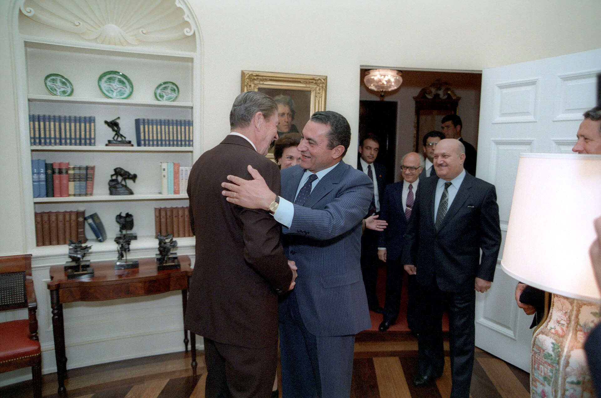
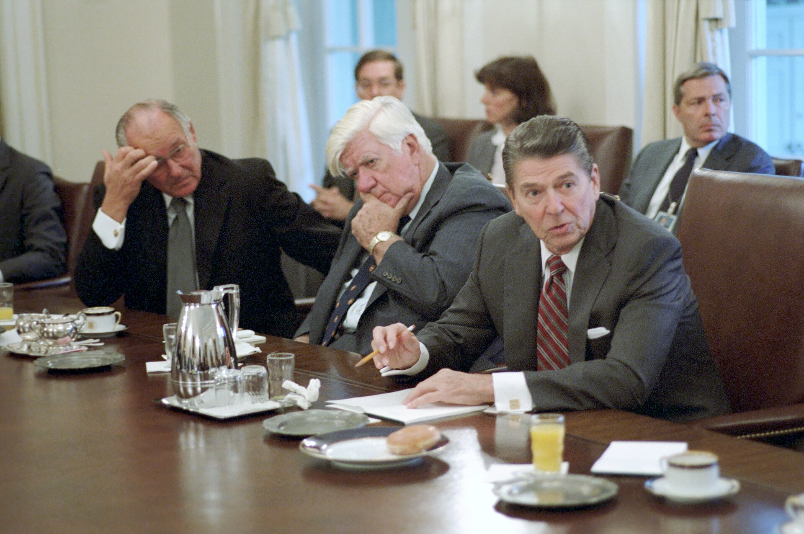
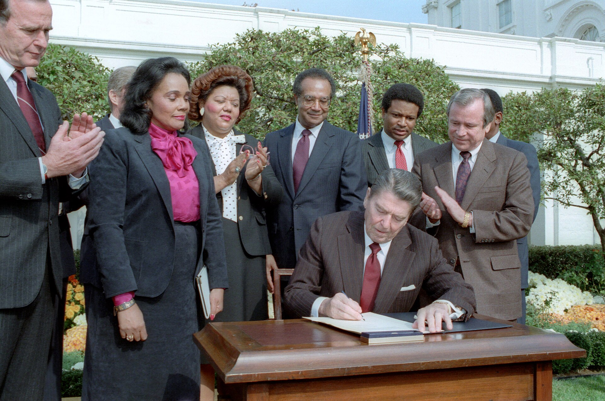

39 years ago today, November 18, 1987, congressional committees investigating the Iran-Contra affair released their findings to the public. The bipartisan report held President Ronald Reagan bearing ultimate responsibility for a secret foreign policy apparatus that bypassed federal law.

## A Secret Pipeline Across Two Continents

Between 1981 and 1986, high-ranking officials inside the Reagan administration orchestrated an elaborate covert enterprise. The United States engaged in secret weapon transactions with the Islamic Republic of Iran, a state formally designated as a sponsor of terrorism. The proceeds generated from these illicit arms shipments were then systematically diverted across the globe to Central America, where they financed the Contras, an armed guerrilla movement seeking to overthrow the socialist Sandinista government of Nicaragua.

## Hostages, Weapons, and the Boland Amendment

The initial rationale presented within the administration was securing the freedom of 7 American hostages held in Lebanon by Hezbollah, an armed organization closely aligned with Iran's Islamic Revolutionary Guard Corps. Manucher Ghorbanifar, an expatriate Iranian arms dealer, proposed trading arms shipments for influence over the captors. Meanwhile, on Capitol Hill, lawmakers had grown alarmed by covert United States involvement in Central America. Congress passed the Boland Amendments, signed into law by Reagan himself, which barred the Central Intelligence Agency, the Department of Defense, and any other intelligence entity from expending funds to assist military operations in Nicaragua.

*Archive, 1983 — Photo: President (1981-1989 : Reagan). White House Photographic Off / Public domain*

## Diplomatic Embarrassment and the Public Exposure

The clandestine arrangement created severe diplomatic hypocrisy. In 1983, the United States had initiated Operation Staunch, an international diplomatic campaign urging governments worldwide to halt all arms deliveries to Iran. When the Lebanese publication Ash-Shiraa broke the story of secret United States weapon shipments in November 1986, the revelations stunned international allies and domestic observers alike. President Reagan addressed the nation on television, acknowledging arms transfers had occurred while maintaining that the United States had not traded arms for hostages. However, investigators soon learned that large quantities of government documents were shredded or concealed by White House staff as the probe began.

*Archive, 1983 — Photo: President (1981-1989 : Reagan). White House Photographic Off / Public domain*

## The Congressional Indictment of Executive Secrecy

By March 1987, President Reagan went on television again, acknowledging that what began as a strategic opening had deteriorated into an arms-for-hostages trade and accepting full responsibility for the affair. On November 18, 1987, the joint House and Senate investigative panels issued their conclusive report. The committees determined that senior officials had operated in gross disregard of the law, creating a secret government outside constitutional limits. While congressional investigators did not uncover conclusive proof that Reagan personally directed every detail of the diversion scheme, the report insisted that the chief executive bore the ultimate responsibility for the pervasive culture of secrecy and lawlessness within his administration.

*Archive, 1983 — Photo: President (1981-1989 : Reagan). White House Photographic Off / Public domain*

## Indictments, Pardons, and the Independent Counsel

The scandal prompted a prolonged independent criminal investigation led by Independent Counsel Lawrence Walsh, appointed in December 1986. Several dozen administration figures faced indictments, including Secretary of Defense Caspar Weinberger and National Security Council aide Lieutenant Colonel Oliver North. Although 11 individuals were convicted, appellate courts later overturned key verdicts. In the final weeks of his presidency in December 1992, George H. W. Bush, who served as Reagan's vice president throughout the affair, issued executive pardons to six key figures, precluding further trials. Only one defendant, Thomas G. Clines, served prison time.

## The Enduring Shadow Over Presidential Power

Independent Counsel Walsh submitted his final accounting in August 1993, later documenting the systematic deception and obstruction in his memoir. Today, the Iran-Contra affair remains one of the defining constitutional crises of late twentieth-century American politics. It stands as a pivotal historical benchmark regarding the limits of executive power, the oversight responsibilities of Congress, and the perils of conducting shadow foreign policy behind closed doors.

### Sources

- <https://en.wikipedia.org/wiki/Iran%E2%80%93Contra_affair>
- <https://commons.wikimedia.org/wiki/File:Photograph_of_President_Reagan_receiving_the_Tower_Commission_Report_in_the_Cabinet_Room_-_NARA_-_198581.jpg>
- <https://commons.wikimedia.org/wiki/File:President_Ronald_Reagan_Meeting_with_President_Hosni_Mubarak_of_Egypt_in_The_Oval_Office_-_DPLA_-_079aff6e5e6220e49a81e9cc4fa740e8.jpg>
- <https://commons.wikimedia.org/wiki/File:Meeting_to_Discuss_The_Situation_in_Grenada_with_a_Group_of_Bipartisan_Members_of_Congress_with_Tip_O%27Neill_and_Bob_Michel_in_Cabinet_Room_-_DPLA_-_522462c995b6e7960861783636f81bd2.jpg>
- <https://commons.wikimedia.org/wiki/File:President_Reagan_at_Signing_Ceremony_for_Martin_Luther_King_Holiday_Legislation_in_the_Rose_Garden_with_Coretta_Scott_King,_George_Bush,_Howard_Baker,_Bob_Dole,_Jack_Kemp,_Samuel_Pi_-_DPLA_-_4e348270f5d83a7644e8b8182bfa6dd1.jpg>
