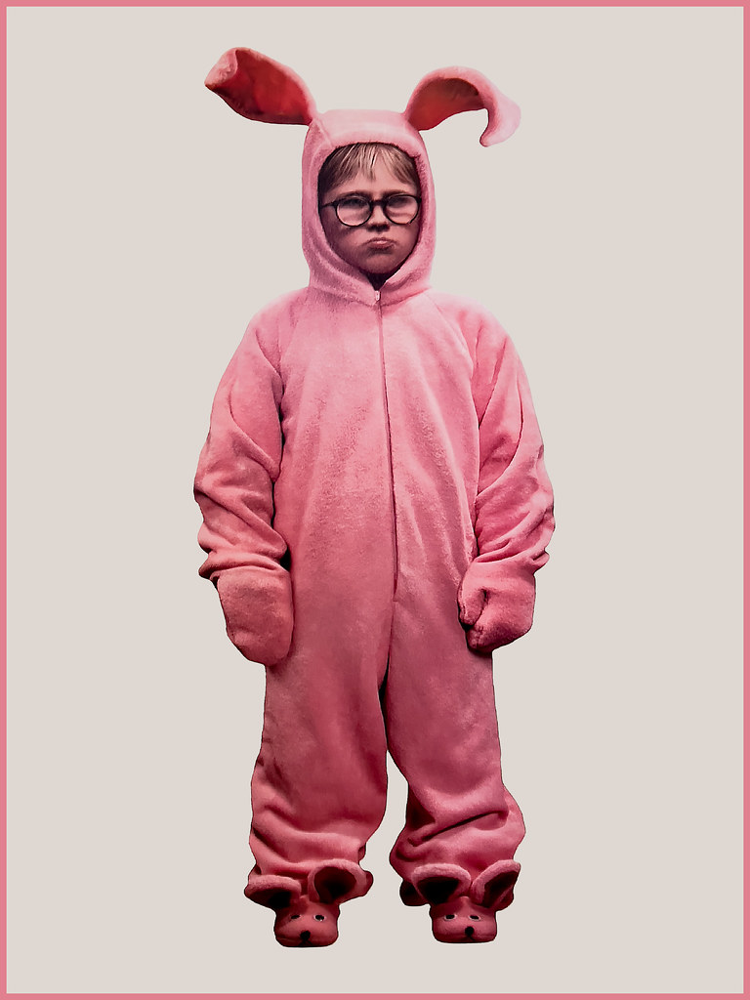
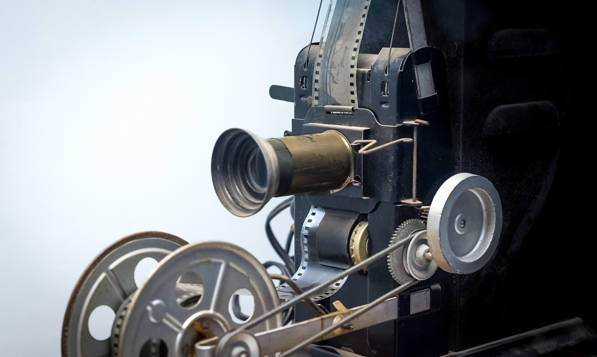

43 years ago today, November 18, 1983, MGM/UA released a modest holiday comedy in American movie theaters called A Christmas Story. The picture opened quietly against bigger releases, but its warm depiction of childhood longing and family life soon captured the hearts of generations.

## From Radio Broadcasts to the Silver Screen

The inspiration for A Christmas Story trace back to the semi-autobiographical writings of author and radio personality Jean Shepherd. In 1966, Shepherd published the book In God We Trust: All Others Pay Cash, which included stories that had earlier appeared in Playboy magazine between 1964 and 1966. He also drew material from his 1971 collection, Wanda Hickey's Night of Golden Memories and Other Disasters.

Director Bob Clark first encountered Shepherd's distinct voice in 1968 while listening to his WOR Radio talk show in New York. Clark heard Shepherd narrate the humorous tale of Flick getting his tongue stuck to a frozen pole and became determined to turn Shepherd's nostalgic stories into a feature film. Along with Shepherd and Leigh Brown, Clark developed a screenplay that wove several of these childhood anecdotes into a single holiday narrative.

## Ralphie Parker’s Quest for the Red Ryder Air Rifle

Set in the fictional town of Hohman in Northwest Indiana around 1940, the story revolves around 9-year-old Ralphie Parker, played by young actor Peter Billingsley. As Christmas approaches, Ralphie is consumed by a singular desire: he wants Santa Claus to bring him a Red Ryder Carbine Action 200-shot Range Model air rifle.

His quest meets resistance at every turn. When he hints at the gift to his mother, played by Melinda Dillon, she dismisses the idea immediately. When he writes a school theme paper praising the rifle, his teacher Miss Shields assigns him a C-plus. Even the department store Santa Claus at Higbee's shoves him down a slide while uttering the identical caution: 'You'll shoot your eye out, kid.'

*NOT FROM THE EVENT — Photo: Ron Cogswell / CC BY 2.0*

## The Vignettes That Defined an Era

Surrounding Ralphie's main quest are several vignettes illustrating the eccentricities of the Parker household. Darren McGavin portrayed Ralphie's father, known throughout the film as 'The Old Man,' an energetic figure locked in a perpetual war with the house's clanking furnace. His proudest moment arrives when he wins a newspaper contest and receives a 'major award'—a flamboyant table lamp shaped like a woman's leg encased in a fishnet stocking, much to Mrs. Parker's quiet dismay.

Other misadventures punctuate the season. Ralphie's classmate Flick is pressured by Schwartz into a 'triple dog dare' and ends up with his tongue frozen to the elementary school flagpole, requiring a rescue by the local fire department. Ralphie waits weeks for an official Little Orphan Annie decoder pin, only to discover that the radio code is a commercial message urging children to drink Ovaltine. An accidental profanity while helping change a flat tire leads to Ralphie having his mouth washed out with Lifebuoy soap, and torment by neighborhood bully Scut Farkus finally ends in an explosive playground brawl.

*NOT FROM THE EVENT — Photo: Ron Cogswell / CC BY 2.0*

## Box Office Numbers and Early Critical Reception

Filmed partly on location in Canada and in Cleveland, Ohio, the movie was produced on a tight budget of 3.3 million dollars. Upon its theatrical release by MGM/UA Entertainment Co. on November 18, 1983, the film earned positive reviews from critics who appreciated its gentle, episodic humor and lack of cheap sentimentality.

The film performed steadily at the box office, ultimately taking in 20.8 million dollars in theatrical gross. In 1984, the production received critical honors in Canada, securing two Genie Awards. Adult Ralphie's voiceover, narrated directly by Jean Shepherd, lent the film a rich literary cadence that distinguished it from typical commercial holiday fare of the early 1980s.

*Not a photo of the event itself · NOT FROM THE EVENT · Stock image — Photo: ClickerHappy / Pixabay Content License*

## The Rise of the 24-Hour Television Marathon

While A Christmas Story was a commercial success during its initial theater run, its status as a seasonal juggernaut solidified through home video releases and television broadcasts. In 1997, the cable network TNT established an annual tradition titled '24 Hours of A Christmas Story.' The marathon consisted of twelve back-to-back airings running continuously from Christmas Eve evening through Christmas Day.

In 2004, the marathon moved over to sister network TBS, where it continued to attract millions of viewers each holiday season. The around-the-clock broadcast allowed families across the United States to drop into Ralphie's world at any hour of the day, transforming scenes like the pink bunny suit and the family eating Peking duck at a Chinese restaurant after neighborhood hounds ate their turkey into shared holiday rituals.

## Preservation and Lasting Legacy

In 2012, the Library of Congress recognized the cultural stature of A Christmas Story by selecting it for preservation in the United States National Film Registry. The registry specifically cited the movie as being 'culturally, historically, or aesthetically significant.'

The Parker family's escapades also sparked several follow-ups over the years, including the 1994 theatrical sequel My Summer Story, a 2012 direct-to-video production titled A Christmas Story 2, and the 2022 release A Christmas Story Christmas, which brought back Peter Billingsley and original cast members. Decades after its low-key 1983 theatrical debut, Bob Clark's film remains an enduring snapshot of American family life and holiday childhood.

### Sources

- <https://en.wikipedia.org/wiki/A_Christmas_Story>
- <https://www.flickr.com/photos/22711505@N05/52590180014>
- <https://www.flickr.com/photos/22711505@N05/52590343320>
- <https://www.flickr.com/photos/22711505@N05/52599931737>
- <https://pixabay.com/photos/film-35mm-vintage-projector-1365334/>
