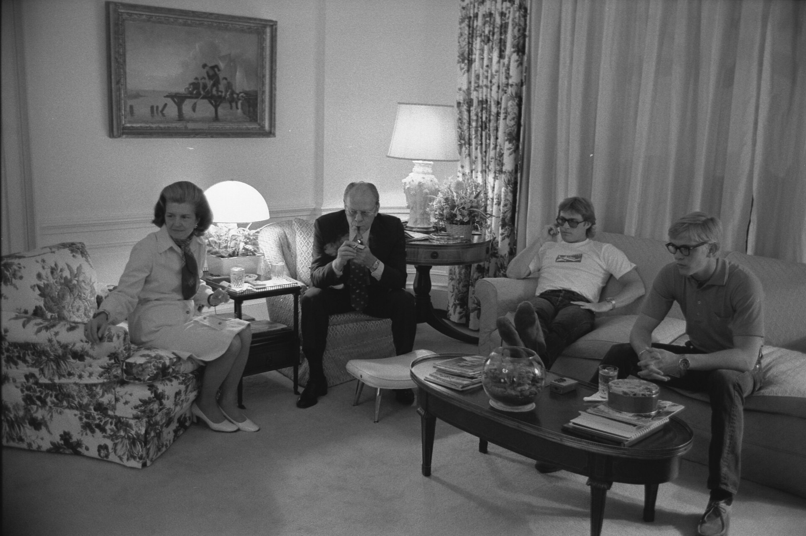
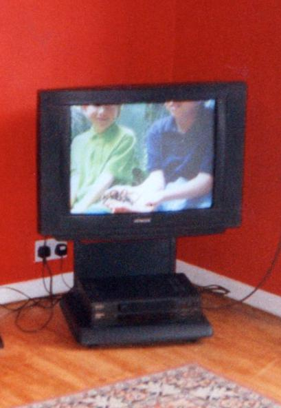

25 years ago today, November 18, 2001, Nintendo officially launched the Nintendo GameCube in North America. Following its Japanese debut on September 14, 2001, the system entered the market as Nintendo's fourth major home console, succeeding the cartridge-based Nintendo 64. It arrived in the midst of a fierce battle for living room supremacy alongside Sony's PlayStation 2 and Microsoft's newly released Xbox.

## From Project Dolphin to the Flipper Processor

Development of the console began in 1998, when Nintendo partnered with ArtX, a company founded by former SGI engineers who had previously worked on the Nintendo 64. ArtX took charge of the system logic and graphics processor, codenamed "Flipper." On May 12, 1999, Nintendo publicly unveiled the project under the codename "Dolphin," highlighting partnerships with IBM for the PowerPC-based "Gekko" CPU and Panasonic for optical drive technology. The console went through preliminary names such as N2000, Star Cube, and Nintendo Advance before Nintendo officially revealed the GameCube name in Japan on August 25, 2000.

## Breaking Away from Cartridges at a 199-Dollar Price Point

The GameCube marked a major technical shift as Nintendo's first home console to abandon ROM cartridges in favor of optical discs. Unlike its rivals, which doubled as multimedia DVD movie players, the GameCube remained solely dedicated to games, utilizing a proprietary MiniDVD-based disc format and memory cards for save files. Nintendo also introduced a distinctive controller featuring a handlebar grip and staggered analog sticks, supplemented later by accessories like the WaveBird Wireless Controller and the Game Boy Advance link cable. To capture consumer interest, Nintendo announced a launch price of 199 dollars on May 21, 2001—undercutting both the PlayStation 2 and the Xbox by 100 dollars—and backed the rollout with a 76 million dollar marketing blitz centered on the slogan "Born to Play."

*Scene of the era (not a photo of this event) — Photo: David Hume Kennerly / Public domain*

## A Launch Lineup Headlined by Luigi

When the GameCube arrived in North American stores on November 18, 2001, it broke a long-standing company tradition: for the first time since the Famicom, Nintendo launched a home console without a Mario platformer. Instead, Mario's brother took the spotlight in Luigi's Mansion, leading an initial wave of software that also featured Star Wars Rogue Squadron II: Rogue Leader. While several anticipated titles experienced delays past opening day, the console offered sharp visual performance and responsive gameplay from the outset.

*1990s Television Set — Photo: ProtoKiwi / CC BY 4.0*

## Building a Hall of Fame Software Catalog

Although the GameCube faced stiff competition and limited third-party publisher support, its exclusive library became one of the most celebrated in video game history. Landmark releases quickly followed the launch, including Super Smash Bros. Melee in late 2001, Super Mario Sunshine, Eternal Darkness, and Metroid Prime in 2002, The Legend of Zelda: The Wind Waker, Paper Mario: The Thousand-Year Door in 2004, and Resident Evil 4 in 2005. Furthermore, enduring Nintendo franchises such as Animal Crossing, Pikmin, and Luigi's Mansion all had their beginnings on the GameCube.

*Los Angeles Convention Center construction 1970 — Photo: Larry Sharkey, Los Angeles Times / CC BY 4.0*

## Sales Reality and the Transition to the Wii

Over its lifecycle, Nintendo sold 21.74 million GameCube consoles worldwide. While the hardware remained profitable, sales ended up lower than Nintendo had anticipated, trailing the PlayStation 2 and slightly behind the Xbox, though outselling Sega's Dreamcast. Nintendo shifted its focus toward motion control concepts—which had originally been prototyped during the GameCube era—and released the backward-compatible Wii on November 19, 2006. Production of the GameCube officially concluded in February 2007.

## An Enduring Design That Still Connects Players

Decades after its North American debut, the GameCube retains a passionate following among gamers and historians alike. Its acclaimed game library continues to influence contemporary titles, and the console's unique controller proved so popular and practical that Nintendo has provided adapter support and compatibility for it on every subsequent home platform. What began on a November Sunday in 2001 remains an essential chapter in the story of modern entertainment.

### Sources

- <https://en.wikipedia.org/wiki/GameCube>
- <https://www.flickr.com/photos/31687107@N07/4917865367>
- <https://commons.wikimedia.org/wiki/File:Ford_family_watches_Sacramento_assassination_attempt_news_coverage_image_A6332-04.jpg>
- <https://commons.wikimedia.org/wiki/File:1990s_Television_Set.jpg>
- <https://commons.wikimedia.org/wiki/File:Los_Angeles_Convention_Center_construction_1970.jpg>
