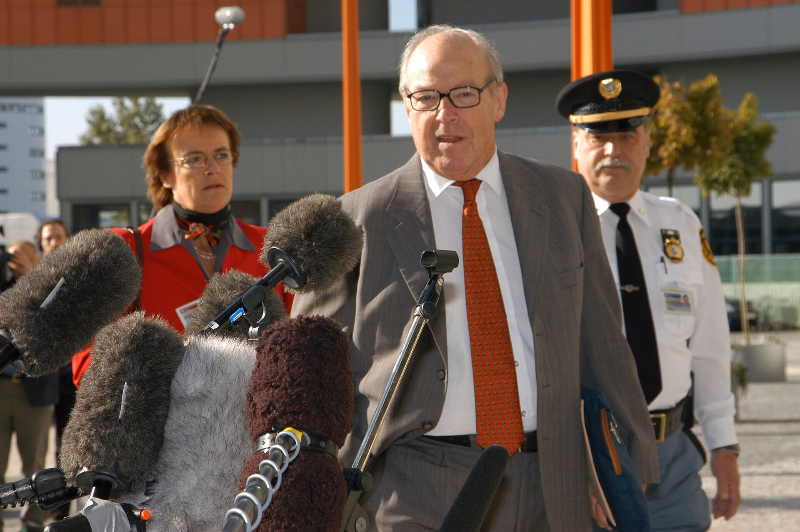
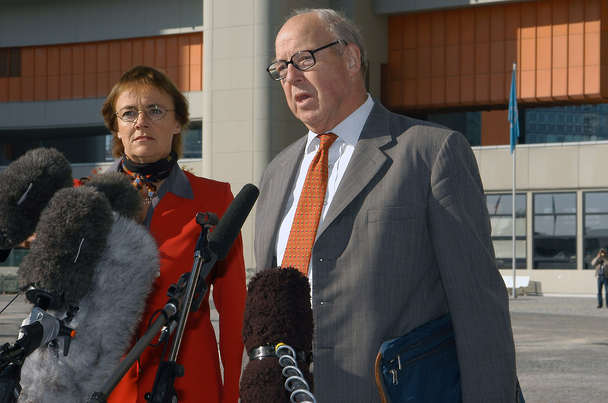
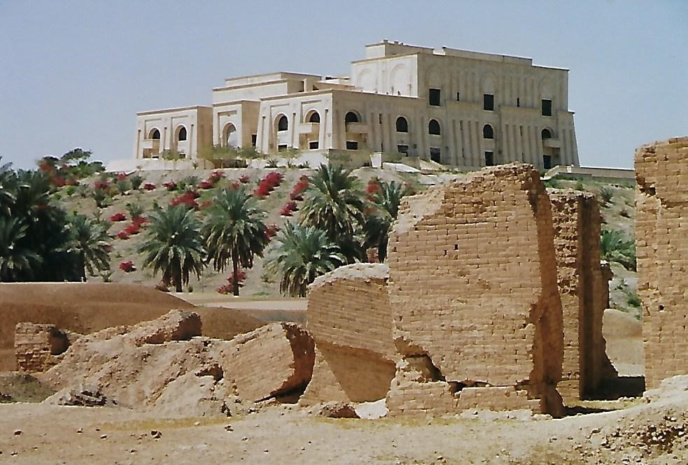

24 years ago today, November 18, 2002, United Nations weapons inspectors led by Swedish diplomat Hans Blix touched down in Baghdad. Their mission was to search Iraq for stockpiles of chemical, biological, and nuclear weapons amidst mounting threats of war from the United States.

## Mounting Accusations in Washington

The crisis had escalated rapidly in the wake of the September 11, 2001 terrorist attacks, after which President George W. Bush declared a global 'war on terror.' Five Americans subsequently died in mailings containing anthrax spores. While the actual perpetrator remained unconfirmed, prominent American officials publicly speculated that Iraq was responsible. Within the administration, key figures including Vice President Dick Cheney and Secretary of Defense Donald Rumsfeld asserted in 2002 that Iraq maintained ties to al-Qaeda and was actively producing weapons of mass destruction. To justify their claims, officials pointed to Iraq's procurement of aluminum tubes and documents suggesting Baghdad sought uranium.

## Hans Blix Takes the Lead

To avert an American military intervention, Iraqi President Saddam Hussein consented in November 2002 to allow United Nations inspectors back into the country. The official charged with overseeing the search was Hans Blix, a veteran Swedish diplomat who had previously served as Sweden's Minister for Foreign Affairs and spent sixteen years directing the International Atomic Energy Agency. Blix had previously overseen the agency's response to the 1986 Chernobyl disaster. United Nations Secretary-General Kofi Annan called Blix out of retirement to chair the United Nations Monitoring, Verification and Inspection Commission, created to verify Iraqi disarmament.

*Dr Hans Blix (03010752) — Photo: IAEA Imagebank / CC BY 2.0*

## Inspections Under Intense Scrutiny

Upon reaching Iraq on November 18, 2002, Blix and his inspection teams began scouring suspected military compounds, testing facilities, and industrial complexes. The pressure from Washington was relentless, as the United States threatened to invade if Iraq failed to surrender its alleged stockpiles. However, throughout their extensive searches, the international monitors uncovered no operational weapons of mass destruction or active production facilities. In response to these findings, American officials maintained that Iraq had simply hidden the materials prior to the arrival of the inspectors.

*Dr Hans Blix (03010755) — Photo: IAEA Imagebank / CC BY 2.0*

## The Push Toward Military Intervention

Seeking military backing from international allies, the Bush administration made its case before the United Nations Security Council. In February 2003, Secretary of State Colin Powell delivered an address alleging that Iraq had concealed weapons before inspections commenced and possessed mobile biological weapons laboratories, citing testimony from an Iraqi defector. Powell asserted that these weapons posed a direct threat to American cities. Other members of the Security Council remained unconvinced due to the absence of verifiable proof on the ground, yet the political trajectory toward war was already set.

*Saddam-Hussein-Palast (Babylon) — Photo: Mehlauge / CC BY-SA 4.0*

## Ultimatum and the March 2003 Invasion

The diplomatic window closed abruptly on March 17, 2003, when President Bush delivered a televised address from the White House. He announced that Saddam Hussein had 48 hours to leave Iraq or face military action. Bush ordered all United Nations weapons inspectors, including Blix and his personnel, to evacuate the country immediately. Three days later, on March 20, 2003, a United States-led coalition launched the invasion of Iraq, inaugurating a conflict that lasted until 2011.

## The Aftermath of an Intelligence Failure

During and after the invasion, coalition forces conducted their own extensive searches, but no weapons of mass destruction were ever found. The intelligence foundation cited for the conflict rapidly disintegrated: the documents regarding uranium purchases were proven to be forgeries in 2003, and in 2011, the defector cited by Colin Powell admitted to fabricating his claims regarding mobile weapons labs. In 2004, President Bush and Colin Powell officially conceded that the weapons did not exist. Powell cited a severe 'intelligence failure' and subsequently resigned from his post, concluding a contentious chapter that began with the arrival of inspectors in Baghdad.

### Sources

- <https://en.wikipedia.org/wiki/United_Nations>
- <https://commons.wikimedia.org/wiki/File:Hans_Blix_in_Vienna_2002.jpg>
- <https://commons.wikimedia.org/wiki/File:Dr_Hans_Blix_(03010752).jpg>
- <https://commons.wikimedia.org/wiki/File:Dr_Hans_Blix_(03010755).jpg>
- <https://commons.wikimedia.org/wiki/File:Saddam-Hussein-Palast_(Babylon).jpg>
