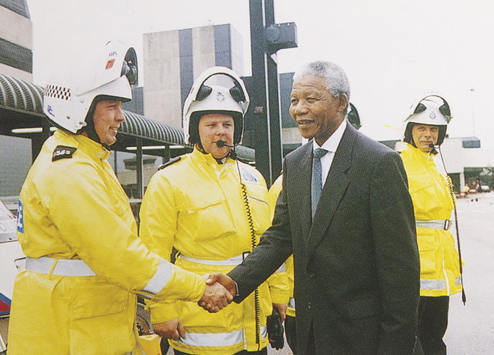
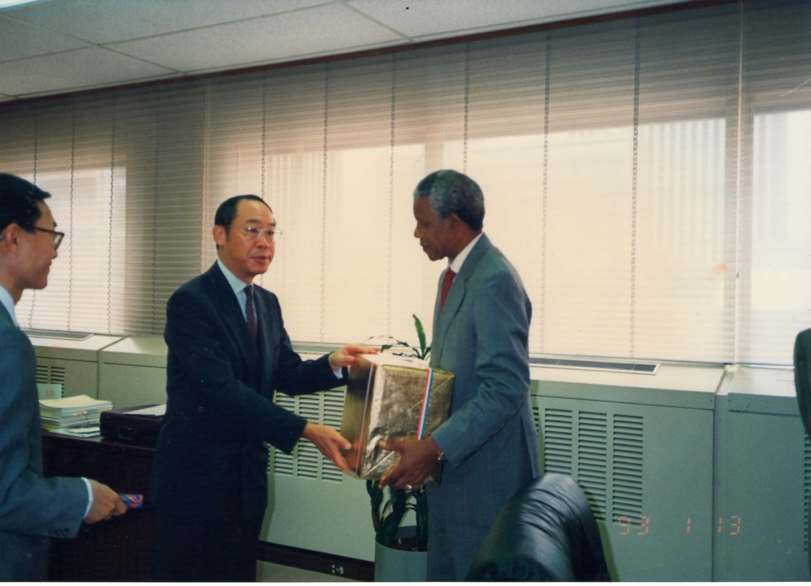
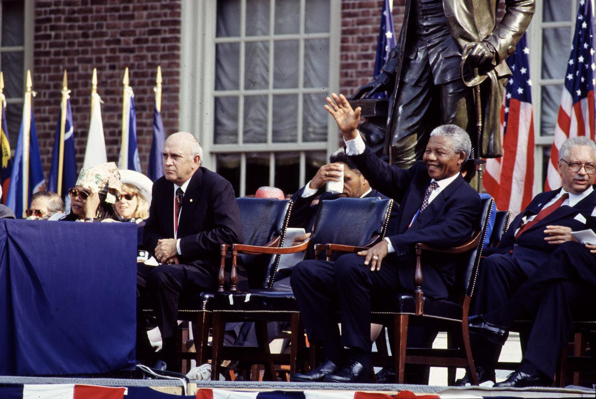

33 years ago today, November 18, 1993. In South Africa, 21 political parties approved a historic interim constitution, officially paving the way to end decades of white minority rule and expand voting rights to all citizens. The milestone marked a decisive turning point in the dismantling of apartheid.

## The Decades of Disenfranchisement

The roots of political inequality in South Africa stretched deep into its colonial and post-union history. The Union of South Africa was formed in 1910 under the South Africa Act 1909, uniting four British colonies: the Cape, Natal, Transvaal, and Orange River colonies. Over time, the qualified franchise that existed in the Cape was dismantled, stripping Black South Africans of political voice.

In 1948, the National Party came to power and formally institutionalized racial segregation as apartheid. Subsequent constitutional updates entrenched this separation. The 1961 constitution established a republic after a whites-only referendum, and the 1983 constitution created a tricameral parliament with segregated chambers for White, Coloured, and Indian representatives, while entirely excluding the Black majority.

## The Rise of Resistance and Early Talks

Resistance against institutional segregation grew both domestically and internationally. The African National Congress and other anti-apartheid organizations led campaigns against the regime, prompting the government to begin repealing some discriminatory statutes in the mid-1980s.

Formal constitutional negotiations commenced in December 1991 under the framework of the Convention for a Democratic South Africa, known as CODESA. Negotiators sought a peaceful roadmap from apartheid to democracy. The primary dispute was the mechanism for drafting the final supreme law: the African National Congress advocated for a democratically elected constituent assembly, while the National Party wanted guarantees to safeguard minority interests before general elections took place.

*West Midlands Police - Day 230 - Nelson Mandela visit, 1993 (14792067600) — Photo: West Midlands Police from West Midlands, United Kingdom / CC BY-SA 2.0*

## Deadlock and the Multi-Party Process

The initial CODESA negotiations collapsed in May 1992 during their second plenary session. A major sticking point was the threshold required for the future assembly to adopt the constitution; the National Party sought a 75 percent supermajority requirement, which would have granted it effective veto power.

In April 1993, negotiations resumed under the Multi-Party Negotiating Process. A specialized committee formulated a set of core constitutional principles that any future charter would be required to honor. This compromise ensured basic human rights, liberal democratic structures, and proportional minority protections, clearing the pathway for political consensus among competing groups.

*Chien-Mandela, 1993-06 — Photo: 故事封面圖片 / Public domain*

## The Historic Accord of November 18, 1993

On November 18, 1993, 21 political parties reached agreement and endorsed the Interim Constitution of South Africa. This document established the fundamental architecture of a liberal parliamentary republic with nine distinct provinces.

For the first time in South African history, the constitution enshrined universal adult suffrage and a comprehensive bill of rights. It ended the legal foundation of white minority rule and created an agreed timetable to transition governing authority to a fully representative administration.

*F. W. de Klerk and Nelson Mandela in Philadelphia 1993 — Photo: Carol M. Highsmith / Public domain*

## Transition to the 1994 Elections and 1996 Constitution

The approval of the interim charter enabled South Africa to hold its first universal democratic elections in 1994. The newly elected parliament functioned as a constituent assembly tasked with writing a permanent supreme law that conformed to the agreed constitutional principles.

On December 18, 1996, President Nelson Mandela promulgated the final Constitution of the Republic of South Africa. It formally took effect on February 4, 1997, superseding the 1993 interim document and concluding the formal legal transition from apartheid to constitutional democracy.

## The Legacy of the Democratic Foundation

South Africa today operates as a parliamentary republic encompassing nine provinces, with its administrative capital in Pretoria, legislative capital in Cape Town, and judicial capital in Bloemfontein. The foundational framework established in late 1993 introduced universal participation to all racial groups.

While South Africa continues to confront deep socioeconomic inequalities, the agreement forged on November 18, 1993, remains the cornerstone moment when rival parties chose negotiation over conflict, bringing an end to statutory minority rule.

### Sources

- <https://en.wikipedia.org/wiki/South_Africa>
- <https://commons.wikimedia.org/wiki/File:Photo_of_the_Day_342_-_Meeting_Neslon_Mandela.jpg>
- <https://commons.wikimedia.org/wiki/File:West_Midlands_Police_-_Day_230_-_Nelson_Mandela_visit,_1993_(14792067600).jpg>
- <https://commons.wikimedia.org/wiki/File:Chien-Mandela,_1993-06.jpg>
- <https://commons.wikimedia.org/wiki/File:F._W._de_Klerk_and_Nelson_Mandela_in_Philadelphia_1993.jpg>
