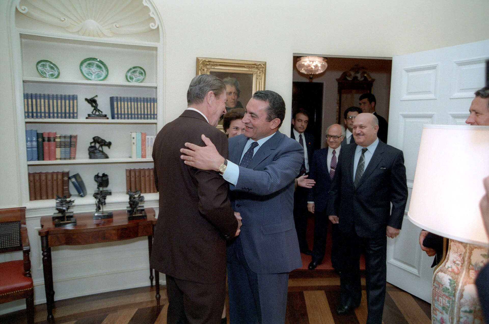
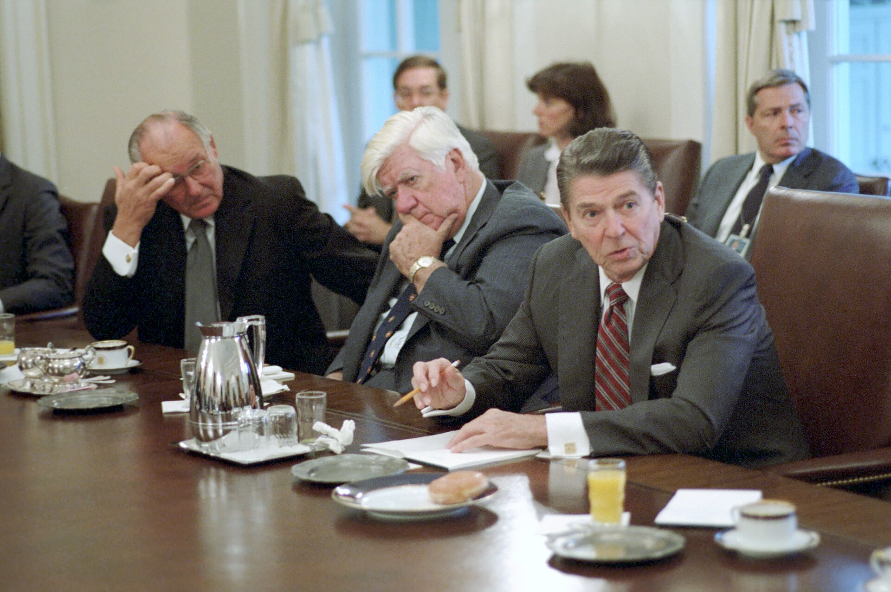
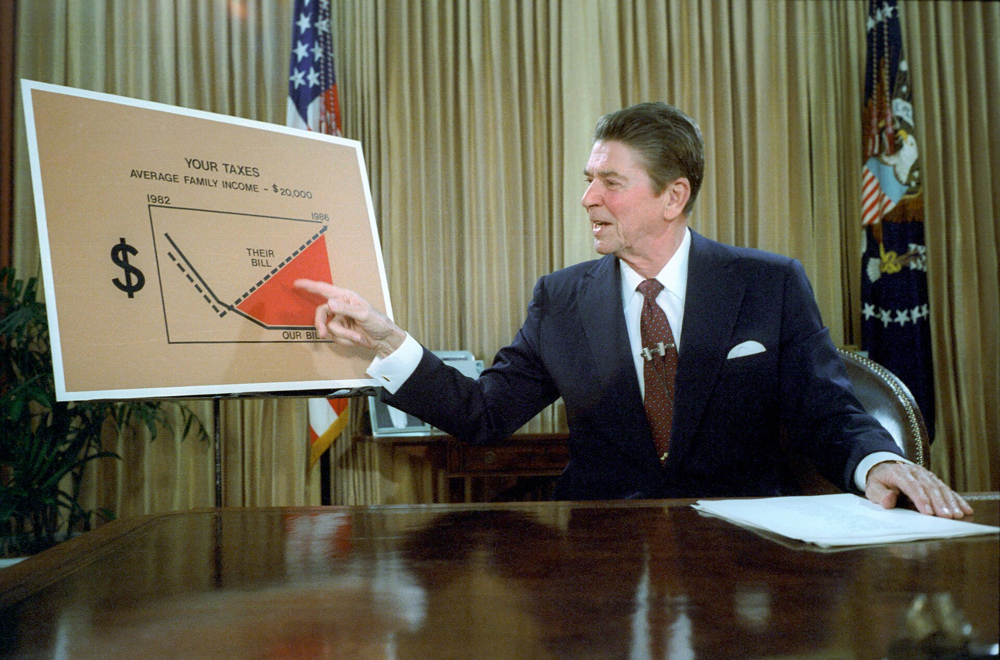

41 years ago today, November 19, 1985, United States President Ronald Reagan and Soviet Union General Secretary Mikhail Gorbachev sat down together in Geneva, Switzerland. It was the first time the leaders of the two Cold War superpowers met face-to-face, beginning a dialogue that altered the course of modern world history.

## A World Divided by the Cold War

The Cold War began in the aftermath of the Second World War as an intense geopolitical rivalry between two former allies: the United States and the Soviet Union. By the late 1940s, Europe was split by an Iron Curtain between the capitalist Western Bloc and the communist Eastern Bloc. The United States launched the Marshall Plan and established the NATO alliance, while Moscow consolidated control over Eastern Europe and formed the Warsaw Pact. Although the two nuclear superpowers never fought directly on the battlefield, they engaged in severe proxy conflicts around the globe, including the Korean War, the Vietnam War, and the Soviet-Afghan War. The arms race in both conventional and nuclear weapons, combined with espionage, propaganda campaigns, and crises like the 1962 Cuban Missile Crisis, kept the world under perpetual fear of nuclear war.

## Reagan's First Term and a Shifting Cold War Policy

Ronald Reagan entered the White House after winning a landslide victory over Jimmy Carter in 1980. A former actor, governor of California, and prominent conservative figure, Reagan brought a decisive shift to American foreign affairs. During the 1970s, relations between Washington and Moscow had experienced a period of détente, marked by treaties limiting strategic nuclear arsenals. However, Reagan shifted Cold War policy away from détente. In his first term, he escalated the arms race and authorized substantial increases in American military spending. He ordered the 1983 invasion of Grenada and maintained an uncompromising stance against Soviet influence worldwide. After securing another landslide victory against Walter Mondale in the 1984 presidential election, Reagan prepared for a second term dominated by foreign diplomacy.

*Archive, 1983 — Photo: President (1981-1989 : Reagan). White House Photographic Off / Public domain*

## Gorbachev's Arrival and New Leadership in Moscow

The geopolitical landscape shifted dramatically in 1985 when Mikhail Gorbachev became the General Secretary of the Soviet Union. Inheriting an economy strained by heavy defense commitments and systemic inefficiencies, Gorbachev moved to expand political freedoms and seek diplomatic engagement with the West. The emergence of a new, reform-minded Soviet leader presented Washington with an unexpected opening. Despite years of heated rhetoric and ideological standoff, the United States and the Soviet Union agreed to arrange an in-person meeting between their two leaders to discuss arms control and regional stability.

*Archive, 1983 — Photo: President (1981-1989 : Reagan). White House Photographic Off / Public domain*

## Geneva: The Neutral Stage for Global Diplomacy

The summit was scheduled for Geneva, Switzerland, a location long celebrated as an international center for humanitarian and diplomatic work. Situated where the Rhône leaves Lake Geneva, Geneva had hosted the League of Nations after World War I, saw the signing of the Geneva Conventions on humanitarian treatment in war, and served as the headquarters for numerous United Nations agencies and the International Committee of the Red Cross. Because of its unique standing as a neutral international crossroads, Geneva had earned the title of the Peace Capital, making it the natural venue for Ronald Reagan and Mikhail Gorbachev to hold their historic encounter.

*Archive, 1981 — Photo: President (1981-1989 : Reagan). White House Photographic Off / Public domain*

## The Historic Summit on November 19, 1985

On November 19, 1985, Ronald Reagan and Mikhail Gorbachev came together in Geneva for their opening discussions. It was their very first time meeting in person. Rather than relying solely on formal diplomatic exchanges through intermediaries, the American president and the Soviet general secretary spoke directly to one another. Over the course of the summit, they addressed the dangerous accumulation of nuclear weapons, ideological disagreements, and international security concerns. While deep policy differences remained unresolved, the face-to-face encounter established personal communication between the two leaders and broke the deep freeze that had characterized superpower relations in the early 1980s.

## The Legacy of the Geneva Dialogue

The 1985 Geneva meeting proved to be a critical turning point in Cold War history. The personal channel forged by Reagan and Gorbachev led to further negotiations, culminating in the historic Intermediate-Range Nuclear Forces Treaty. Gorbachev's ongoing reforms and political openings contributed to the revolutions of 1989 across the Eastern Bloc and ultimately the dissolution of the Soviet Union in 1991, which formally brought an end to the Cold War. Four decades later, the November 1985 summit in Geneva remains an enduring reminder of how direct personal diplomacy can ease global tensions and change the direction of nations.

### Sources

- <https://en.wikipedia.org/wiki/Cold_War>
- <https://commons.wikimedia.org/wiki/File:Official_Portrait_of_President_Reagan_1981.jpg>
- <https://commons.wikimedia.org/wiki/File:President_Ronald_Reagan_Meeting_with_President_Hosni_Mubarak_of_Egypt_in_The_Oval_Office_-_DPLA_-_079aff6e5e6220e49a81e9cc4fa740e8.jpg>
- <https://commons.wikimedia.org/wiki/File:Meeting_to_Discuss_The_Situation_in_Grenada_with_a_Group_of_Bipartisan_Members_of_Congress_with_Tip_O%27Neill_and_Bob_Michel_in_Cabinet_Room_-_DPLA_-_522462c995b6e7960861783636f81bd2.jpg>
- <https://commons.wikimedia.org/wiki/File:President_Ronald_Reagan_Addresses_the_Nation_from_the_Oval_Office_on_Tax_Reduction_Legislation_-_DPLA_-_c671d512e3601137f56b068779ab6e2b.jpg>
