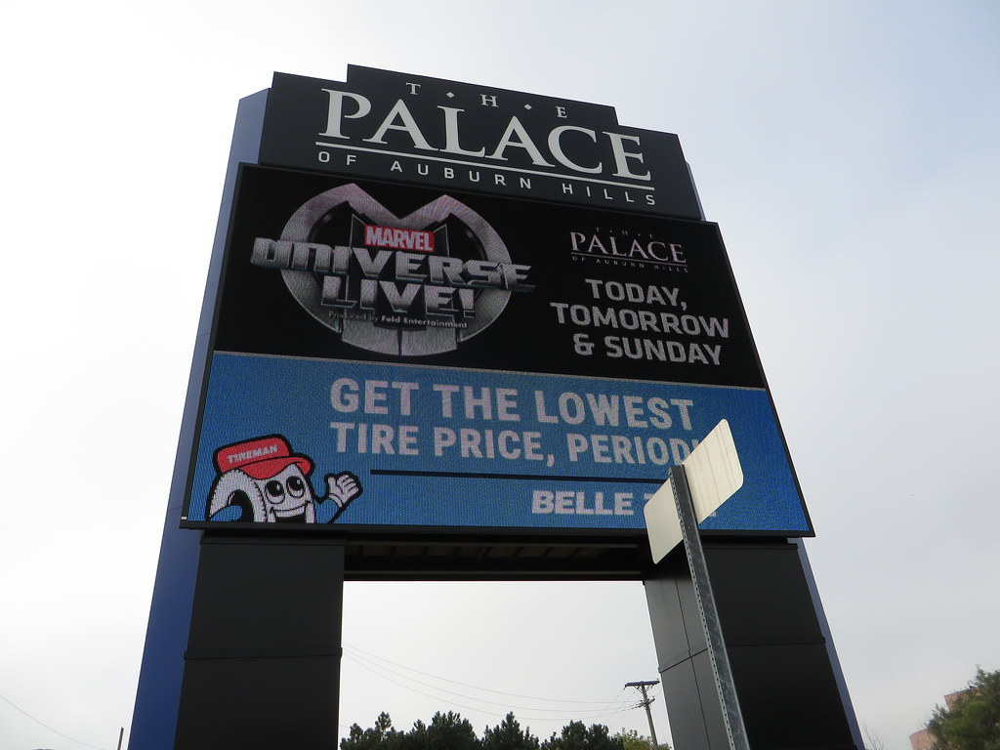
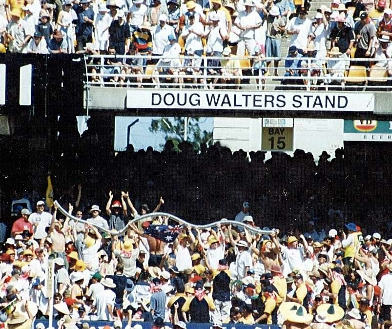
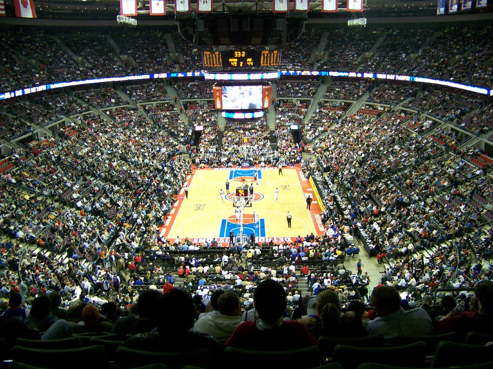

22 years ago today, November 19, 2004, an NBA regular season matchup between the Indiana Pacers and Detroit Pistons ended in unprecedented chaos. With less than a minute left on the game clock, an altercation on the court escalated into a full-scale riot inside the arena seating bowl, forever altering the careers of several star players.

## Tensions Boiling at The Palace of Auburn Hills

The showdown at The Palace of Auburn Hills in Michigan carried immense weight for both franchises. The Detroit Pistons were the reigning NBA champions after upsetting the Los Angeles Lakers the previous spring. In the Eastern Conference finals on their way to that title, Detroit had eliminated the Indiana Pacers in a grueling series. Entering the November 19 rematch, Indiana had built a strong 7–2 record and was widely regarded as a top contender to reach the NBA Finals. Veteran guard Reggie Miller was playing in his 18th and final season, hoping to close his career with a championship. As the clock wound down in the fourth quarter, Indiana held a commanding 97–82 lead over the champions.

## A Hard Foul and a Scorer's Table

With only 45.9 seconds remaining on the clock and the outcome beyond doubt, Detroit center Ben Wallace drove toward the basket for a layup. Indiana forward Ron Artest delivered a hard foul from behind to stop the shot. A furious Wallace reacted by forcefully shoving Artest in the chest with both hands. Players and coaches from both benches quickly intervened to separate the two men. To prevent himself from being provoked into a physical fight, Artest walked over to the sideline and laid down flat on his back atop the scorer's table, waiting for the referees to sort out the fouls.

*Palace of Auburn Hills, Home of the Detroit Pistons, Auburn Hills, Michigan — Photo: Ken Lund / CC BY-SA 2.0*

## A Thrown Cup Sparks a Full-Scale Brawl

While Artest remained on the table, a Pistons fan named John Green hurled a plastic cup filled with beer from several rows up in the arena seats. The cup struck Artest directly in the chest. Enraged by the projectile, Artest immediately bounded off the table, rushed into the stands, and grabbed another spectator, Michael Ryan, mistakenly believing Ryan had thrown the beverage. Indiana swingman Stephen Jackson followed Artest into the seating section and began throwing punches. On the court, Jermaine O'Neal struck a fan who had walked onto the playing floor. Guard Jamaal Tinsley even grabbed a long-handled dustpan to use as a weapon before being restrained. Drinks, food, and debris showered the court as security and local police rushed to regain control. Officials abandoned the game with 45.9 seconds left, awarding Indiana the 97–82 victory.

*SCG-Beersnake2004-01-04 — Photo: Bigbewo / Public domain*

## Unprecedented League Suspensions and Financial Penalties

The disciplinary response from NBA Commissioner David Stern was swift and historic. In total, the league suspended nine players for a combined 146 games without pay, resulting in more than $11 million in lost salaries. Ron Artest received the harshest punishment in league history for an on-court incident unrelated to substance abuse: a suspension covering the remaining 73 regular season games and all 13 of Indiana's playoff games. Stephen Jackson was suspended for 30 games, while Ben Wallace received a six-game suspension. Anthony Johnson was suspended for five games. Jermaine O'Neal was initially banned for 25 games, though his penalty was later reduced to 15 games by arbitrator Roger Kaplan, a decision upheld by U.S. District Judge George B. Daniels.

*Palace of Auburn Hills — Photo: Kevin.Ward / CC BY-SA 2.0*

## Criminal Charges and Lifetime Arena Bans

The incident extended far beyond basketball sanctions, leading to formal legal consequences for both participants and spectators. Prosecutors filed criminal assault and battery charges against five Indiana players: Artest, Jackson, Johnson, David Harrison, and O'Neal, who faced two counts. All five players eventually received sentences of probation and community service. On the fan side, five spectators faced criminal assault charges for their roles in the melee, including John Green. The Detroit Pistons took administrative action as well, banning all five fans from attending home games at the venue for life.

## The Shattered Season in Indiana

The fallout from the brawl completely derailed Indiana's championship aspirations. Depleted by lengthy suspensions and subsequent injuries, the Pacers struggled to field a competitive lineup. In one contest, the team was forced to dress an injured Jeff Foster simply to satisfy the NBA requirement of having at least eight active players, avoiding an automatic forfeit. Guard Fred Jones had to play 40 or more minutes in six straight games due to the severe lack of available guards. Indiana plummeted from its 7–2 start to finish third in the Central Division at 44–38. Meanwhile, Detroit recovered to win the division with a 54–28 record and reached the 2005 NBA Finals, where they fell to the San Antonio Spurs in seven games. The brawl forever came to be known as 'The Malice at the Palace,' remaining the most infamous altercation in American professional sports history.

### Sources

- <https://en.wikipedia.org/wiki/November%2019>
- <https://commons.wikimedia.org/wiki/File:Reggie_Miller_2003.jpg>
- <https://www.flickr.com/photos/75683070@N00/21708158102>
- <https://commons.wikimedia.org/wiki/File:SCG-Beersnake2004-01-04.jpg>
- <https://www.flickr.com/photos/9267838@N06/1299471157>
