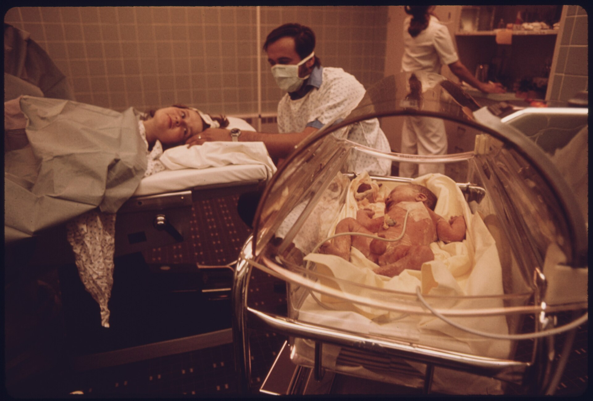
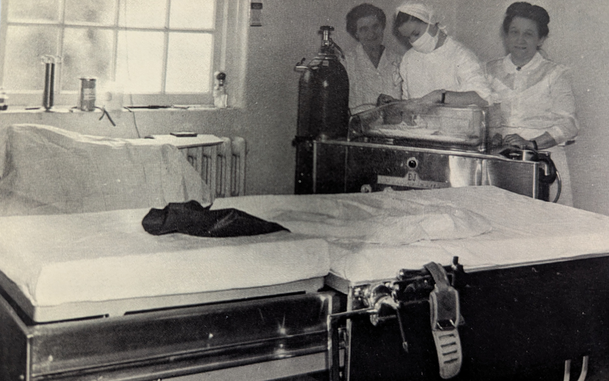
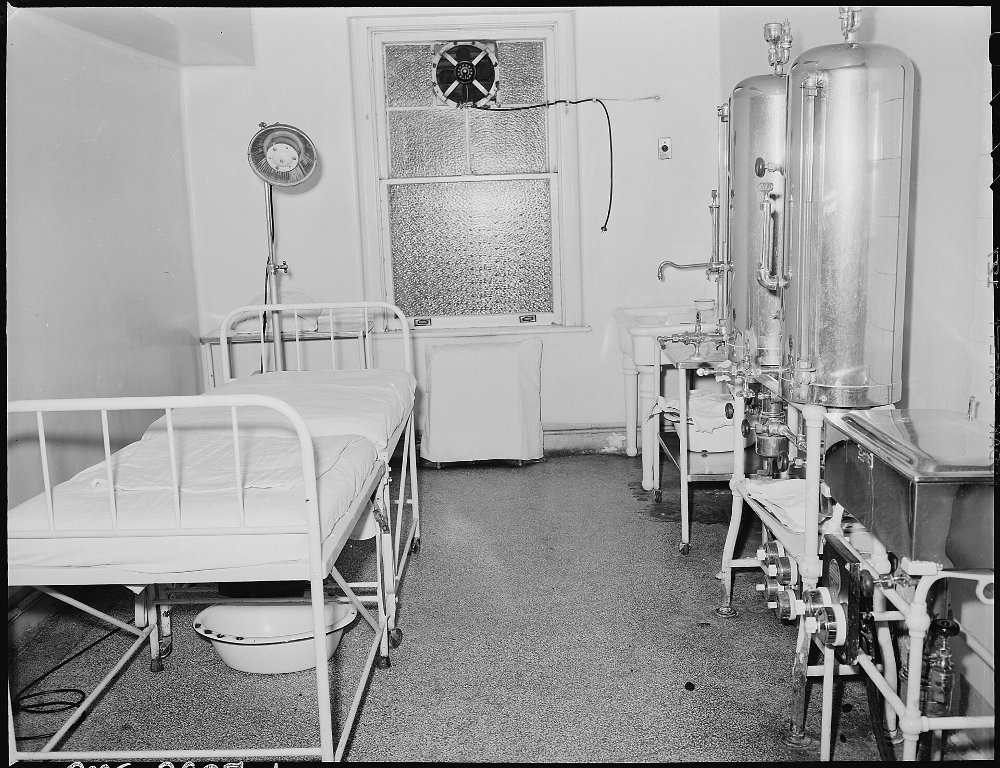

29 years ago today, November 19, 1997, Bobbi McCaughey gave birth to seven babies at the Iowa Methodist Medical Center in Des Moines, Iowa. It was only the second recorded instance in which seven babies were born alive, and the first time in medical history that every single infant survived infancy.

## An Unexpected Fertility Journey

Kenny McCaughey and Bobbi McCaughey lived in the small town of Carlisle, Iowa. They were already parents to an older daughter, Mikayla Marie, who was born on January 3, 1996. Because they were hoping to expand their family, Bobbi underwent fertility treatment using Metrodin, an ovulation-stimulating medication. The treatment resulted in the conception of seven fetuses. When doctors raised the option of selective reduction to improve the odds of carrying the remaining infants to term, Bobbi and Kenny declined. The couple chose instead to keep every baby, explaining that they would place the outcome in God's hands.

## Six Minutes in the Operating Room

The delivery was scheduled at the Iowa Methodist Medical Center in Des Moines, Iowa's capital city. Obstetricians Karen Drake and Paula Mahone took charge of the high-risk care for Bobbi and the unborn infants. On November 19, 1997, a specialized medical team of 40 specialists gathered in the operating suite. Bobbi underwent a scheduled Caesarean section. Within a span of just six minutes, all seven premature infants—four boys and three girls—were safely brought into the world.

*WOMAN WHO HAS JUST GIVEN BIRTH IN THE DELIVERY ROOM OF LORETTO HOSPITAL IN NEW ULM, MINNESOTA. HER HUSBAND, WHO... - NARA - 558166 — Photo: Phillips, Kathy, Photographer (NARA record: 8467756) / Public domain*

## The Nation Takes Notice

News of the successful deliveries spread rapidly across the country. In December 1997, the family was featured on the cover of Time magazine. Congratulatory messages poured in, including a personal phone call from President Bill Clinton. The public reaction was massive, bringing extraordinary acts of generosity. The McCaugheys received donations that included a 5,500-square-foot house, a large passenger van, nanny assistance, infant clothing, and a full two-year supply of diapers. Both the State of Iowa and Hannibal-LaGrange University in Hannibal, Missouri, offered full college scholarships for each of the seven children upon completing high school.

*Delivery room, Doylestown Emergency Hospital (c. 1949) — Photo: Unknown author / Public domain*

## Coping with Fame and Scrutiny

The unprecedented attention also brought challenges. Bobbi later recalled that for every ten encouraging letters, they received critical mail, and complete strangers occasionally knocked on their back door asking to hold a newborn. While neighbors in Carlisle respected their privacy and helped shield the family from prying eyes, others worried about the potential commercial exploitation of the infants. The three surviving Dionne quintuplets—Yvonne Dionne, Annette Allard, and Cécile Langlois—wrote an open letter to Bobbi and Kenny, urging them to protect the seven infants from commercial exploitation and the pitfalls of intense public exhibition.

*Delivery room in company owned hospital. U.S. Coal & Coke Company, U.S. ^30 & 31 Mines, Lynch, Harlan County, Kentucky. - NARA - 541414 — Photo: Russell Lee / Public domain*

## Growing Up as Seven

Raising seven premature infants required relentless care and medical monitoring. Two of the children, Alexis and Nathan, were diagnosed with cerebral palsy, which required them to use walkers for mobility. In November 2005, Nathan underwent spinal surgery to assist his ability to walk. Despite the physical challenges and the logistical hurdles of caring for septuplets alongside their older sister, the family managed their extraordinary household in Carlisle, turning a rare medical milestone into a remarkable story of perseverance.

### Sources

- <https://en.wikipedia.org/wiki/November%2019>
- <https://commons.wikimedia.org/wiki/File:WOMAN_ABOUT_TO_GIVE_BIRTH_IN_THE_DELIVERY_ROOM_OF_LORETTO_HOSPITAL_IN_NEW_ULM,_MINNESOTA._THERE_ARE_TWO_HOSPITAL..._-_NARA_-_558165.jpg>
- <https://commons.wikimedia.org/wiki/File:WOMAN_WHO_HAS_JUST_GIVEN_BIRTH_IN_THE_DELIVERY_ROOM_OF_LORETTO_HOSPITAL_IN_NEW_ULM,_MINNESOTA._HER_HUSBAND,_WHO..._-_NARA_-_558166.jpg>
- <https://commons.wikimedia.org/wiki/File:Delivery_room,_Doylestown_Emergency_Hospital_(c._1949).png>
- <https://commons.wikimedia.org/wiki/File:Delivery_room_in_company_owned_hospital._U.S._Coal_%26_Coke_Company,_U.S._%5E30_%26_31_Mines,_Lynch,_Harlan_County,_Kentucky._-_NARA_-_541414.jpg>
