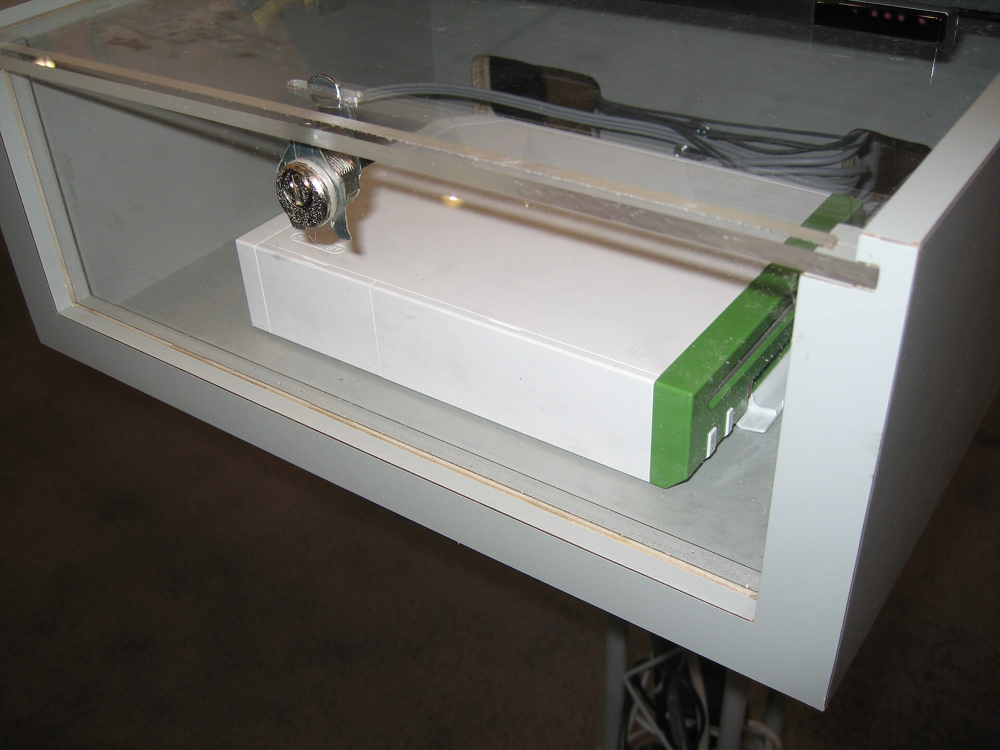
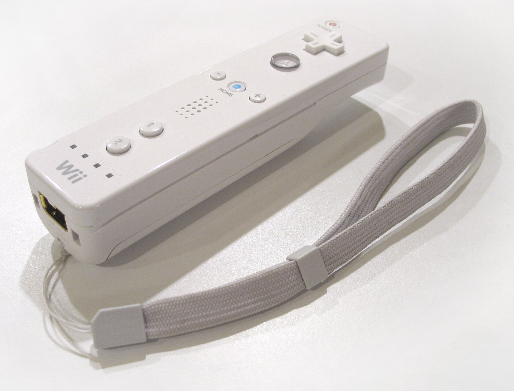

20 years ago today, November 19, 2006. Nintendo released the Wii home video game console in the United States, sparking a worldwide sensation that redefined interactive home entertainment.

## Stepping Away from the Raw Power Race

During the early 2000s, the video game industry was locked in a fierce technological arms race. Competitors like Sony with the PlayStation 3 and Microsoft with the Xbox 360 focused heavily on advancing graphical fidelity and raw computational power. However, internal market research at Nintendo revealed that complex hardware had made game development difficult and created barriers for casual players. When Satoru Iwata assumed the presidency of Nintendo in May 2002, succeeding Hiroshi Yamauchi, he recognized that the company needed a fundamentally new direction.

## A Radical Vision for Broad Audiences

Under the leadership of legendary game designer Shigeru Miyamoto and hardware engineer Genyo Takeda, Nintendo began conceptual development on a project initially known as GameCube Next and later codenamed Revolution. The company chose not to compete on brute computing power. Instead, Nintendo prioritized new ways of playing games that could appeal to people of all demographics, from young children to older adults who had never picked up a traditional controller.

*Wii Cake — Photo: Joshin Yamada / CC BY 2.0*

## The Breakthrough of the Wii Remote

The defining innovation of the console was its controller. On September 24, 2001, Nintendo had begun collaborating with Gyration Inc., a firm holding motion-sensing patents, to develop motion-based input hardware. The result was the Wii Remote, a handheld wireless controller equipped with motion-tracking sensors that could recognize physical gestures and function as a pointing device. The system also offered native Internet connectivity through the Wii Shop Channel, backward compatibility with GameCube games, and wireless links to the handheld Nintendo DS.

*Wii devkit at DigitalLife 2006 — Photo: nywriter21 / CC BY 2.0*

## Launch Day Frenzy and the Wii Sports Craze

The Wii arrived in North America on November 19, 2006, followed by releases in other global regions in December. The console included Wii Sports as a pack-in game, allowing owners to immediately experience virtual bowling, tennis, and boxing simply by swinging the controller. The intuitive gameplay resonated instantly with the American public, drawing long lines outside electronics retailers and causing widespread product shortages across the market.

*Wii Remote Image — Photo: Greyson Orlando / Public domain*

## A Global Phenomenon Surpassing 101 Million Units

Propelled by Wii Sports and landmark franchise installments in the Super Mario, The Legend of Zelda, Pokémon, and Metroid series, the Wii became the best-selling console of the seventh generation within a year. By the end of its commercial lifespan, total lifetime sales of the Wii surpassed 101 million units worldwide. It cemented itself as Nintendo's second best-selling home console, surpassed only by the Nintendo Switch in 2021, and remains the seventh-best-selling console of all time as of April 2026.

## A Legacy of Bringing People Together

Nintendo eventually discontinued the primary Wii hardware in October 2013, followed by variants like the RVL-101 and the Wii Mini. While later hardware like the Wii U in 2012 sought to chart new directions, the cultural footprint of the original Wii remains distinct. From its origins as an 1889 Kyoto playing card workshop to delivering over 870 million consoles worldwide by November 2026, Nintendo transformed living room leisure by proving that the joy of play belongs to everyone.

### Sources

- <https://en.wikipedia.org/wiki/November%2019>
- <https://commons.wikimedia.org/wiki/File:ArcadeGames.jpg>
- <https://commons.wikimedia.org/wiki/File:Wii_Cake.jpg>
- <https://commons.wikimedia.org/wiki/File:Wii_devkit_at_DigitalLife_2006.jpg>
- <https://commons.wikimedia.org/wiki/File:Wii_Remote_Image.jpg>
