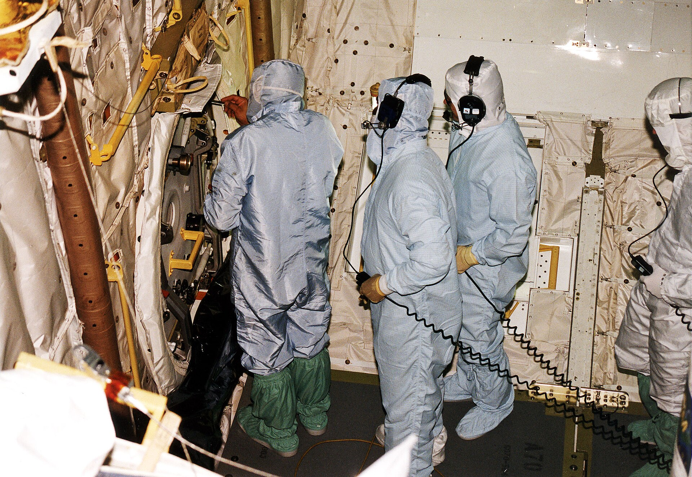
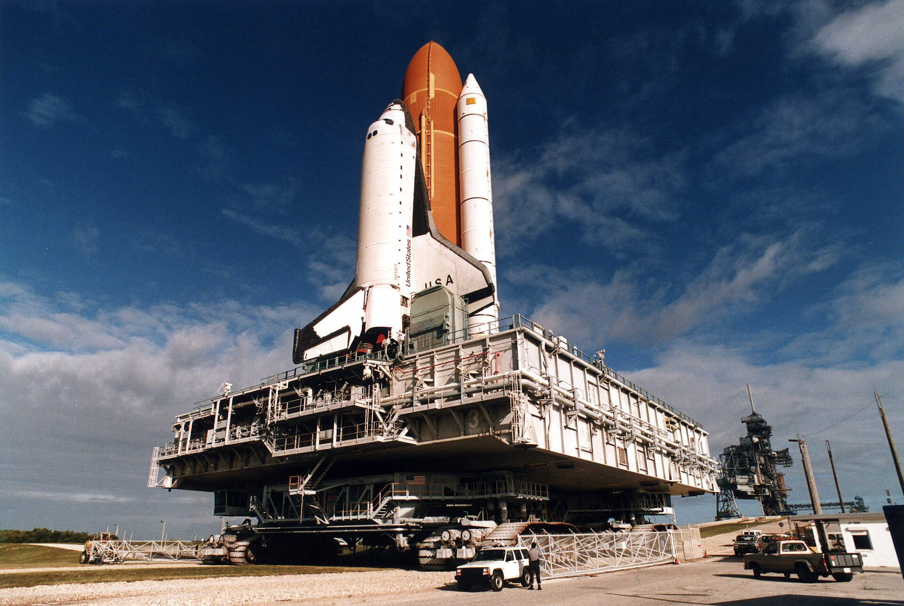
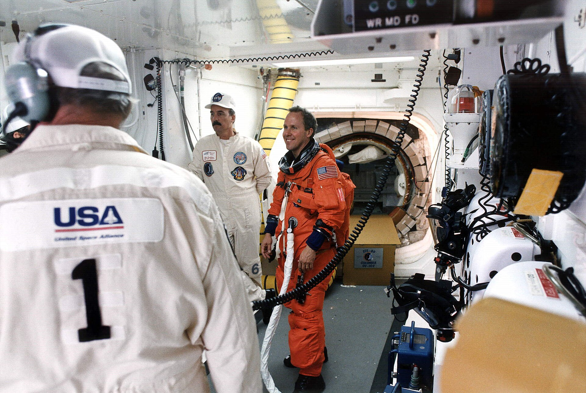

30 years ago today, on November 19, 1996, Space Shuttle Columbia launched from Kennedy Space Center on mission STS-80. That flight would make history by spending 17 days, 15 hours, and 53 minutes in space, standing as the longest single mission ever achieved in the three decades of NASA's Space Shuttle program.

## Columbia: The Flagship of the Fleet

Manufactured by Rockwell International and designated OV-102, Columbia was the first space-worthy orbiter in NASA's fleet. It had inaugurated the Space Shuttle program with STS-1 on April 12, 1981, and proved the concept of reusable spacecraft when it flew STS-2 on November 12, 1981. Because it was the earliest operational orbiter, Columbia retained unique structural characteristics. It had distinctive black chines, test instrumentation, an internal airlock, and a heavier aft fuselage. In original construction, Columbia was around 1,000 kilograms heavier than Challenger and 3,600 kilograms heavier than Endeavour. Over its career, it became NASA's dedicated platform for orbital science.

## The Extended Duration Mission

The STS-80 mission was designed to maximize time in low Earth orbit. In 1992, NASA modified Columbia with an Extended Duration Orbiter pallet, allowing it to sustain crews on lengthy scientific research flights. Prior to STS-80, the only orbiter capable of rivaling Columbia's endurance was Endeavour, which had logged nearly 17 days on STS-67. STS-80 was initially scheduled for launch on October 31, 1996, but several technical delays pushed the launch date back to November 19. When the solid rocket boosters ignited, Columbia carried high-precision science payloads aimed at advancing astronomy and materials research.

*STS-80 Door Test — Photo: NASA / Public domain*

## Story Musgrave's Historic Milestone

Among the crew members on STS-80 was veteran astronaut Story Musgrave. During this flight, Musgrave achieved a milestone that no other space traveler has ever matched: he became the only astronaut in history to fly on all five Space Shuttles—Challenger, Atlantis, Discovery, Endeavour, and Columbia. The mission also saw him tie the record for the most spaceflights and establish a record at the time as the oldest man in space. Musgrave's enthusiasm was evident until the very end; during reentry and landing, instead of staying in Seat 5, he stood on the flight deck behind cockpit Seat 1 to film the spacecraft's fiery descent through the overhead windows.

*STS-80 Roll Out 01 — Photo: NASA / Public domain*

## Scientific Payloads and a Jammed Hatch

The primary objectives of STS-80 included deploying and retrieving two free-floating scientific satellites. On flight day one, the crew successfully released the ORFEUS-SPAS II ultraviolet spectrometer satellite, retrieving it on flight day sixteen. On flight day four, they deployed the Wake Shield Facility-3 to study thin-film semiconductor growth in the vacuum of space, recapturing it three days later. However, the mission did face an unexpected obstacle. Two spacewalks planned for astronauts Tom Jones and Tammy Jernigan had to be canceled when the airlock's outer hatch jammed, later attributed to a loose screw that had fallen during installation.

*KSC-96EC-1295 NASA Mission Specialist Thomas Jones in White Room prior to launch of Space Shuttle mission STS-80 — Photo: NASA / Public domain*

## A Weather Delay and an All-Time Record

The flight was originally slated to return to Earth on December 5, 1996. When unfavorable weather conditions swept over the landing site at Kennedy Space Center, mission controllers held Columbia in orbit for two additional days. By the time the orbiter finally glided to a smooth landing on December 7, it had completed 17 days, 15 hours, and 53 minutes aloft. That remarkable duration officially sealed STS-80 as the longest flight in the entire 135-mission span of the Space Shuttle program.

## The Enduring Memory of Columbia

Over 22 years of active service, Columbia flew 28 missions, spent more than 300 days in space, and completed over 4,000 orbits around Earth. It carried the first Spacelab laboratory, deployed the Chandra X-ray Observatory, and flew pioneering astronauts from across the globe. Although the shuttle fleet was retired in 2011 following a long journey of exploration, the 17-day flight of STS-80 remains a standout testament to what the world's first reusable spacecraft could achieve.

### Sources

- <https://en.wikipedia.org/wiki/Space_Shuttle_Columbia>
- <https://commons.wikimedia.org/wiki/File:STS-80_crew.jpg>
- <https://commons.wikimedia.org/wiki/File:STS-80_Door_Test.jpg>
- <https://commons.wikimedia.org/wiki/File:STS-80_Roll_Out_01.jpg>
- <https://commons.wikimedia.org/wiki/File:KSC-96EC-1295_NASA_Mission_Specialist_Thomas_Jones_in_White_Room_prior_to_launch_of_Space_Shuttle_mission_STS-80.jpg>
