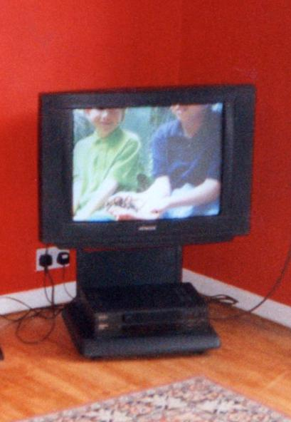

27 years ago today, November 19, 1999. Internal Revenue Service agent John Carpenter answered the final question correctly on Who Wants to Be a Millionaire, becoming the first contestant in the worldwide franchise to win the top prize. His cool demeanor and unforgettable phone call captivated viewers across the United States.

## A Global Television Phenomenon Arrives in America

Who Wants to Be a Millionaire was originally created in the United Kingdom by David Briggs, Mike Whitehill, and Steven Knight, debuting on the ITV network on September 4, 1998, hosted by Chris Tarrant. The game had evolved from early concepts tentatively titled Cash Mountain, eventually taking its name from a Cole Porter song featured in the 1956 film High Society. When British producer Paul Smith franchised the concept internationally, strict standards were established to preserve the mood of the original, including specific lighting, dramatic music cues, and hosts dressed in Armani suits. By the autumn of 1999, the American edition hosted by Regis Philbin had taken the country by storm, offering an unprecedented cash prize of $1 million.

## An Economics Graduate from Connecticut

John Carpenter was born in Hamden, Connecticut, on December 24, 1967. His father, Tom, worked as a computer program analyst for the Department of Veterans Affairs, while his mother, Gail, worked as an administrative assistant for the Massachusetts Audubon Society. In 1986, Carpenter enrolled at Rutgers University, graduating in 1990 with a bachelor's degree in economics. In January 1991, after passing government examinations, he joined the Internal Revenue Service. In November 1996, Carpenter met his future wife, Deborah, who was pursuing a master's degree at Southern Connecticut State University while working as a bank branch manager in New Haven. The couple married in August 1998. At 31 years old, Carpenter was living a quiet life as a federal tax agent.

*Not a photo of the event itself · NOT FROM THE EVENT · Stock image — Photo: StockSnap / Pixabay Content License*

## A Spontaneous Call to the Show Hotline

Carpenter had not initially paid much attention to the game show. One evening, after having dinner with friends at his home, he happened to tune in to the broadcast. While watching, he realized that the higher-tier questions did not seem substantially harder than the introductory ones. Feeling confident in his general knowledge, Carpenter decided to dial into the show's contestant hotline. He answered every screening question correctly and received a callback almost immediately. Within two days of placing that phone call, Carpenter found himself in the studio under the bright lights, facing host Regis Philbin.

*Not a photo of the event itself · NOT FROM THE EVENT · Stock image — Photo: funnytools / Pixabay Content License*

## Cruising Past Fourteen Questions

When Carpenter sat in the hot seat, the studio audience playfully booed him after he revealed that he worked for the Internal Revenue Service. Once play began, however, Carpenter demonstrated remarkable composure. He advanced through the money ladder with steady confidence, leaving all of his lifelines untouched. As Philbin later observed, Carpenter cruised right through those first fourteen questions. The only moment of hesitation occurred on a question asking for the location of the historic Gunfight at the O.K. Corral. Carpenter paused, recalled scenes from the film Tombstone, and correctly answered Tombstone, Arizona, keeping his spotless run alive.

*1990s Television Set — Photo: ProtoKiwi / CC BY 4.0*

## The Million-Dollar Question and a Famous Phone Call

Carpenter reached the final million-dollar question having used none of his lifelines. Philbin read the prompt: 'Which of these U.S. Presidents appeared on the television series Laugh-In?' The four multiple-choice options were Lyndon Johnson, Richard Nixon, Jimmy Carter, and Gerald Ford. Rather than answering immediately, Carpenter elected to deploy his Phone-a-Friend lifeline to call his father, Tom. When his father answered, Carpenter did not ask for assistance. Instead, he smiled and explained that he did not really need help, but wanted to let his father know that he was going to win the million dollars. Carpenter later admitted he faked needing the lifeline because he thought he would look too arrogant if he finished the game without using any. He promptly selected Richard Nixon, and confetti erupted across the stage.

## A Lasting Record and a Return to the IRS

Carpenter's victory made him the first top-prize winner in the history of the entire global franchise, as well as the holder of the largest single win in United States game show history at the time. That financial record stood until 2000, when Rahim Oberholtzer won $1.12 million on Twenty One. Following his win, Carpenter made numerous talk show appearances and became the seventeenth highest-earning game show contestant in American history. Despite the windfall, he chose not to quit his job at the Internal Revenue Service. He later explained in an interview that after federal and state taxes were deducted, the prize was not change-your-life money if you wanted to eat every day, and he continued working for the agency decades later.

### Sources

- <https://en.wikipedia.org/wiki/Who_Wants_to_Be_a_Millionaire%3F>
- <https://pixabay.com/photos/tv-television-retro-classic-old-1844964/>
- <https://pixabay.com/photos/tv-television-vintage-oldschool-2619649/>
- <https://pixabay.com/photos/television-developing-countries-899265/>
- <https://commons.wikimedia.org/wiki/File:1990s_Television_Set.jpg>
