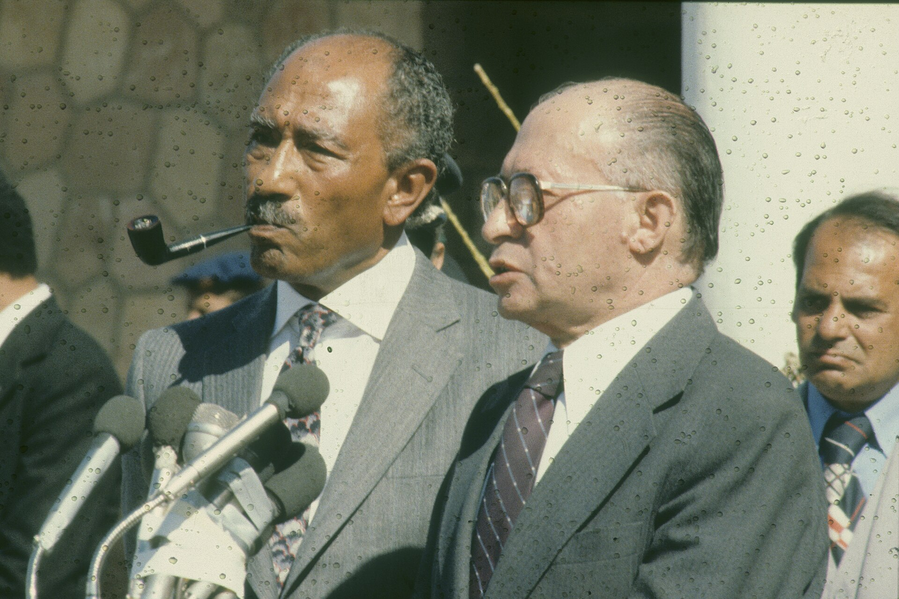
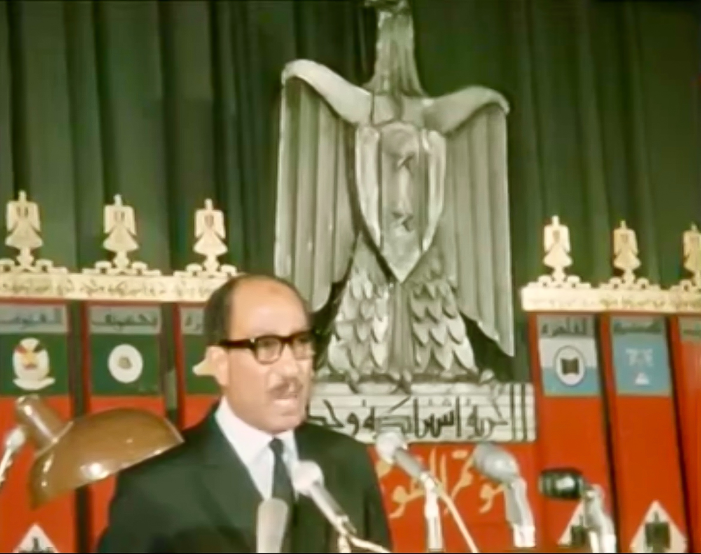

49 years ago today, November 20, 1977. Egyptian President Anwar Sadat became the first Arab leader to officially visit Israel, traveling to Jerusalem to meet Israeli Prime Minister Menachem Begin and address the Knesset. His bold mission was undertaken to seek a permanent peace settlement after years of war and hostility. The visit shocked observers around the world and marked an unprecedented turning point in Middle Eastern diplomacy.

## Decades of Armed Conflict

Before November 1977, relations between Egypt and Israel were defined by battlefield clashes. The two nations had engaged in major armed conflicts in 1948, 1956, 1967, and 1973. In the 1967 war, Egypt suffered a severe blow, losing control of both the Sinai Peninsula and the Gaza Strip to Israel.

Egypt, the most populous nation in the Arab world with over 107 million people today, stood at the forefront of the regional confrontation. For decades, official recognition of Israel by an Arab state was considered completely out of the question. Borders remained shut, and diplomatic communication did not exist.

## Anwar Sadat's Path to Leadership

Anwar Sadat was born on December 25, 1918, in Mit Abu El Kom to a poor family with 14 siblings. He graduated from the Royal Military Academy in Cairo in 1938 and entered the army as a second lieutenant. Sadat later joined Gamal Abdel Nasser in forming the Free Officers movement, which led to the 1952 revolution and the establishment of the republic.

Sadat served twice as vice president under Nasser before assuming the presidency following Nasser's death in 1970. Over his 11 years as president, Sadat shifted Egypt's domestic and foreign policy. In 1973, he led Egypt into the October war to reclaim the Sinai Peninsula, cementing his status as a national leader.

*Menachem Begin (FL45926767) — Photo: Dan Hadani / CC BY 4.0*

## The Historic Mission to Jerusalem

Recognizing that warfare alone could not secure long-term stability, President Sadat made the unprecedented decision to go directly to the Israeli capital. On November 20, 1977, he traveled to Jerusalem, where he was formally received by Israeli Prime Minister Menachem Begin.

Sadat then stepped into the Knesset, the parliament of Israel, becoming the first Arab leader ever to address the legislative assembly. In his address, Sadat declared that he had come seeking a permanent peace settlement based on justice. The sight of an Egyptian head of state speaking warmly yet firmly inside Jerusalem astonished international observers and broke decades of psychological estrangement.

*Anwar Sadat (1971) — Photo: Unknown authorUnknown author / Public domain*

## Camp David and the Sinai Peninsula

Sadat's presence in Jerusalem set off an active diplomatic process that altered the geopolitical landscape. In 1978, Egypt and Israel signed the historic Camp David Accords. These negotiations culminated in a bilateral peace treaty that established formal diplomatic ties between the two countries.

As part of the agreements, Israel agreed to withdraw from the occupied Sinai Peninsula, while the territory was heavily demilitarized. By 1982, control of the Sinai Peninsula was completely turned over to Egypt, fulfilling one of Sadat's most vital territorial goals.

*Anwar Sadat and Helmut Schmidt — Photo: Sven Simon / Public domain*

## Backlash and Tragic Consequences

The breakthrough in Jerusalem came at a high political and personal price for the Egyptian president. With the exception of Sudan, most of the Arab world and the Palestine Liberation Organization vehemently opposed Sadat's decision to negotiate directly with Israel. Sadat's refusal to reconcile over the Palestinian issue led to Egypt being suspended from the Arab League from 1979 to 1989.

Domestically, the peace initiative enraged radical factions within Egypt. On October 6, 1981, during an annual military parade in Cairo, armed militants opened fire on the presidential reviewing stand, assassinating Sadat. The treaty he forged, however, survived his death.

## A Legacy of Courageous Diplomacy

Sadat's historic journey to Jerusalem demonstrated that deeply rooted conflicts could be addressed through direct engagement. While the peace process generated widespread controversy throughout the Middle East, the bilateral peace between Egypt and Israel has endured through decades of regional turmoil.

Nearly half a century later, Anwar Sadat's speech before the Knesset on November 20, 1977, remains one of the most remarkable moments of statecraft in modern history. It proved that a single leader willing to cross hostile borders could transform the trajectory of entire nations.

### Sources

- <https://en.wikipedia.org/wiki/Egypt>
- <https://commons.wikimedia.org/wiki/File:CAC_CC_001_18_15_0000_1437.jpg>
- <https://commons.wikimedia.org/wiki/File:Menachem_Begin_(FL45926767).jpg>
- <https://commons.wikimedia.org/wiki/File:Anwar_Sadat_(1971).jpg>
- <https://commons.wikimedia.org/wiki/File:Anwar_Sadat_and_Helmut_Schmidt.jpg>
