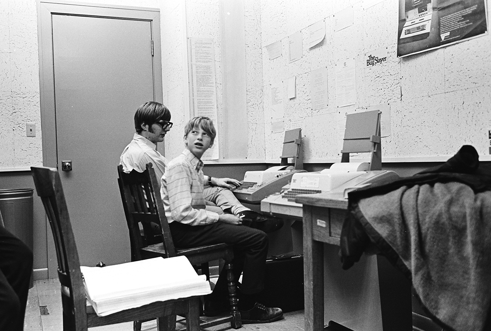
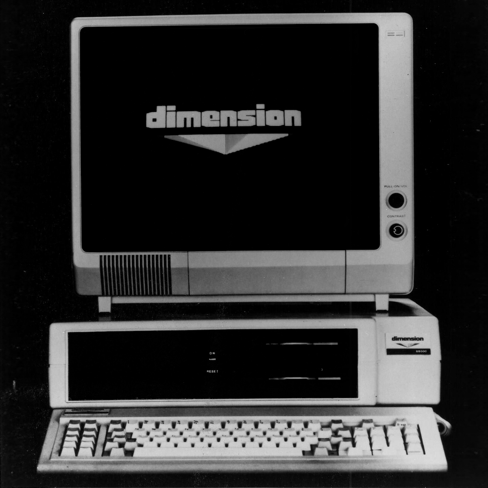
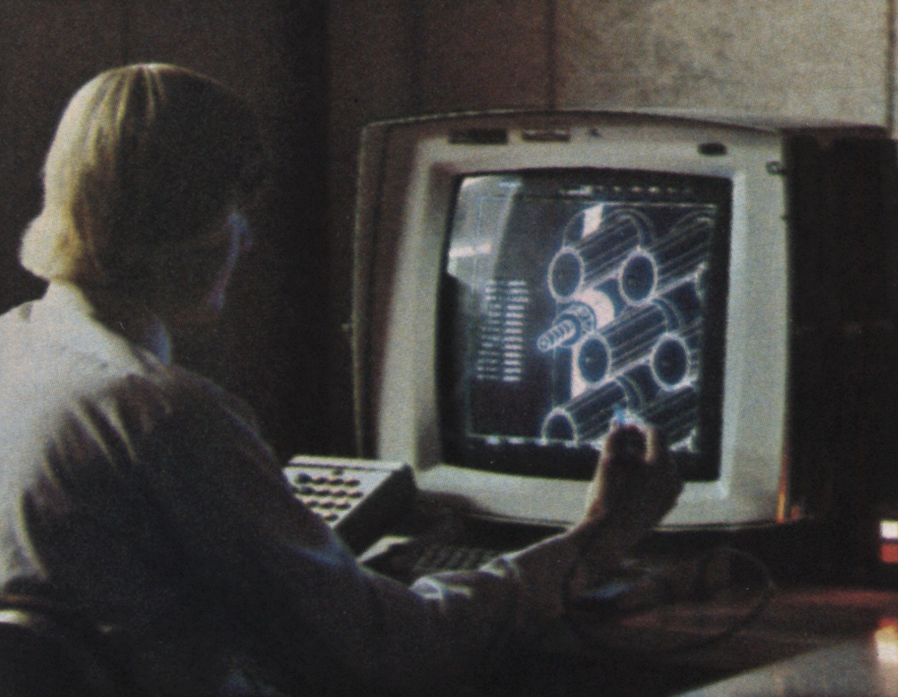

41 years ago today, November 20, 1985, Microsoft officially released Windows 1.0 to manufacturing and the general public across the United States. It marked the tech company's first major step away from purely text-driven commands and toward graphical computing on personal computers. Though its initial reception was modest, this single launch initiated a software revolution that would reshape homes, offices, and schools for decades to come.

## Moving Away from the Flashing DOS Cursor

In the early 1980s, sitting down at an IBM PC-compatible computer meant staring at a black screen with a stark, blinking command prompt. Users relied on MS-DOS, which required them to memorize technical command strings just to open files, check disk directories, or launch applications. If you mistyped a single letter or punctuation mark, the system simply refused to cooperate.

Microsoft, founded in 1975 by childhood friends Bill Gates and Paul Allen in Albuquerque, New Mexico, had already achieved remarkable success supplying MS-DOS. However, industry visionaries realized that computing would remain intimidating to everyday consumers without a visual way to interact with machines. The solution was the graphical user interface, commonly referred to as a GUI, which replaced cryptic keystrokes with visual boxes, icons, and menus.

## The Race to Build an Interface Manager

Microsoft's work on visual software began as early as 1981 under the project name Interface Manager. The development intensified after Bill Gates attended the COMDEX computer exposition in 1982, where he witnessed a demonstration of Visi On, an early graphical software suite developed for IBM-compatible machines.

Recognizing that Apple Computer was also advancing bit-mapped graphical environments inspired by research from Xerox PARC, Microsoft pushed to create its own platform. In August 1983, Gates hired Scott A. McGregor, a key developer behind PARC's original windowing technology, to lead the engineering team. In November 1983, Microsoft publicly demonstrated the software under the name Windows, promising an operating environment that would run on top of MS-DOS while supporting multitasking and mouse navigation.

*Paul Allen and Bill Gates at Lakeside School in 1970 — Photo: Bruce Burgess / Public domain*

## A Two-Year Wait and the Arrival of Tiled Windows

Although Microsoft originally showcased Windows in late 1983, turning the concept into a commercial product took two additional years of development. When Windows 1.0 was finally shipped to retailers on November 20, 1985, it arrived as a 16-bit graphical shell driven by an administrative program called the MS-DOS Executive.

The environment bundled a suite of handy built-in tools designed to prove the utility of a graphical workspace. These included Calculator, Calendar, Cardfile, Clipboard Viewer, Clock, Control Panel, Notepad, Paint, Terminal, and Write, along with a board game called Reversi. Unlike modern software, Windows 1.0 did not allow application windows to overlap. Instead, programs were strictly tiled side by side across the screen, ensuring that only modal dialog boxes could appear on top of other active windows.

*Micro Craft Corporation Dimension 68000 publicity photo — Photo: Micro Craft Corporation / Public domain*

## Early Skepticism and Hardware Hurdles

When consumers and trade journalists got their hands on Windows 1.0, the response was cautious and mixed. Critics pointed out that the software suffered from sluggish performance on contemporary hardware, which typically required at least 192 kilobytes of memory and two floppy disk drives. Furthermore, very little third-party business software had been designed specifically to take advantage of the Windows environment.

Because most popular PC software was still written directly for MS-DOS, many users saw little reason to navigate through the new visual shell. Competing against Apple's integrated systems, Windows 1.0 struggled to capture widespread enthusiasm right away. Nevertheless, hardware manufacturers and software developers recognized that graphical interfaces were the inevitable future of computing.

*Engineer working on CAD workstation with light pen Hughes Aircraft Company — Photo: Hughes Aircraft Company / Public domain*

## Refinement, Overlapping Windows, and Market Triumph

Microsoft refused to abandon the concept. The European version, Windows 1.02, made its debut in May 1986, followed by maintenance releases 1.03 and 1.04. The true operational leap came on December 9, 1987, when Microsoft released Windows 2.0. This successor introduced overlapping windows, expanded memory management, and richer keyboard shortcuts.

The introduction of overlapping windows sparked a major copyright infringement lawsuit from Apple Computer, a legal dispute that courtrooms eventually resolved in Microsoft's favor in 1993. By 1990, the arrival of Windows 3.0 catapulted the operating system into massive mainstream commercial dominance, selling millions of copies and establishing Windows as the standard environment for personal workstations worldwide.

## The Enduring Legacy of Windows 1.0

Though primitive by today's standards, Windows 1.0 proved to be an extraordinarily durable milestone in personal computing history. Microsoft continued to provide technical support for Windows 1.0 all the way until December 31, 2001, making it the single longest-supported release in the entire history of Windows.

From that modest, tiled 16-bit shell launched in November 1985, Windows grew to anchor one of the most valuable corporations in the world. As of October 2026, Microsoft Windows retains a 77 percent share of the global desktop operating system market, with Windows 11 powering 74 percent of those desktop machines. That immense global presence traces directly back to the moment forty-one years ago when personal computer users were first invited to pick up a mouse, point at a screen, and open a window.

### Sources

- <https://en.wikipedia.org/wiki/Microsoft>
- <https://commons.wikimedia.org/wiki/File:Charles_Coles_1985.jpg>
- <https://commons.wikimedia.org/wiki/File:Paul_Allen_and_Bill_Gates_at_Lakeside_School_in_1970.jpg>
- <https://commons.wikimedia.org/wiki/File:Micro_Craft_Corporation_Dimension_68000_publicity_photo.png>
- <https://commons.wikimedia.org/wiki/File:Engineer_working_on_CAD_workstation_with_light_pen_Hughes_Aircraft_Company.jpg>
