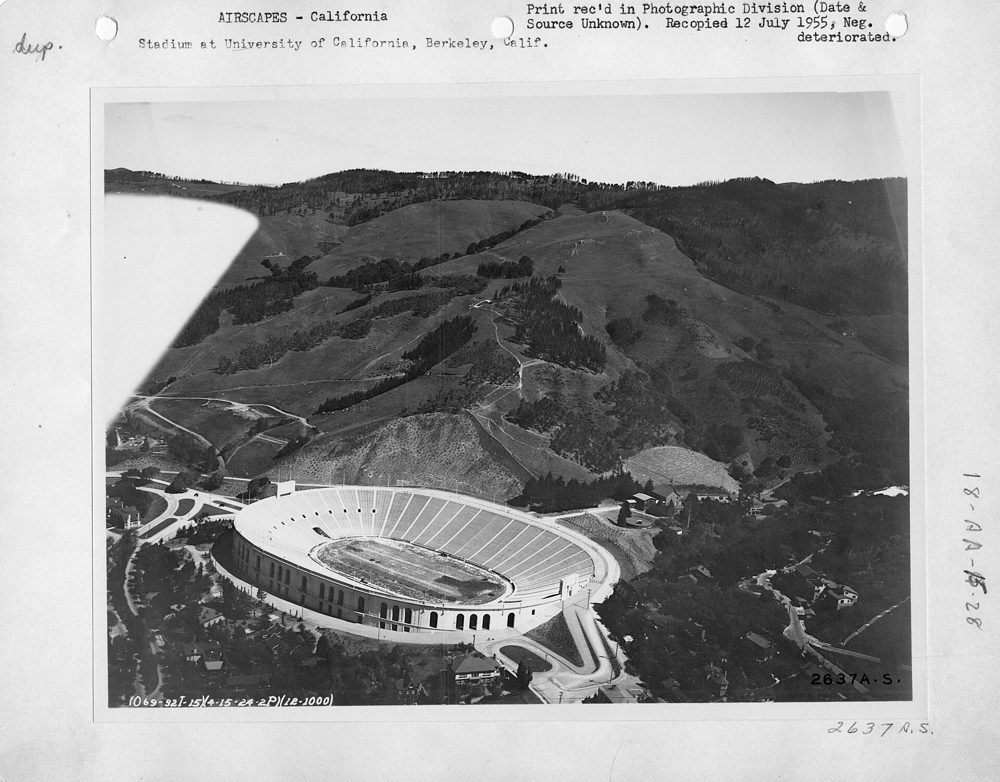
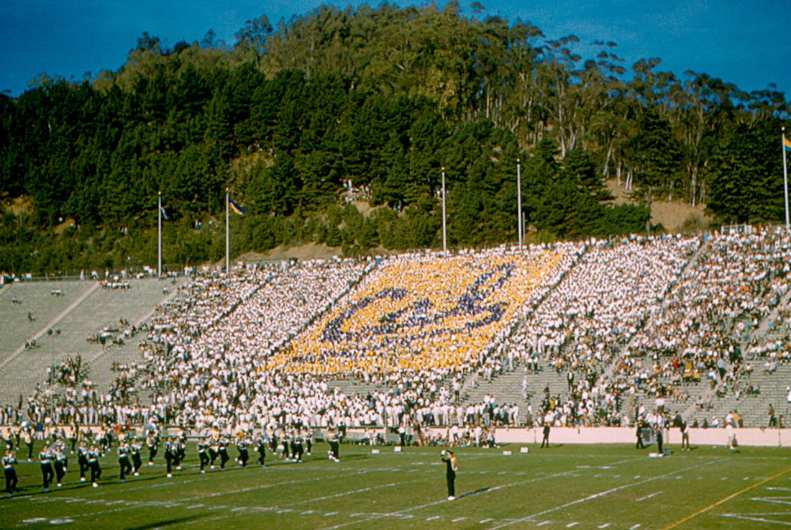
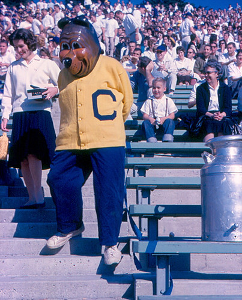

44 years ago today, November 20, 1982, the University of California, Berkeley pulled off the most chaotic final play in college football history to defeat rival Stanford 25 to 20. It was an afternoon at California Memorial Stadium that permanently cemented itself into American athletic folklore.

## High Stakes at the 85th Big Game

The annual clash between the California Golden Bears and the Stanford Cardinal was already steeped in deep tradition. This contest marked the 85th edition of the Big Game, an annual Bay Area showdown dating back to 1899. At stake was custody of the Stanford Axe, a historic trophy mounted on a plaque carrying the scores of previous matchups. Since an agreement established in 1933 following decades of campus pranks and trophy thefts, the winner of the Big Game earned the right to keep the Axe.

While Cal had secured a winning record, the Golden Bears had received no bowl game invitations. Stanford, however, entered the contest with immense pressure. The Cardinal held a 5–5 record under star senior quarterback John Elway, who was playing in his final regular-season collegiate game before heading to the National Football League. Representatives from the Hall of Fame Classic committee were in the stands, ready to offer Stanford a bowl bid against Vanderbilt if the Cardinal could secure their sixth victory of the year.

## A Fierce Second-Half Battle

Cal established early control, taking a 10–0 lead into halftime behind a field goal and a 55-yard touchdown drive engineered by Gale Gilbert and capped by a diving end zone catch from Mariet Ford. In the third quarter, Stanford answered Cal's missed field goal with an 80-yard march. John Elway connected on consecutive passes to running back Vincent White to spark the Cardinal offense.

Stanford captured its first lead at 14–10 on another touchdown reception by White. Cal countered with a field goal and a Gilbert touchdown pass to Wes Howell to retake a 19–14 advantage, but a failed two-point conversion kept Stanford within striking distance. When Stanford booted a field goal to trim Cal's margin to 19–17, the game tightened into a dramatic fourth-quarter showdown with bowl hopes hanging in the balance.

*California - Berkeley - NARA - 23934121 — Photo: Unknown authorUnknown author or not provided / Public domain*

## John Elway's Late Drive

Stanford regained possession at its own 20-yard line with just 1:27 remaining on the clock. Elway went to work, overcoming a fourth-and-long deep in his own territory and guiding the Cardinal offense steadily down the field. He marched Stanford all the way to Cal's 23-yard line, positioning his team for the decisive strike.

With only 8 seconds showing on the stadium clock, Stanford kicker Mark Harmon lined up and converted a clutch field goal. The kick gave Stanford a 20–19 lead with just 4 seconds remaining. Stanford players and sideline personnel erupted in celebration, convinced they had wrapped up the victory, reclaimed the Stanford Axe, and locked up an invitation to the Hall of Fame Classic.

*Berkeley - University of California Football — Photo: roger4336 / CC BY-SA 2.0*

## Five Laterals and the Band on the Field

Cal received the ensuing kickoff with four seconds left, knowing their only hope lay in keeping the ball alive through desperate backward tosses. What followed became known simply as 'The Play.' Cal players executed five chaotic lateral passes over the course of a wacky 57-yard return, evading Stanford tacklers who struggled to bring down the ball carriers.

Believing the game had already concluded when the clock hit zero, members of the Stanford Band began marching directly onto the field mid-play with their musical instruments. As the field filled with musicians, Cal player Kevin Moen received the final lateral, dodged through the confused crowd, and charged straight through the Stanford band into the end zone for a walk-off touchdown.

*Berkeley - Football Mascot 'Oski' — Photo: roger4336 / CC BY-SA 2.0*

## An Enduring College Football Legend

After game officials sorted through the overwhelming confusion and validated the five lateral exchanges, the touchdown was confirmed. Cal was awarded a shocking 25–20 victory, setting off wild celebrations on the field while Stanford stood stunned at the sudden reversal of fortune.

The game's finish instantly generated debate, with long-standing arguments regarding the legality of two backward pass attempts during the chaotic sequence. Today, 'The Play' stands as one of the most iconic and debated finishes across all of American sports history, remembered every autumn whenever Cal and Stanford meet on the gridiron.

### Sources

- <https://en.wikipedia.org/wiki/November%2020>
- <https://commons.wikimedia.org/wiki/File:Escape_artist_busking_UC_Berkeley_California_campus_1980.jpg>
- <https://commons.wikimedia.org/wiki/File:California_-_Berkeley_-_NARA_-_23934121.jpg>
- <https://commons.wikimedia.org/wiki/File:Berkeley_-_University_of_California_Football.jpg>
- <https://www.flickr.com/photos/24736216@N07/4076120253>
