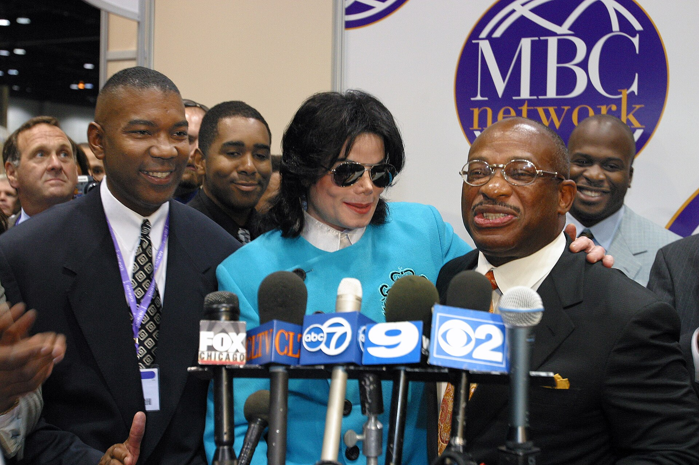
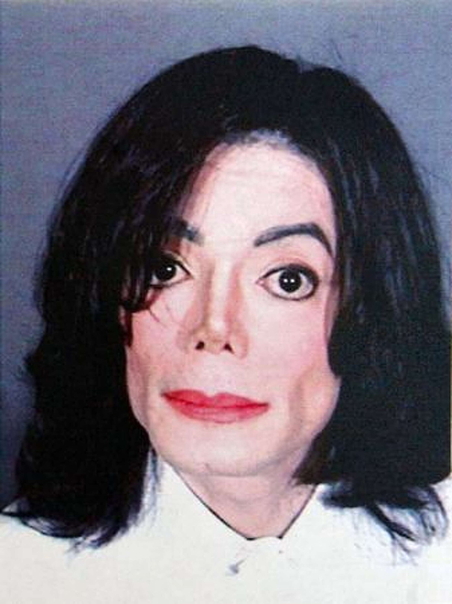
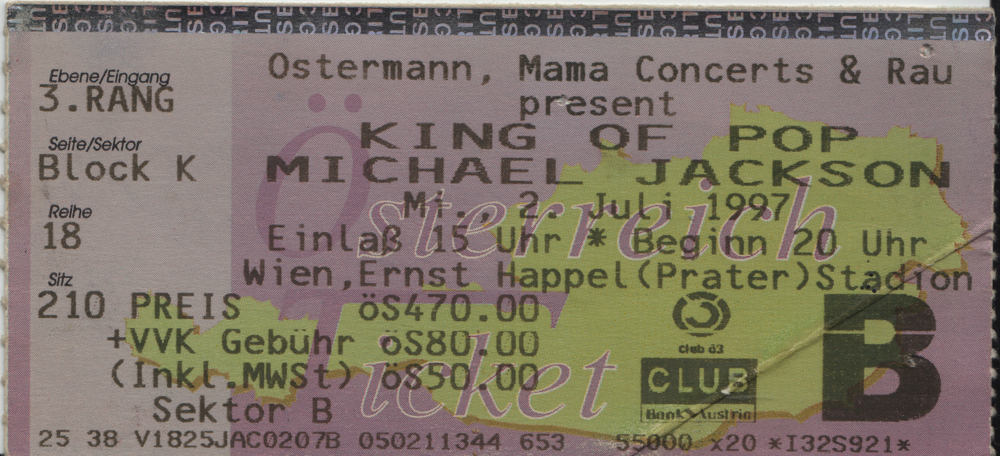

23 years ago today, November 20, 2003, pop icon Michael Jackson was arrested in California on felony charges of child molestation. The sudden arrest of one of the world's most famous entertainers set off an intense global media spectacle and launched a high-stakes legal battle that gripped the American public.

## A Global Icon Under Unprecedented Scrutiny

Michael Jackson had long occupied a unique position in global popular culture. Beginning his career as a young child in Gary, Indiana, he had led the Jackson 5 to the top of the Billboard charts before embarking on an unmatched solo career. His 1982 album Thriller became the best-selling album in history, redefining music videos and concert performances. However, by the early 2000s, Jackson's eccentric lifestyle, changing appearance, and secluded life at his Neverland Ranch estate in Los Olivos, California, increasingly overshadowed his musical output.

## The Shadow of the 1993 Allegations

The arrest in 2003 was not the first time the singer had confronted such serious accusations. In 1993, Los Angeles screenwriter and dentist Evan Chandler had accused Jackson of sexually abusing his thirteen-year-old son, Jordan Chandler. The resulting criminal investigation found no physical evidence, but the ensuing civil lawsuit ended Jackson's lucrative commercial endorsements, including his long-standing partnership with Pepsi. In January 1994, Jackson resolved the matter through an out-of-court financial settlement totaling 23 million dollars, emphasizing throughout that the payout was not an admission of wrongdoing.

*2003 Michael Jackson at The Cable Show (29358712934) — Photo: INTX: The Internet &amp; Television Expo / CC BY 2.0*

## A Broadcast Documentary Reopens the Door

The renewed scrutiny that led to the 2003 arrest was triggered by the televised documentary Living with Michael Jackson, hosted by British journalist Martin Bashir. In the broadcast, Jackson was shown holding hands with Gavin Arvizo, a thirteen-year-old cancer survivor who had frequently visited Neverland Ranch. During interviews, Jackson defended his practice of allowing children to sleep in his room, insisting that sharing his bed was innocent and entirely non-sexual. The documentary drew immediate public backlash, prompting Santa Barbara County law enforcement to open a new criminal inquiry into the singer's activities at his estate.

*Michaeljacksonmug1 (high quality) — Photo: Santa Barbara County Sheriff's Office / Public domain*

## Surrender and Booking in Santa Barbara County

On November 20, 2003, Jackson flew to California and formally surrendered to authorities at the Santa Barbara County Sheriff's Department. Officers booked the entertainer on multiple felony counts relating to the alleged abuse of Gavin Arvizo, including charges of molestation and administering an intoxicating agent to a minor. News helicopters tracked his convoy, and hundreds of journalists gathered outside the facility, broadcasting images of the pop star in handcuffs to an astonished worldwide audience.

*Archive, 1999 — Photo: Medullaoblongata Projekt / CC BY-SA 4.0*

## The 2005 Trial and Complete Acquittal

The charges culminated in the high-profile criminal case People v. Jackson, held in Santa Barbara County Superior Court in Santa Maria, California. Jury selection began in January 2005 amid what observers described as a media circus. The defense team argued that the prosecution's witnesses were seeking financial exploitation, and called prominent figures including actor Macaulay Culkin and comedian Chris Tucker to testify on Jackson's behalf. On June 13, 2005, the jury delivered a unanimous verdict, finding Jackson not guilty on all ten counts.

## An Irreversible Departure from Neverland

Although Jackson emerged legally cleared from the courtroom, the toll of the arrest and grueling trial was permanent. Following the verdict, Jackson abandoned Neverland Ranch entirely, spending several months living abroad in Bahrain and Ireland. He never returned to reside at the sprawling estate that had defined his later career. Jackson passed away in Los Angeles on June 25, 2009, leaving behind a complex legacy that continues to provoke reflection decades after the November 2003 arrest.

### Sources

- <https://en.wikipedia.org/wiki/Michael_Jackson>
- <https://commons.wikimedia.org/wiki/File:Michaeljacksonmug1.jpg>
- <https://commons.wikimedia.org/wiki/File:2003_Michael_Jackson_at_The_Cable_Show_(29358712934).jpg>
- <https://commons.wikimedia.org/wiki/File:Michaeljacksonmug1_(high_quality).jpg>
- <https://commons.wikimedia.org/wiki/File:Austria_Vienna_Michael_Jackson_concert_ticket.png>
