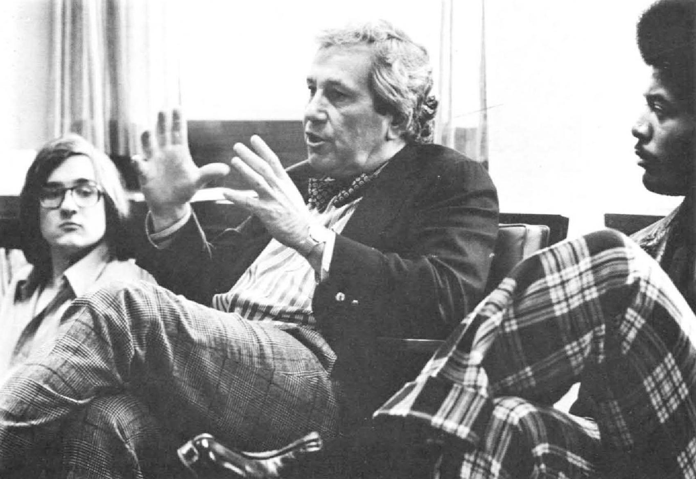
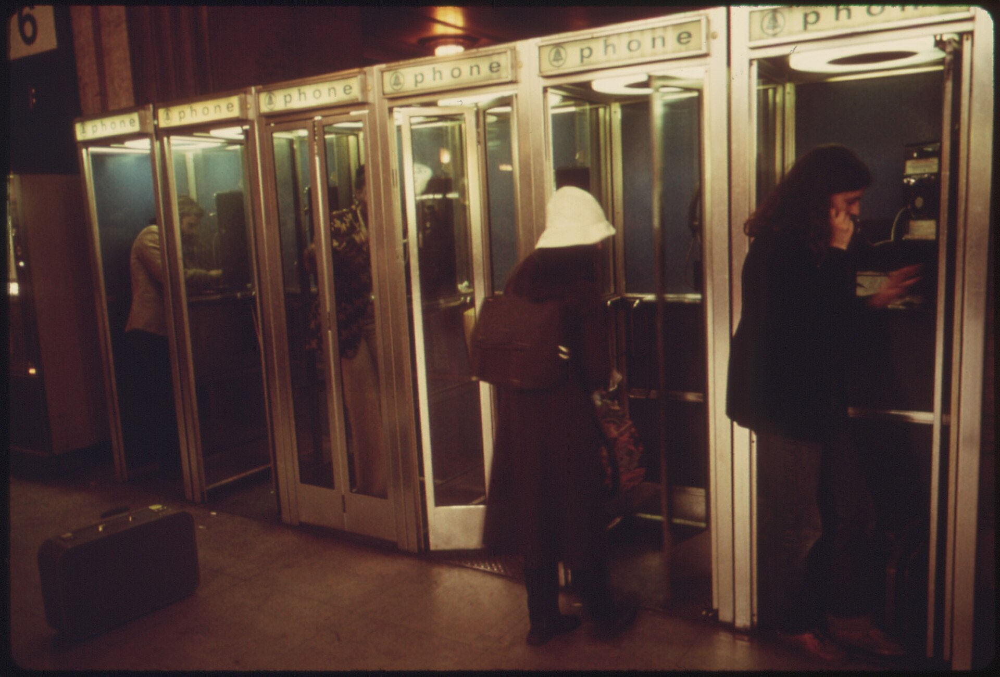

52 years ago today, on November 20, 1974, the United States Department of Justice filed an antitrust lawsuit against AT&T Corporation. The legal action challenged the telecommunications giant and its Bell System, eventually forcing the breakup of the world's largest corporate monopoly.

## The Rise of Ma Bell

The roots of the corporate colossus traced back to 1874, when the Bell Patent Association formed to protect the patent rights of Alexander Graham Bell after his invention of the telephone system. In 1875, that partnership became the Bell Telephone Company, opening its first commercial exchange in New Haven, Connecticut, in 1877. As local telephone exchange companies spread to every major city across the nation, the enterprise evolved into the Bell System.

In 1885, the company incorporated the American Telephone and Telegraph Company in New York to build a nationwide long-distance network. By 1892, lines stretched from New York City to Chicago, Illinois, gradually binding the continent together. On December 30, 1899, AT&T absorbed the assets of its parent, American Bell, moving corporate headquarters out of Massachusetts where strict capitalization limits capped growth at $10 million.

## One Policy, One System, Universal Service

In 1907, Theodore Newton Vail took the helm as president of AT&T, establishing the philosophy that would guide the conglomerate for the next seven decades: 'One Policy, One System, Universal Service.' Vail believed that telephone communication worked best as a unified, regulated monopoly. Under his leadership, the company aggressively acquired smaller phone companies as well as Western Union telegraph.

That rapid consolidation drew early scrutiny from federal regulators. To ward off antitrust action, AT&T entered into the Kingsbury Commitment with the federal government in 1913. Under the agreement, AT&T avoided being broken up or nationalized by agreeing to divest Western Union and allow non-competing independent phone companies to interconnect with its vast long-distance lines. After 1934, federal oversight transitioned to the Federal Communications Commission, allowing the company to function as a sanctioned, regulated utility.

*Archive, 1974 — Photo: Associated Students of the California Institute of Technolog / Public domain*

## An Unmatched Industrial Giant

For the majority of the twentieth century, Americans lived with a single telephone provider familiarly known as Ma Bell. The Bell System operated as a massive vertical monopoly that controlled five primary pillars. AT&T served as the parent firm overseeing corporate strategy and financing, while AT&T Long Lines operated long-distance telephone trunk lines and international submarine cables.

Alongside the transmission lines stood Western Electric Company, which manufactured nearly all telephone equipment and switchboards. Scientific research was conducted by Bell Labs, shared between Western Electric and AT&T. Finally, regional Bell operating companies handled everyday local telephone services across American communities. At its peak, the Bell System employed over one million people and held assets totaling $150 billion, making it an economic force without rival in the private sector.

*ONE OF TWO PHONES IS IN USE AT ONE OF THE SOUTHEASTERN PENNSYLVANIA TRANSPORTATION AUTHORITY (SEPTA) TRAIN STATIONS... - NARA - 556777 — Photo: Jim Pickerell / Public domain*

## The Justice Department Files Suit

Despite its convenience and technological leadership, critics argued that Ma Bell's vertical integration blocked technological progress and locked competitors out of equipment manufacturing and long-distance transmission. On November 20, 1974, the Antitrust Division of the United States Department of Justice filed a formal complaint in federal district court, accusing AT&T of violating the Sherman Antitrust Act.

The Department of Justice, which traces its lineage to 1870 under President Ulysses S. Grant, brought the full weight of its antitrust litigators against the corporate giant. The government argued that AT&T used the guaranteed profits of its local monopoly phone companies to cross-subsidize its long-distance network and suppress competing manufacturers. AT&T mounted a vigorous defense, insisting that unified central management was essential to keep national telephone service reliable and inexpensive.

*TRAIN PASSENGERS USE A BANK OF TELEPHONES IN THE 30TH STREET STATION AT PHILADELPHIA, PENNSYLVANIA. IT IS ONE OF FOUR... - NARA - 556689 — Photo: Jim Pickerell / Public domain*

## The 1982 Settlement and the Seven Baby Bells

The antitrust litigation dragged through the federal court system for nearly eight years, producing millions of pages of documents. By 1982, facing unfavorable legal rulings and recognizing that an outright courtroom victory was unlikely, AT&T agreed to settle the litigation with the Justice Department through a consent decree.

The settlement ordered AT&T to divest its lucrative local operating companies. In 1984, the Bell System officially dissolved, splitting into seven independent Regional Bell Operating Companies, popularly dubbed the 'Baby Bells.' AT&T retained its long-distance operations, Western Electric, and Bell Labs, but lost its direct stranglehold over the local switchboards that reached American homes.

## The Legacy of the Breakup

The dissolution of the Bell System transformed American telecommunications by fostering competition in long-distance calling, telephone equipment manufacturing, and eventually wireless data networks. Yet corporate history took another unexpected turn decades later. Following the passage of the Telecommunications Act of 1996, many legal restrictions on the Baby Bells were eased.

Several former regional spin-offs expanded through mergers. In 2005, one of the original Baby Bells, SBC Communications, bought its former parent company for more than $16 billion and adopted the AT&T name. Over the years, the vast network once built by Alexander Graham Bell and Theodore Vail consolidated primarily into two modern successors: AT&T and Verizon. The legal filing in Washington on November 20, 1974, remains a pivotal milestone in American business history, demonstrating how the federal government fundamentally dismantled the world's most powerful monopoly.

### Sources

- <https://en.wikipedia.org/wiki/Bell_System>
- <https://commons.wikimedia.org/wiki/File:William_Saxbe.jpg>
- <https://commons.wikimedia.org/wiki/File:Dick_Tuck_in_Pasadena,_1974_from_The_Big_T_1974_(page_46_crop).jpg>
- <https://commons.wikimedia.org/wiki/File:ONE_OF_TWO_PHONES_IS_IN_USE_AT_ONE_OF_THE_SOUTHEASTERN_PENNSYLVANIA_TRANSPORTATION_AUTHORITY_(SEPTA)_TRAIN_STATIONS..._-_NARA_-_556777.jpg>
- <https://commons.wikimedia.org/wiki/File:TRAIN_PASSENGERS_USE_A_BANK_OF_TELEPHONES_IN_THE_30TH_STREET_STATION_AT_PHILADELPHIA,_PENNSYLVANIA._IT_IS_ONE_OF_FOUR..._-_NARA_-_556689.jpg>
