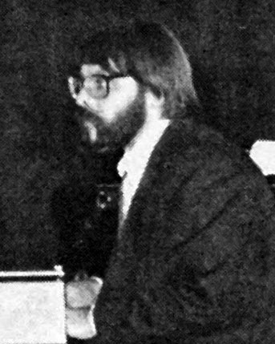
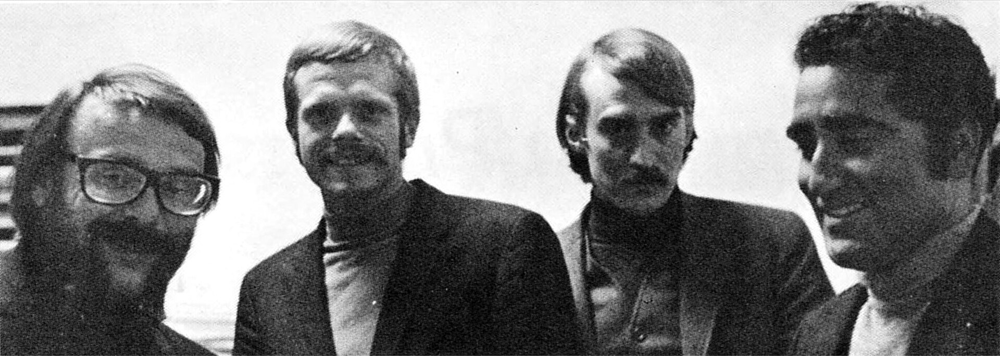
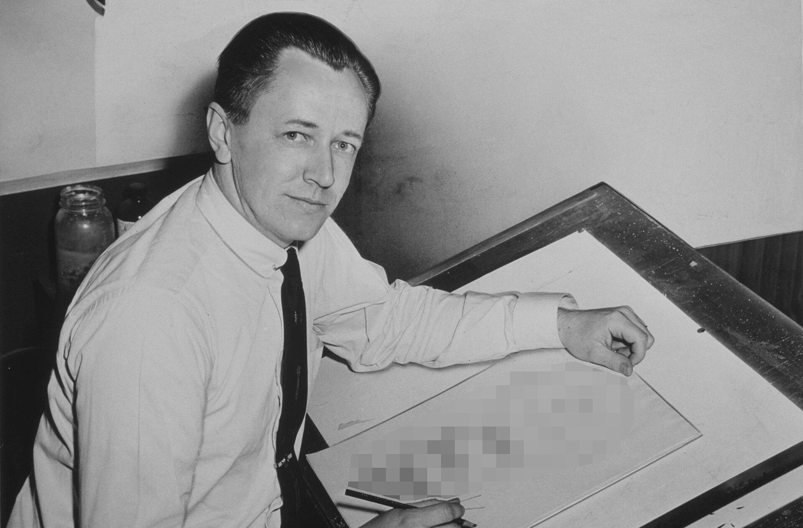

53 years ago today, November 20, 1973, CBS aired the prime-time premiere of A Charlie Brown Thanksgiving, just two days before the national holiday. It marked the tenth animated television special created from Charles M. Schulz's beloved Peanuts comic strip and quickly cemented itself as an American holiday tradition.

## Breaking New Ground with an Original Script

By 1973, holiday animated specials starring Charlie Brown were already an established American viewing ritual. Audiences had embraced A Charlie Brown Christmas in 1965 and It's the Great Pumpkin, Charlie Brown in 1966. However, A Charlie Brown Thanksgiving represented a significant creative turning point for creator Charles M. Schulz. Aside from the traditional opening sequence where Lucy van Pelt pulls the football away from Charlie Brown at the last second, claiming that some traditions fade away, the television special was the first Peanuts production to feature an entirely original script that did not rely on previously published comic strips.

## An Unexpected Holiday Crisis

The plot centered on Charlie Brown's holiday anxiety. While preparing to travel to his grandmother's house for Thanksgiving dinner, Charlie Brown receives a surprise telephone call from Peppermint Patty. With her father away out of town, she invites herself to his house for the holiday, soon expanding the guest list to include Marcie and Franklin. Charlie Brown panics because his family will not be home and he admits he cannot cook anything beyond 'maybe toast.' Linus steps in with a solution, noting they have enough time before the family trip to host a small gathering, enlisting Snoopy and Woodstock to help assemble the meal.

*NOT FROM THE EVENT · 1968 — Photo: The California Aggie / Public domain*

## Toast, Popcorn, and a Backyard Feast

The backyard preparations quickly became one of the most famous animated sequences in television history. Snoopy sets up an outdoor ping pong table and chairs, later dealing plates across the surface like a card dealer in a casino. Together, Charlie Brown, Snoopy, Linus, and Woodstock assemble an unconventional Thanksgiving meal composed entirely of buttered toast, pan-fried popcorn, pretzel sticks, jelly beans, and ice cream sundaes. After Linus delivers a thoughtful grace recounting the First Thanksgiving, Peppermint Patty reacts with anger, rejecting the meal because it lacks turkey, stuffing, mashed potatoes, and pumpkin pie.

*NOT FROM THE EVENT · 1968 — Photo: Fred Arellano for El Yanqui of Monterey Peninsula College / Public domain*

## An Apology and a Grandmother's Welcome

The tension resolves through quiet honesty. Marcie speaks up and gently reminds Peppermint Patty that nobody had invited her, and that she had invited herself to Charlie Brown's house. Feeling humbled, Peppermint Patty asks Marcie to apologize on her behalf, echoing a classic literary parallel to The Courtship of Miles Standish, before walking over to apologize to Charlie Brown face-to-face. A quick telephone call to Charlie Brown's grandmother clears up the situation completely: she happily invites all of Charlie Brown's friends to join the family dinner. As the children ride together singing 'Over the River and Through the Wood,' Charlie Brown humorously points out that his grandmother actually lives in a condominium, while Snoopy and Woodstock enjoy a traditional turkey feast back at the doghouse.

*Charles Schulz NYWTS drawing disguised — Photo: Roger Higgins, World Telegram staff photographer / Public domain*

## High Ratings and an Emmy Award

When the special debuted on Tuesday, November 20, 1973, it became an immediate ratings smash. In the weekly Nielsen ratings, A Charlie Brown Thanksgiving captured third place overall, trailing only two of television's biggest prime-time sitcom hits: All in the Family and Sanford & Son. The critical reception proved just as strong. The following year, the production received an Emmy Award, solidifying its place alongside earlier Peanuts triumphs.

## Vince Guaraldi's Score and Decades of Tradition

A crucial element of the special's charm was its original soundtrack, composed by Vince Guaraldi and conducted and arranged by John Scott Trotter. Guaraldi recorded the score with his quintet at Wally Heider Studios between August and October 1973, featuring Tom Harrell on trumpet, Chuck Bennett on trombone, Seward McCain on electric bass, and Mike Clark on drums. The broadcast continued to air annually on CBS through 1989, later finding homes on cable networks, ABC, and streaming on Apple TV+, returning every November to bring generations of viewers back to that ping pong table of toast and popcorn.

### Sources

- <https://en.wikipedia.org/wiki/A_Charlie_Brown_Thanksgiving>
- <https://commons.wikimedia.org/wiki/File:Vince_Guaraldi_Freeborn_Hall_1968.jpg>
- <https://commons.wikimedia.org/wiki/File:Vince_Guaraldi_Freeborn_Hall_1968_(cropped).jpg>
- <https://commons.wikimedia.org/wiki/File:Vince_Guaraldi_Quartet_1968.jpg>
- <https://commons.wikimedia.org/wiki/File:Charles_Schulz_NYWTS_drawing_disguised.jpg>
