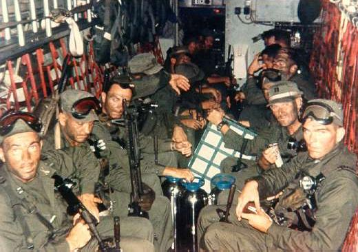
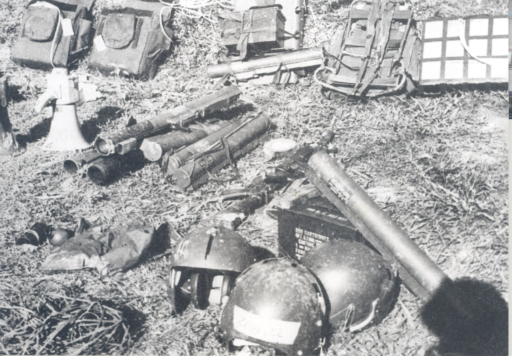
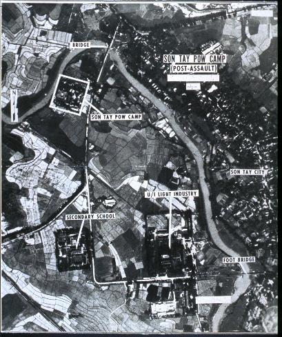

56 years ago today, November 21, 1970, an elite joint force of American commandos launched a daring nighttime helicopter assault on the Son Tay prison camp deep inside North Vietnam to rescue 61 American prisoners of war. The raid was executed with remarkable precision, but the soldiers were met with a silent, agonizing surprise.

## Planning a Daring Rescue in Secret

The concept for the rescue mission began on May 9, 1970, when an Air Force intelligence unit examined aerial reconnaissance photographs. Analysts concluded that a secluded compound near Sơn Tây, suspected since late 1968 of serving as a prisoner-of-war facility, held 55 American captives, with at least six in urgent need of medical rescue. On May 25, Brigadier General James R. Allen met at the Pentagon with Army Brigadier General Donald Blackburn, who took the findings directly to General Earle G. Wheeler, Chairman of the Joint Chiefs of Staff. Wheeler authorized a 15-member feasibility group codenamed Polar Circle, which reviewed all available intelligence and revised the estimated prisoner count to 61.

## Rigorous Rehearsals at Eglin Air Force Base

The operational phase, designated Operation Ivory Coast, formally got underway on August 8, 1970, after Admiral Thomas H. Moorer became the new Chairman of the Joint Chiefs of Staff. Moorer appointed Air Force Brigadier General LeRoy J. Manor as commander and Army Colonel Arthur D. 'Bull' Simons as deputy commander. The mission marked the first joint military operation in United States history conducted under the direct authority of the Joint Chiefs chairman. To maintain peak operational security, Simons selected Special Forces personnel based strictly on combat experience in Southeast Asia and specialized operational skills. Training began at Duke Field at Eglin Air Force Base in Florida, where raiders rehearsed the assault extensively while intelligence gathering continued right up to November 20.

*Archive, 1970 — Photo: US military / Public domain*

## A Perilous Target Outside Hanoi

The objective was extraordinarily perilous. The Sơn Tây camp sat just 23 miles west of North Vietnam's capital of Hanoi, deep in heavily defended territory. Compounding the danger, an estimated 12,000 North Vietnamese soldiers were garrisoned within a five-mile radius of the camp. Any mistake or delay risked turning the compound into an inescapable trap. Planners recognized that absolute speed and surprise were the only ways the assault team could secure the prisoners and evacuate before nearby enemy garrisons could react.

*Archive, 1970 — Photo: US Air Force / Public domain*

## The Midnight Descent into the Compound

In the early hours of November 21, 1970, the rescue force launched its attack. A team of 56 U.S. Army Special Forces commandos was inserted by helicopter directly into the prison compound. One helicopter carried out an intentional crash landing into the tight courtyard of the camp to ensure the immediate suppression of guards and prevent resistance. Led on the ground by Colonel Simons, the raiders moved quickly through the buildings, eliminating hostile guards and securing every corner of the facility. The tactical execution was rapid and overwhelming, resulting in only two American casualties and no American deaths during the entire engagement.

*Archive, 1970 — Photo: US military recon aircraft photo / Public domain*

## The Agony of the Empty Cells

As the Green Berets kicked open cell doors and swept through the barracks calling out for American prisoners, they encountered complete silence. The compound was deserted. Unknown to the raiders before landing, North Vietnamese authorities had recently relocated all the prisoners of war to another facility. With no prisoners to extract, the assault team quickly boarded their remaining extraction helicopters and withdrew from North Vietnam, leaving two damaged aircraft behind as planned.

## The Aftermath and the Legacy of Son Tay

The mission was a tactical masterpiece but an intelligence failure. Public scrutiny and dissatisfaction within the administration of President Richard Nixon over the failure to detect that the prisoners had been moved triggered a comprehensive reorganization of the United States intelligence community just one year later. For the families of American prisoners and the POWs themselves, the raid sent an unmistakable message across North Vietnam: the United States had not abandoned them, and comrades were willing to fly straight into Hanoi's backyard to bring them home.

### Sources

- <https://en.wikipedia.org/wiki/Vietnam_War>
- <https://commons.wikimedia.org/wiki/File:SonTayPrisonCamp.jpg>
- <https://commons.wikimedia.org/wiki/File:SonTayRaiders.JPG>
- <https://commons.wikimedia.org/wiki/File:Equipment_left_behind_by_Son_Tay_raiders.JPG>
- <https://commons.wikimedia.org/wiki/File:SonTayPrisonCampandSchool.jpg>
