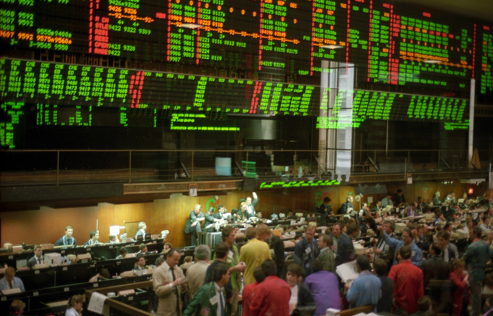
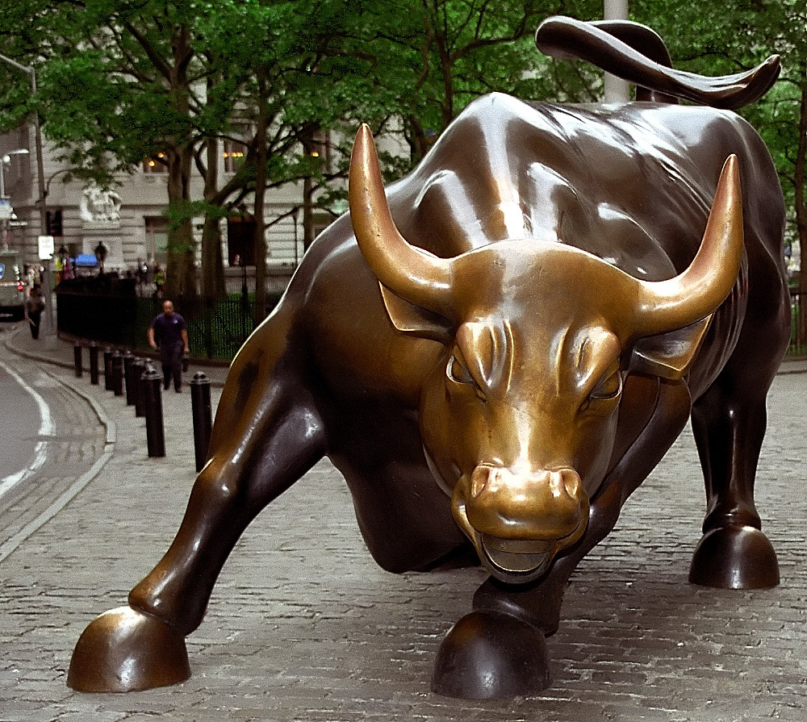

31 years ago today, November 21, 1995, the Dow Jones Industrial Average gained 40.46 points to close at 5,023.55. That late-autumn trading session represented the first time in history that the benchmark index finished above the 5,000 milestone. It was a defining moment for Wall Street and marked 1995 as the first year where the Dow surpassed two millennium marks in a single year.

## The Rise from Charles Dow's Early Newsletters

The Dow Jones Industrial Average traces its roots back to the late nineteenth century. In 1884, Charles Dow devised his initial stock average featuring 11 stocks, which were mostly railroad enterprises and would later develop into the Dow Jones Transportation Average. Dow shared these figures with the public through his Customer's Afternoon Letter, a daily two-page financial bulletin that served as the precursor to The Wall Street Journal.

The venture soon grew alongside his business associate, statistician Edward Jones. On February 16, 1885, the Dow Jones Average launched as a 14-stock index. Nearly a year later, on January 2, 1886, that list dropped to 12 stocks when the Central Pacific Railroad and Central Railroad of New Jersey were removed. Charles Dow sought an effective way to communicate broad industrial trends to ordinary readers and investors.

## The 1896 Debut of the 12 Original Industrials

The industrial measure officially debuted on May 26, 1896, introducing 12 industrial stocks with an opening benchmark value of 40.94. This calculation gave market watchers a direct look at the manufacturing powerhouses shaping the nation's economy.

Those original 12 components represented foundational American businesses of the era. The roster included American Cotton Oil Company, American Sugar Company, American Tobacco Company, Chicago Gas Company, Distilling & Cattle Feeding Company, General Electric, Laclede Gas Company, National Lead Company, North American Utility Company, Tennessee Coal & Iron, U.S. Leather Company preferred, and U.S. Rubber Company. Of those pioneering corporations, General Electric would become one of the most recognizable corporate names of the century.

*Chicago Board of Trade electronic displays — Photo: Lars Plougmann from United States / CC BY-SA 2.0*

## Breaking the 5,000 Barrier in 1995

Nearly a century after that modest debut at 40.94, the market reached a momentous threshold on November 21, 1995. Buoyed by steady economic activity, the average rose by 40.46 points over the course of the day. When the final bell rang, the index settled at 5,023.55.

That closing figure made history in multiple ways. Not only had the Dow crossed 5,000 for the first time, but it also cemented 1995 as the first year in market history where the Dow surpassed two millennium marks in a single year. Investors across the country watched the numbers tick across electronic boards with excitement.

*New York Stock Exchange — Photo: David Blaikie / CC BY 2.0*

## How the Price-Weighted Index and Divisor Operate

The Dow Jones Industrial Average tracks the performance of 30 large companies listed on stock exchanges across the United States. Unlike broader indexes weighted strictly by market value, the Dow is a price-weighted index, meaning companies with the highest price per share carry the highest weighting.

To compute the index, the share prices of all 30 components are added together and divided by the Dow Divisor. When the index began, the divisor was simply the number of component companies. Over the decades, however, structural adjustments like stock splits and corporate spinoffs required the divisor to be recalibrated to prevent artificial jumps. In modern times, the divisor is a fraction less than one, meaning a one-dollar shift in an underlying stock produces a significant movement in the overall point total.

*New York - Lower Manhattan 'Wall Street Bull' — Photo: David Paul Ohmer / CC BY 2.0*

## Debates and Products Surrounding the 30 Components

Because the index contains only 30 stocks selected by a committee, financial analysts have often debated its overall representation. Firms with the highest share price exert an outsized influence; for instance, Goldman Sachs carries the top weighting in the index, while the decline of past component AIG contributed to steep losses during the 2008 financial crisis. Consequently, many financial advisors do not view the Dow as fully representative of the entire economy and often prefer broader alternatives for long-term investments.

Despite these discussions, the Dow has performed largely in line with the broader S&P 500 over the long run. The benchmark has also generated a vast array of linked financial products, including mutual funds, exchange-traded funds, and derivatives such as options and futures. Modified strategies have emerged as well, from equal-weighted funds to strategies focusing on the ten components with the largest dividend yields, known throughout the investment world as the Dogs of the Dow.

## A Benchmark Still Followed Across the Globe

Maintained today by S&P Dow Jones Indices, the index created by Charles Dow and Edward Jones remains one of the world's most referenced financial figures. Whenever evening broadcasts report on the state of the economy, the Dow is often the first number mentioned.

The crossing of 5,023.55 on November 21, 1995, stands out as a clear milestone in that long progression. It captured an era of growing public participation in the markets and set a precedent for rapid gains that continued to shape the financial landscape for decades to come.

### Sources

- <https://en.wikipedia.org/wiki/Dow_Jones_Industrial_Average>
- <https://commons.wikimedia.org/wiki/File:Flagstone_Wall_-_geograph.org.uk_-_425600.jpg>
- <https://commons.wikimedia.org/wiki/File:Chicago_Board_of_Trade_electronic_displays.jpg>
- <https://www.flickr.com/photos/12568962@N00/3448030730>
- <https://www.flickr.com/photos/50965924@N00/2932154983>
