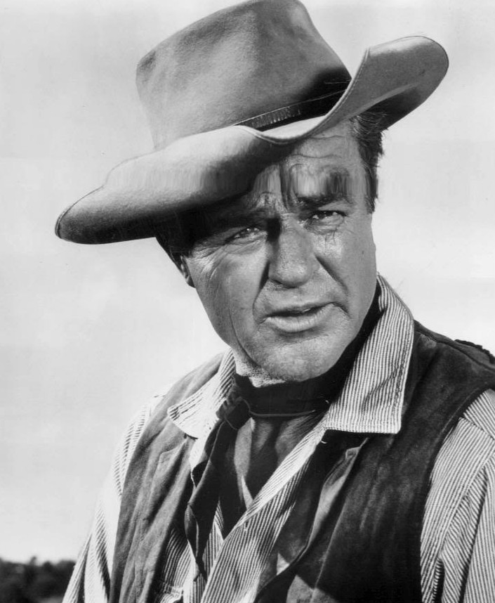
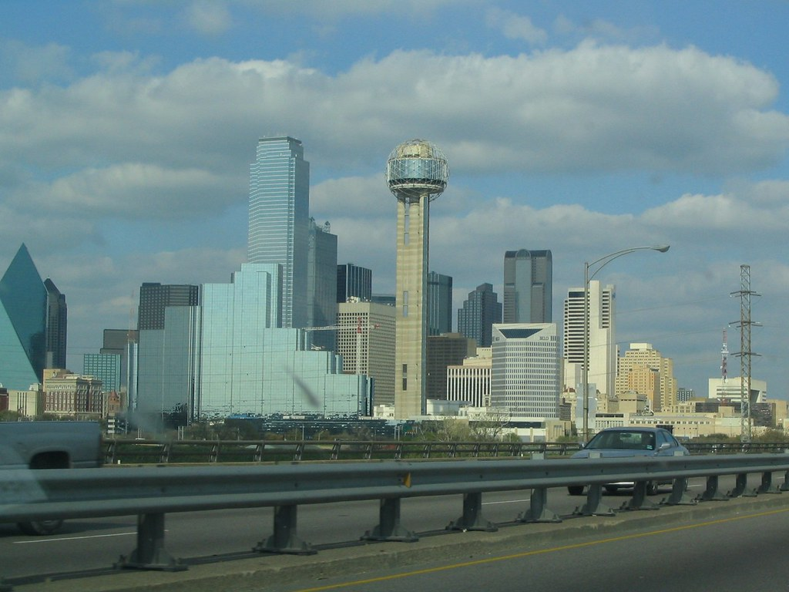
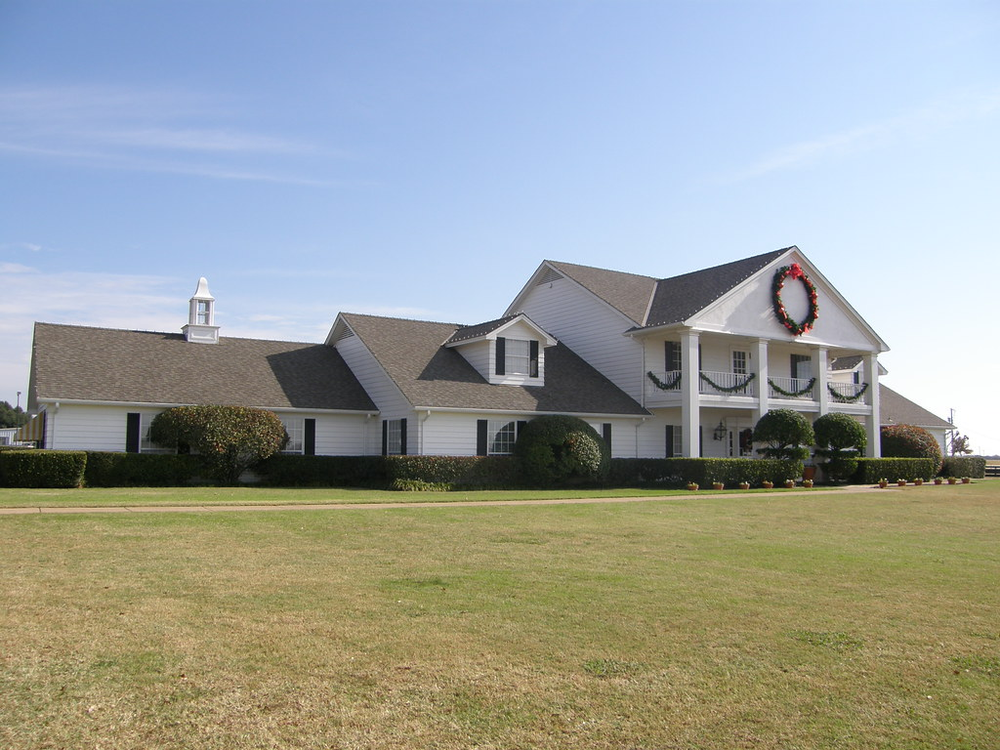

46 years ago today, November 21, 1980, American living rooms went quiet as millions tuned in to CBS for a single answer: who shot J. R. Ewing? The prime-time soap opera Dallas had left viewers hanging for eight excruciating months, creating a cultural frenzy that defined an entire era of television history.

## The Rise of Southfork and the Ewing Dynasty

Dallas first arrived on television on April 2, 1978, beginning as a five-part miniseries on CBS. Broadcast in a late Sunday night slot that was typically associated with lower viewership, neither the network nor the producers initially expected the show to expand beyond those five episodes. Yet the compelling drama of an affluent Texas family quickly drew a massive following, prompting CBS to commission it as a regular series. Dallas would go on to run for 13 additional full seasons, totaling fourteen seasons and 357 episodes before wrapping up on May 3, 1991.

Set in Texas on the fictional Southfork Ranch, the narrative rested on a generational conflict. Patriarch John Ross 'Jock' Ewing, played by veteran Western actor Jim Davis, had established Ewing Oil after a bitter feud in the 1930s with his former partner, Willard 'Digger' Barnes. The animosity between the two dynasties only deepened when Jock's youngest son, Bobby, played by Patrick Duffy, eloped with Digger's daughter, Pamela Barnes, portrayed by Victoria Principal. Matriarch Eleanor 'Miss Ellie' Ewing, portrayed by Barbara Bel Geddes, tried to keep the sprawling family anchored to their cattle ranch, but corporate warfare and personal vendettas constantly threatened to tear them apart.

## The Creation of Television's Ultimate Villain

While the series originally centered on the romantic conflict between Bobby and Pamela, Bobby's older brother soon captured the public imagination. John Ross 'J. R.' Ewing Jr., played with menacing charm by Larry Hagman, emerged as the undeniable breakout character. J. R. was portrayed as an amoral, manipulative oil baron who took sheer delight in outwitting his business rivals and destroying anyone who crossed him. His primary business adversary was Cliff Barnes, son of Digger, whom J. R. targeted through blackmail, bribery, and ruthless corporate maneuvers.

Hagman based aspects of J. R.'s persona on a character he had previously portrayed in the film Stardust, as well as an unpleasant boss from his past. The character's name was partially an homage to Jett Rink, James Dean's famous oil baron role in Giant, while real-life Texas oilman H. L. Hunt served as loose inspiration. At home, J. R.'s private life was equally fraught, marked by a volatile marriage to Sue Ellen, a former Miss Texas played by Linda Gray. Despite his cruelty, Hagman gave J. R. moments of complex loyalty to his family name, cementing his place in television history.

*Jim Davis Death Valley Days 1965 — Photo: Death Valley Days, with a Wilshire Ave address in LA; they a / Public domain*

## The Cliffhanger: 'A House Divided'

By the end of the show's third season, J. R. had alienated nearly every person in his personal and professional circle. In the climactic finale titled 'A House Divided,' broadcast in March 1980, J. R. was working late inside his dimly lit office. Hearing a noise outside, he stepped toward the door, only for an unidentified figure to raise a handgun and fire two shots into his abdomen, leaving him collapsed on the floor as the screen faded to black.

The cliffhanger left viewers entirely in the dark regarding J. R.'s fate and the identity of his shooter. Soap operas had historically relied on open narratives, but this prime-time ending turned into a national obsession. Over the spring and summer of 1980, the catchphrase 'Who shot J. R.?' appeared on bumper stickers, T-shirts, and magazine covers. Betting parlors took wagers on the list of suspects, which included nearly every regular character on the series, from his long-suffering wife Sue Ellen to bitter business rivals and disgruntled relatives.

*Dallas, Texas Skyline from I-35 Eastbound — Photo: Ken Lund / CC BY-SA 2.0*

## Larry Hagman's High-Stakes Contract Standoff

As the country debated the identity of the shooter, the real-world fate of the show hung in the balance. Recognizing that J. R. Ewing had become the linchpin of the entire franchise, Larry Hagman took advantage of the unprecedented publicity to demand a significantly higher salary. With contract negotiations stalled, Hagman threatened not to return to the set for the upcoming season.

CBS responded by leaking rumors that J. R. might undergo facial surgery after surviving the shooting, allowing another actor to step into the role if necessary. However, Hagman held firm, aware that fans would reject any recast of the iconic oil baron. Ultimately, the network conceded to Hagman's contractual requests, securing his presence for the remainder of the series. The actor would go on to be the only cast member to appear in all 357 episodes of the original drama, as well as several episodes of the spin-off series Knots Landing.

*Southfork Ranch — Photo: jimbowen0306 / CC BY 2.0*

## The Reveal: 'Who Done It' Makes History

The agonizing eight-month wait finally ended on the night of November 21, 1980, when CBS aired the highly anticipated resolution episode, 'Who Done It.' Eager to discover the truth behind television's biggest mystery, millions of households tuned in simultaneously, grinding evening activities across the nation to a halt. When the culprit was finally unveiled, the broadcast shattered existing viewership records.

The episode became an instant cultural touchstone and still stands as the second-highest-rated primetime telecast in American television history. The enormous ratings reaffirmed the unrivaled power of the serialized prime-time drama, proving that an unresolved mystery could captivate the collective attention of an entire country. The event transformed season-ending cliffhangers from an occasional narrative trick into a standard structural tool for American network television.

## An Unmatched Television Legacy

The massive triumph of 'Who shot J. R.?' helped establish Dallas as an entertainment juggernaut. In 1979, the series launched a successful spin-off, Knots Landing, which went on to run for fourteen seasons and 344 episodes. Dallas itself accumulated numerous accolades over its multi-decade run, winning four Emmy Awards, including a 1980 Outstanding Lead Actress in a Drama Series trophy for Barbara Bel Geddes.

Decades later, the impact of J. R. Ewing remains unchallenged. In 2007, Time magazine recognized Dallas on its list of the '100 Best TV Shows of All-Time.' In 2013, TV Guide ranked J. R. Ewing as number one on its list of 'The 60 Nastiest Villains of All Time,' while Rolling Stone placed him eleventh among the greatest television villains ever created. When Larry Hagman passed away on November 23, 2012, television lost the face of its most memorable oil baron—a character whose shooting captivated a nation on this very evening in 1980.

### Sources

- <https://en.wikipedia.org/wiki/Dallas_(TV_series)>
- <https://commons.wikimedia.org/wiki/File:Here_We_Go_Again_(TV_series).jpg>
- <https://commons.wikimedia.org/wiki/File:Jim_Davis_Death_Valley_Days_1965.jpg>
- <https://www.flickr.com/photos/75683070@N00/66296057>
- <https://www.flickr.com/photos/82538566@N00/2091590207>
