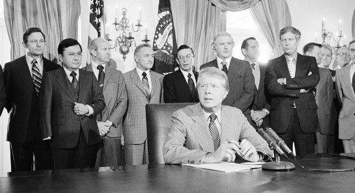
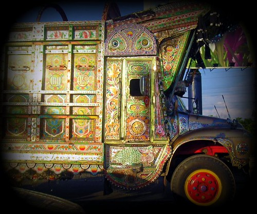
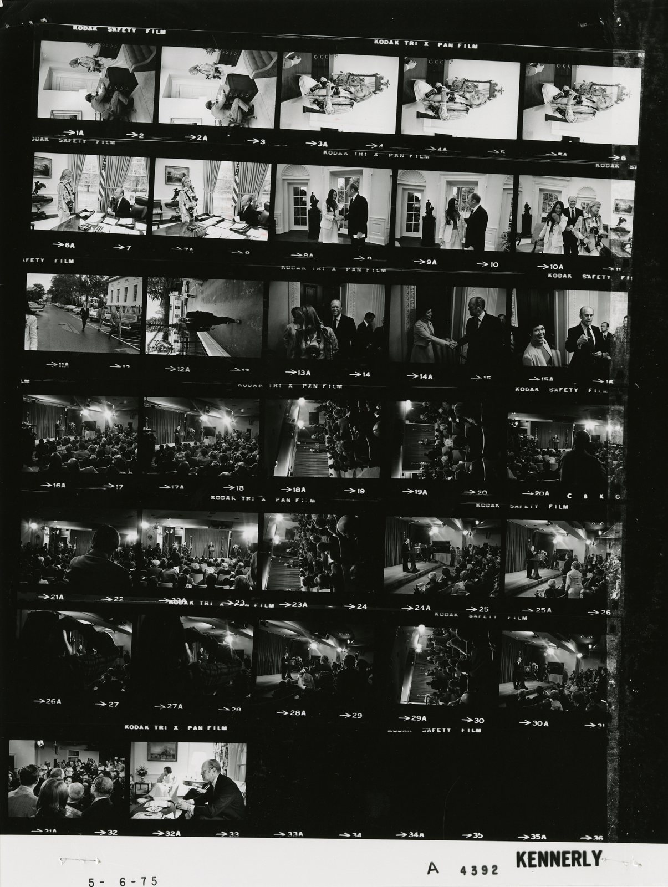

47 years ago today, on November 21, 1979, a violent mob attacked the United States Embassy in Islamabad, Pakistan, setting the diplomatic compound ablaze and trapping personnel inside for hours. The siege claimed four lives inside the mission and marked one of the darkest diplomatic crises of that turbulent autumn.

## A Rumor Sparks Regional Fury

The international climate in November 1979 was already near the boiling point due to the ongoing Iran hostage crisis, where American diplomats were held captive in Tehran. On November 20, an armed group seized the Grand Mosque in Mecca, Saudi Arabia, demanding the overthrow of the Saudi monarchy and an end to foreign influence. Confusion immediately followed about who was responsible. Seizing on the chaos, Iranian religious cleric Ayatollah Ruhollah Khomeini broadcast an incendiary, false accusation on state radio, claiming that American and Israeli forces had staged the assault on Islam's holiest site. The allegation gained further traction after news circulated that President Jimmy Carter had dispatched U.S. Navy aircraft carriers to the Indian Ocean.

## The Mob Surrounds the Embassy

Islamabad, Pakistan's planned capital established in 1967 along the Margalla Hills, became the center of a sudden uprising. Around 12:00 p.m. on November 21, buses loaded with demonstrators arrived outside the United States Embassy gates. The crowd was predominantly made up of students from Quaid-i-Azam University affiliated with the Islamist political party Jamaat-i-Islami. What began as a noisy protest quickly escalated as more than 1,500 people surrounded the mission, chanting anti-American slogans before breaching the compound walls.

*Jimmy Carter signing Executive Order on Intelligence reform — Photo: Unknown / Public domain*

## Flames and Hostages Inside the Mission

Rioters overwhelmed security personnel, broke into embassy offices, and deliberately set fires throughout the buildings. Several American diplomats were seized and held hostage, with rioters threatening public executions and show trials. Thick smoke filled the complex as staff retreated into secure rooms. United States Ambassador Arthur W. Hummel Jr. happened to be away from the embassy compound when the attack began, narrowly avoiding capture by the mob.

*Truck (Islamabad, Pakistan) — Photo: ~MVI~ (warped) / CC BY 2.0*

## A Desperate Appeal to Pakistani Authorities

As news of the assault reached Washington, President Jimmy Carter placed an urgent telephone call to Pakistani President Muhammad Zia-ul-Haq. Carter demanded that Pakistani security forces intervene immediately to protect American lives and diplomatic personnel. President Zia, who had seized power in a 1977 coup and relied on Jamaat-i-Islami as a political ally, proved hesitant to deploy the army against the demonstrators. For nearly 24 hours, the besieged staff remained trapped while fires raged.

*Scene of the era (not a photo of this event) — Photo: David Hume Kennerly / Public domain*

## The Aftermath and the Cost

Pakistani troops finally moved into the diplomatic compound on the morning of November 22 to disperse the crowd and retake control. By the time order was restored, two rioting students had been killed and as many as 70 were injured. Inside the embassy, four personnel lost their lives: a United States Marine Security Guard, a U.S. Army warrant officer, and two Pakistani employees. Sympathy riots erupted across Pakistan that same day, resulting in the burning of American cultural centers in Rawalpindi, Lahore, and Karachi. While Khomeini publicly praised the rioters, the tragic day remains a stark case study in the lethal danger of state-sponsored disinformation.

### Sources

- <https://en.wikipedia.org/wiki/Islamabad>
- <https://commons.wikimedia.org/wiki/File:Warsaw_Uprising_by_G%C4%85szewski_-_Listening_to_Radio_in_Kampinos.jpg>
- <https://commons.wikimedia.org/wiki/File:Jimmy_Carter_signing_Executive_Order_on_Intelligence_reform.jpg>
- <https://www.flickr.com/photos/20119750@N00/1339048339>
- <https://commons.wikimedia.org/wiki/File:Ford_A4392_NLGRF_photo_contact_sheet_(1975-05-06)(Gerald_Ford_Library).jpg>
