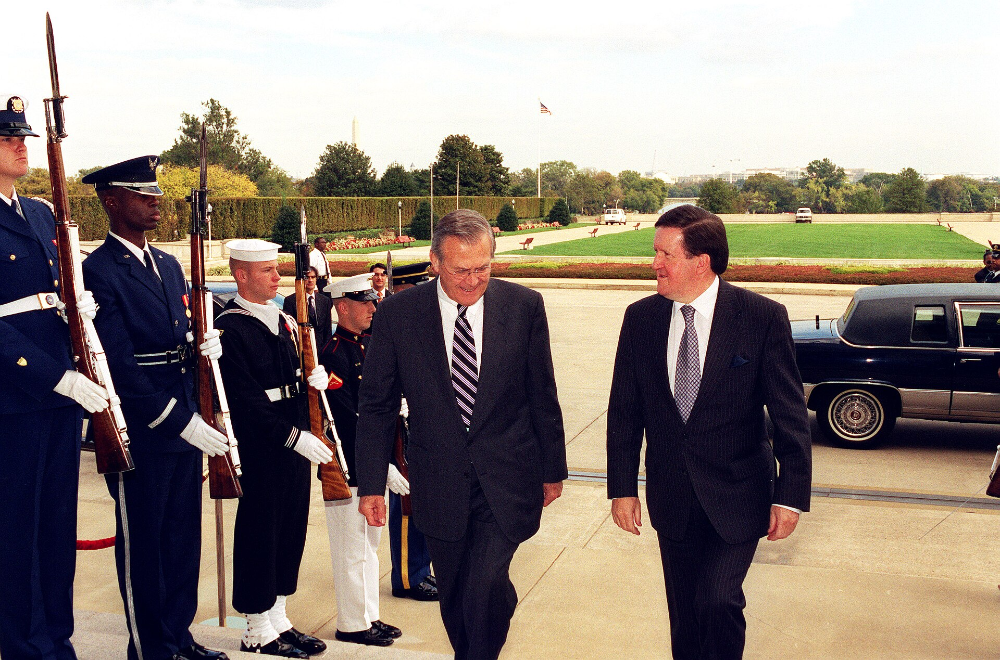
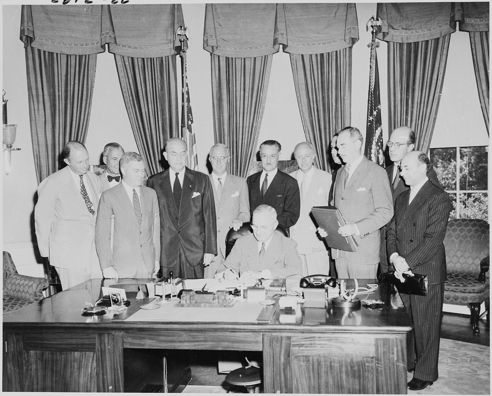

24 years ago today, November 21, 2002, NATO took an unprecedented step in redrawing the security landscape of Europe. At an alliance summit, seven sovereign nations—Bulgaria, Estonia, Latvia, Lithuania, Romania, Slovakia, and Slovenia—received official invitations to become full members of the North Atlantic Treaty Organization.

## The Foundation of Collective Security

The North Atlantic Treaty Organization was conceived in the early years of the Cold War. In March 1948, European nations formed the Western Union under the Treaty of Brussels, but American leaders recognized that deterring Soviet aggression required a broader transatlantic framework. Under the principles of the Truman Doctrine, discussions began in Washington, where Canadian diplomat Lester B. Pearson served as a principal architect of the founding document.

On April 4, 1949, the United States, Canada, and ten European partners signed the North Atlantic Treaty in Washington. The alliance was anchored by Article 5, which declared that an attack on any member was an attack against the entire coalition. In 1952, NATO established a civilian Secretary General to oversee political operations. When West Germany joined the alliance in May 1955, the Soviet Union responded by creating the Warsaw Pact, locking the European continent into two opposing military blocs.

## The Collapse of the Soviet Bloc

For four decades, the frontier between NATO and the Warsaw Pact defined global geopolitics. At the peak of tensions during the construction of the Berlin Wall in 1961, roughly 400,000 American service members were stationed across Europe. However, by the late 1980s, the political foundations of the Soviet sphere began to crumble.

The Revolutions of 1989 swept communist governments from power across Eastern Europe. In October 1990, East Germany reunited with the Federal Republic of Germany inside NATO. One month later, in November 1990, the alliance and the Soviet Union signed the Treaty on Conventional Armed Forces in Europe (CFE), mandating the destruction of 52,000 pieces of heavy weaponry. In February 1991, the Warsaw Pact was officially disbanded, and in December of that year, the Soviet Union itself dissolved, bringing an end to the ideological standoff.

*Defense.gov News Photo 021021-D-2987S-004 — Photo: Helene C. Stikkel / Public domain*

## The Search for Democratic Stability

Following the Soviet collapse, newly democratic nations faced severe geopolitical uncertainty. Bulgaria, which had been incorporated into the socialist Eastern Bloc in 1946, held competitive multiparty elections following the 1989 revolution and adopted a new democratic constitution in 1991. The country, covering 110,994 square kilometers along the Black Sea with its capital in Sofia, sought deeper integration with Western institutions.

To the north, the Baltic nations navigated their own difficult journey to sovereignty. Estonia had declared independence in 1918 but suffered annexation by the Soviet Union during World War II. Throughout decades of foreign control, Estonia preserved its de jure continuity through overseas diplomatic missions. After the mass protests of the Singing Revolution, Estonia restored full independence on August 20, 1991. For Tallinn, joining the Western alliance was the definitive guarantee against future territorial subjugation.

*Photograph of President Truman signing the document implementing the North Atlantic Treaty at his desk in the Oval... - NARA - 200163 — Photo: Abbie Rowe / Public domain*

## The Decision of November 21, 2002

By the turn of the century, NATO had begun redefining its purpose in the post-Cold War world. It had intervened during the Bosnian War from 1992 to 1995 under a United Nations mandate, and later in the 1999 Kosovo War. When the United States faced attack on September 11, 2001, the alliance invoked Article 5 for the first time in its history, launching joint security operations in Afghanistan.

Against this shifting strategic background, alliance leaders gathered on November 21, 2002, to consider expanding eastward. That morning, NATO formally extended invitations to seven candidates: Bulgaria, Estonia, Latvia, Lithuania, Romania, Slovakia, and Slovenia. The decision represented the largest single wave of invitations in the alliance's existence, confirming that the divide created by World War II had been permanently dismantled.

*Prague Congress Centre — Photo: brozkeff / CC BY-SA 2.0*

## Accession and the Modern Alliance

The invitation in late 2002 set into motion detailed political, military, and legal integration. In 2004, all seven nations completed the accession process and deposited their instruments of ratification, officially entering the North Atlantic Treaty Organization.

Since the conclusion of the Cold War, NATO has accepted sixteen new European member states. As of today, the alliance unites 32 independent member nations—thirty in Europe and two in North America—spanning from its civilian headquarters in Brussels to its military command, SHAPE, near Mons, Belgium. Together, NATO allies maintain approximately 3.5 million active military personnel and account for more than half of global defense expenditures, continuing the collective defense framework initiated over seven decades ago.

### Sources

- <https://en.wikipedia.org/wiki/Bulgaria>
- <https://commons.wikimedia.org/wiki/File:Defense.gov_News_Photo_021021-D-2987S-018.jpg>
- <https://commons.wikimedia.org/wiki/File:Defense.gov_News_Photo_021021-D-2987S-004.jpg>
- <https://commons.wikimedia.org/wiki/File:Photograph_of_President_Truman_signing_the_document_implementing_the_North_Atlantic_Treaty_at_his_desk_in_the_Oval..._-_NARA_-_200163.jpg>
- <https://www.flickr.com/photos/95574889@N04/18141914015>
