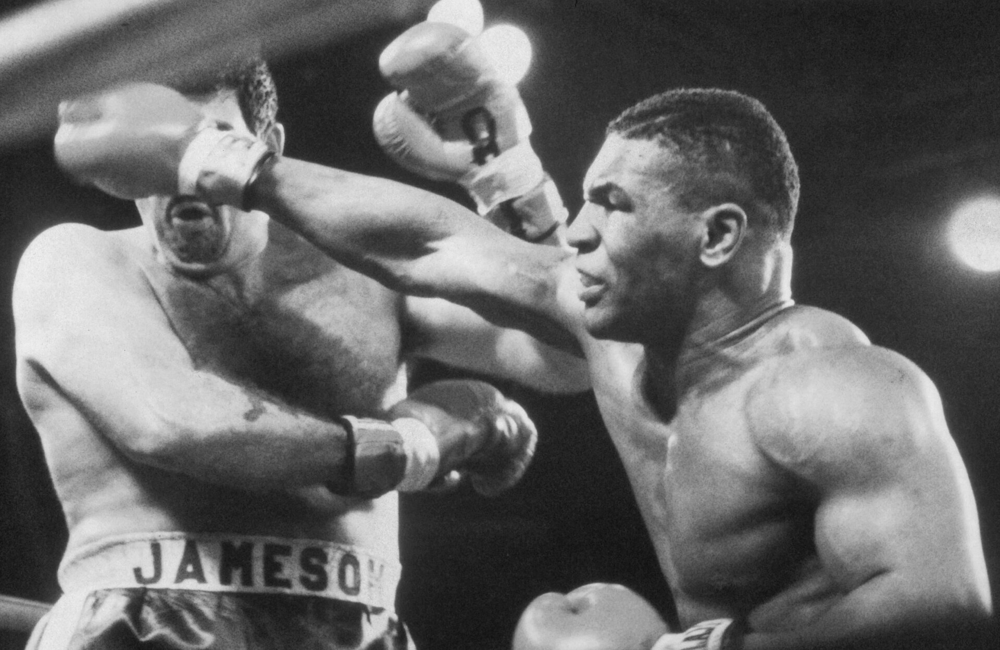
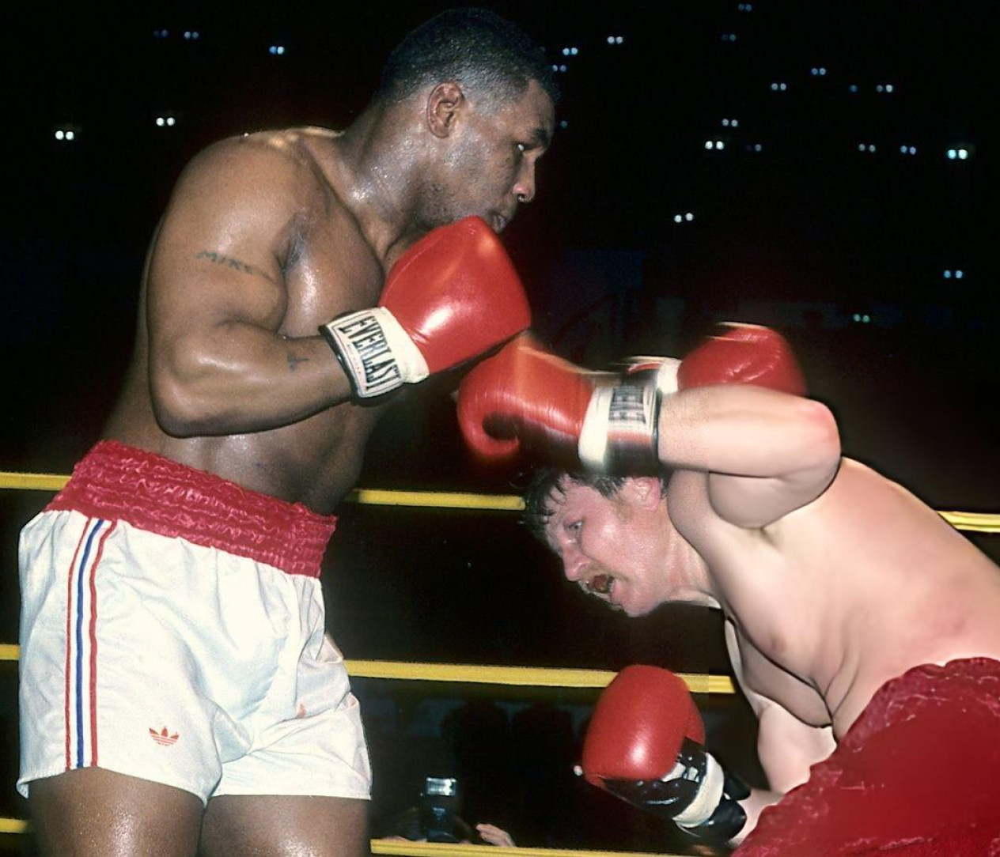
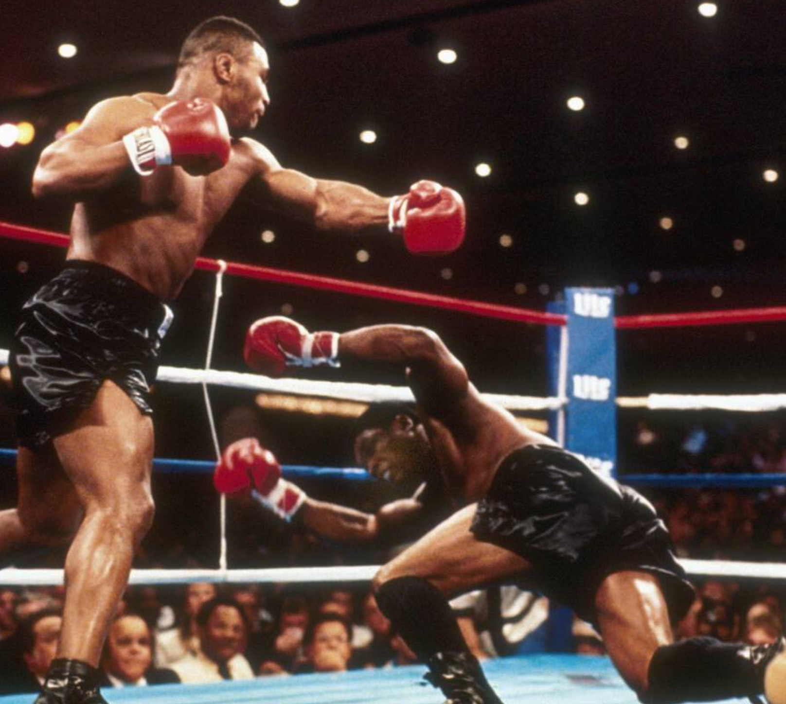

40 years ago today, November 22, 1986, twenty-year-old Mike Tyson knocked out Trevor Berbick in Las Vegas to capture the WBC heavyweight title. With that second-round victory, the Brooklyn native broke Floyd Patterson's long-standing record and became the youngest world heavyweight champion in boxing history.

## The Rise of Kid Dynamite

Born in Brooklyn in June 1966, Michael Gerard Tyson endured a difficult childhood marked by poverty, street fights, and dozens of arrests before his boxing talent was discovered at the Tryon School for Boys by Bobby Stewart. Stewart introduced the young fighter to legendary trainer and manager Cus D'Amato, who took legal guardianship of Tyson after his mother died. Trained by D'Amato and Kevin Rooney, Tyson developed an aggressive, peek-a-boo style inspired by Sonny Liston's ferocious power and intimidating ring presence.

After winning gold at the 1981 and 1982 Junior Olympic Games and taking the National Golden Gloves title in 1984, Tyson made his professional debut in Albany, New York, on March 6, 1985. He stopped Hector Mercedes in the opening round and fought at an astonishing pace, appearing in fifteen bouts during his first calendar year as a pro. Tyson won his first nineteen professional fights by knockout, finishing twelve of them in the very first round.

## A Seasoned Champion Across the Ring

By late 1986, Tyson owned a record that included twenty-six knockout victories in twenty-eight fights, dispatching tough contenders and fringe challengers alike. The stage was set for his first world title shot against Trevor Berbick, the reigning World Boxing Council heavyweight champion. Berbick, born in Jamaica, had built a rugged reputation over a decade in the division.

Berbick held unique distinctions in boxing lore. In 1981, he defeated Muhammad Ali by unanimous decision in the final bout of Ali's legendary career. Five years later, on March 22, 1986, Berbick upset Pinklon Thomas over twelve brutal rounds to win the WBC belt. Entering his first title defense against Tyson in Las Vegas, Berbick was determined to halt the hype surrounding the twenty-year-old challenger.

*Mike Tyson vs Mike Jameson — Photo: Kevin McManus / Public domain*

## Two Rounds of Relentless Destruction

When the bell rang on the night of November 22, Tyson immediately closed the distance, bobbing beneath Berbick's reach and firing heavy hooks to the body and head. Berbick tried to establish his physical presence, but Tyson's hand speed and punching power pushed the champion backward from the start.

The climax arrived swiftly in the second round. Early in the frame, Tyson connected with a sharp combination that sent Berbick down for a quick knockdown. Berbick beat the count, but Tyson showed no hesitation, trapping the champion along the ropes and landing punishing combinations. Late in the round, a short left hook found Berbick's temple, sending him crashing heavily to the canvas.

*Tyson vs Steve Zouski — Photo: Bill Apter / Public domain*

## The Scene That Shook Las Vegas

What followed became one of the most famous images in modern boxing. Berbick attempted to rise immediately, but his equilibrium was completely shattered. He stumbled backward, tumbled into the ropes, and fell back down. Gathering himself once more, Berbick pushed up again, only to lose his balance and crash to the floor a third time.

Seeing that Berbick could not control his legs, referee Mills Lane stepped in, waved his arms, and officially halted the contest. At two minutes and thirty-five seconds of the second round, the fight was over. Tyson raised his arms in victory, surrounded by cornermen Kevin Rooney and his team, having fulfilled the destiny Cus D'Amato had mapped out years earlier.

*Archive, 1986 — Photo: Jeff Robins, Associated Press / Public domain*

## From Young Phenom to Undisputed Champion

At 20 years, 4 months, and 22 days old, Tyson shattered the record previously held by Floyd Patterson to become the youngest heavyweight champion boxing had ever seen. The victory launched a period of complete dominance over the heavyweight division. Tyson went on to capture the WBA belt and the IBF title, becoming the first heavyweight to hold all three major belts simultaneously and unifying them in succession.

Tyson remained undisputed champion until 1990, delivering highlight knockouts including his 91-second demolition of Michael Spinks. Inducted into both the International Boxing Hall of Fame and the World Boxing Hall of Fame, Tyson finished his career celebrated as one of the hardest punchers in sports history. Four decades after that night in Las Vegas, no fighter has ever claimed the heavyweight crown at a younger age.

### Sources

- <https://en.wikipedia.org/wiki/Mike_Tyson>
- <https://commons.wikimedia.org/wiki/File:Mike_Tyson_and_Don_King_after_the_match_against_Trevor_Berbick_(cropped).jpg>
- <https://commons.wikimedia.org/wiki/File:Mike_Tyson_vs_Mike_Jameson.jpg>
- <https://commons.wikimedia.org/wiki/File:Tyson_vs_Steve_Zouski.jpg>
- <https://commons.wikimedia.org/wiki/File:Mike_Tyson_vs._Trevor_Berbick.jpg>
