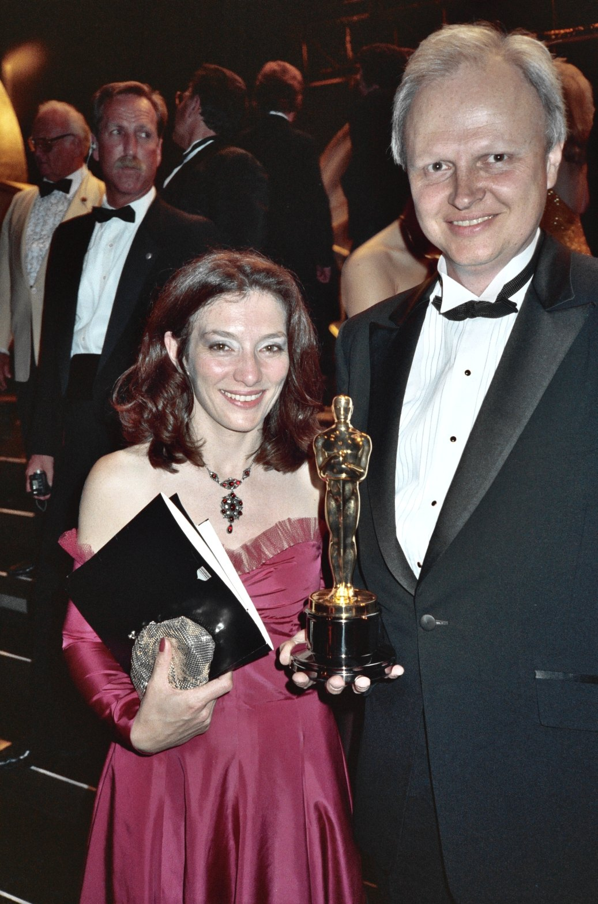
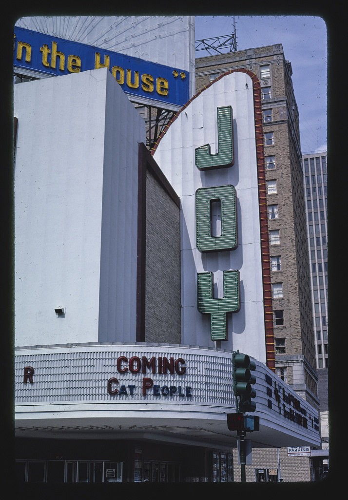
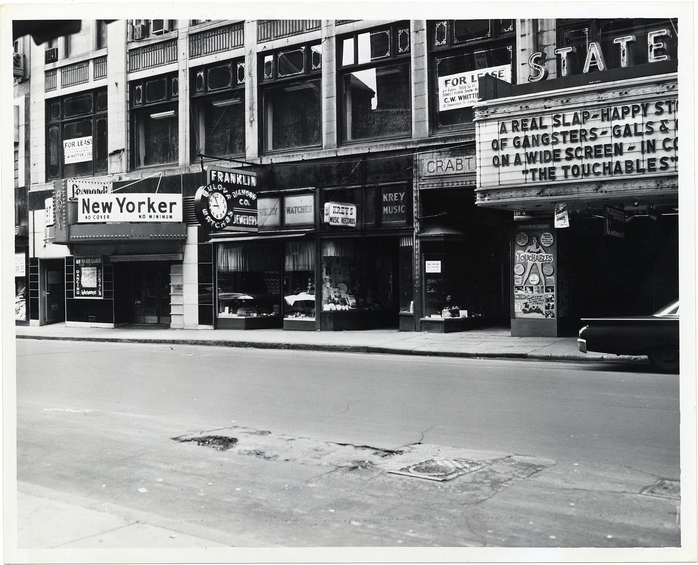

31 years ago today, November 22, 1995, movie theaters across the United States premiered Toy Story. It was the world's very first entirely computer-animated feature film, marking an extraordinary leap forward in cinema history.

## From Computer Science Labs to the Silver Screen

The technology behind Toy Story was decades in the making. The roots of Pixar traced back to 1974, when New York Institute of Technology founder Alexander Schure created the Computer Graphics Lab to pursue the dream of making a computer-animated film. Key computer scientists like Edwin Catmull and Alvy Ray Smith joined the effort, later moving to Lucasfilm in 1979 to establish its Graphics Group. In February 1986, the group was spun off as an independent corporation funded by Apple co-founder Steve Jobs, taking the name Pixar. Utilizing custom tools including their RenderMan software, Pixar produced innovative short films that proved computers could convey genuine emotion.

## A Near-Fatal Production Crisis

Following the acclaim of Pixar's 1988 short film Tin Toy, Walt Disney Pictures approached the fledgling studio to produce a full-length feature told from a toy's perspective. Director John Lasseter, alongside writers Andrew Stanton and Pete Docter, set to work on early treatments. However, Disney executives requested an edgier tone, resulting in harsh character dynamics and disastrous story reels. Disney shut down production, placing the entire future of the studio at stake. Lasseter and his team refused to give up, completely overhauling the screenplay alongside Joss Whedon, Joel Cohen, and Alec Sokolow to focus on a core emotional premise: that toys exist purely out of a heartfelt desire to be loved and played with by children.

*Unknown woman and man stand with statuette at 1988 Academy Awards — Photo: Alan Light / CC BY 2.0*

## The Rivalry of Woody and Buzz Lightyear

The revamped story centered on Andy Davis, a young boy preparing to move to a new home around his sixth birthday. Andy's favorite toy, a vintage pull-string cowboy named Sheriff Woody, voiced by Tom Hanks, suddenly finds his status threatened by a high-tech space cadet action figure named Buzz Lightyear, voiced by Tim Allen. The comedy and tension deepened because Buzz genuinely believed he was a real Space Ranger rather than a plastic toy. Backed by a memorable supporting cast featuring Annie Potts, John Ratzenberger, Don Rickles, Wallace Shawn, and Jim Varney, the film balanced sharp wit with tender sincerity.

*Joy Theater marquee, Canal Street, New Orleans, Louisiana (LOC) — Photo: The Library of Congress / Public domain*

## Box Office Triumph and Critical Acclaim

Toy Story held its premiere at the El Capitan Theatre in Los Angeles on November 19, 1995, before opening nationwide on November 22 just ahead of Thanksgiving. The film set a record for the highest-grossing opening weekend of its time and went on to gross more than $363 million worldwide. It concluded its run as the second highest-grossing movie of 1995. Critics universally praised its innovative visual rendering, Randy Newman's music—including the anthem 'You've Got a Friend in Me'—and the chemistry between Hanks and Allen. It earned a rare 100% approval rating on Rotten Tomatoes and received three Academy Award nominations, becoming the first animated movie ever nominated for Best Original Screenplay.

*Street scene of downtown Boston showing the New Yorker Lounge, a Jeweler, and a movie theater marquee (12777786333) — Photo: City of Boston Archives from West Roxbury, United States / CC BY 2.0*

## An Enduring Legacy in American Cinema

The triumph of Toy Story transformed Pixar into an animation powerhouse and fundamentally shifted the landscape of modern Hollywood moviemaking. In recognition of its breakthrough technical achievement, John Lasseter was awarded a Special Achievement Academy Award. In 2005, the Library of Congress selected Toy Story for preservation in the United States National Film Registry as culturally, historically, or aesthetically significant. Decades after Woody and Buzz first tumbled out of Andy's window, the film remains a beloved landmark that reshaped the dreams of animators and audiences around the world.

### Sources

- <https://en.wikipedia.org/wiki/Toy_Story>
- <https://pixabay.com/photos/film-reel-movie-reel-retro-vintage-932154/>
- <https://commons.wikimedia.org/wiki/File:Unknown_woman_and_man_stand_with_statuette_at_1988_Academy_Awards.jpg>
- <https://commons.wikimedia.org/wiki/File:Joy_Theater_marquee,_Canal_Street,_New_Orleans,_Louisiana_(LOC).jpg>
- <https://commons.wikimedia.org/wiki/File:Street_scene_of_downtown_Boston_showing_the_New_Yorker_Lounge,_a_Jeweler,_and_a_movie_theater_marquee_(12777786333).jpg>
