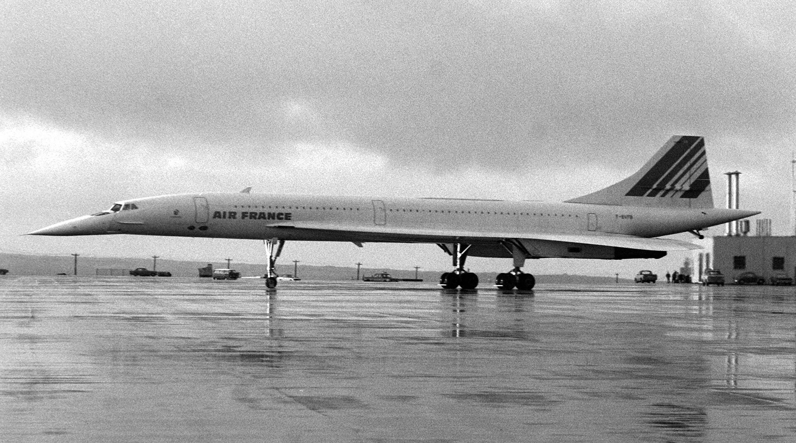
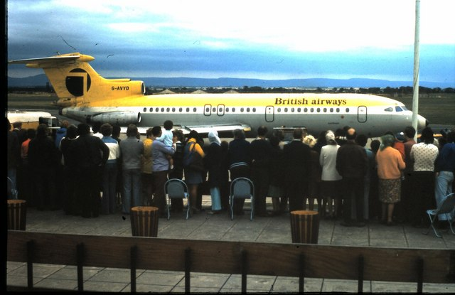
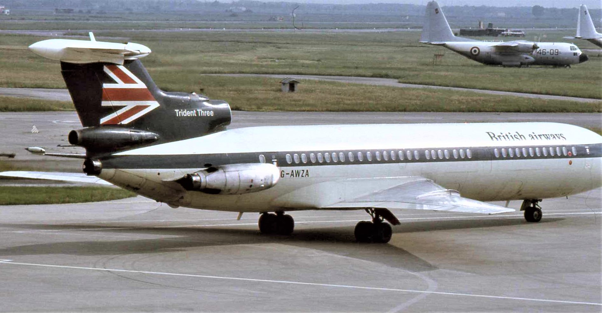

49 years ago today, November 22, 1977, British Airways inaugurated regular London to New York City supersonic Concorde service. The launch established a scheduled transatlantic supersonic connection that drastically reduced travel time between the United Kingdom and the United States, marking a historic pinnacle in commercial aviation.

## The Dawn of Commercial Supersonic Travel

The Concorde was developed as the world's first supersonic passenger aircraft, operated jointly in commercial service by British Airways and Air France. Its scheduled commercial passenger operations officially commenced on January 21, 1976, when British Airways took off from London Heathrow bound for Bahrain. That flight demonstrated that civilian passengers could cruise at supersonic velocities in regular airline operations, opening up a new frontier for long-distance international travel.

## Pioneering Routes to the United States

Securing access to transatlantic routes across the North Atlantic was vital to the commercial viability of the Concorde program. Commercial service to the United States officially commenced on May 24, 1976, with flights landing at Washington Dulles. Flights toward New York's John F. Kennedy International Airport followed, setting the stage for the formal inauguration of regular scheduled service between London and New York City on November 22, 1977. In addition to North American service, British Airways also established Concorde flights to Singapore in co-operation with Singapore Airlines as an extension of the Bahrain route.

*Concorde 1977 (cropped) — Photo: PH3 Caffaro / Public domain*

## The Evolution of British Airways

The airline operating the British Concorde had a long corporate lineage dating back to five pioneering air carriers established between 1916 and 1922. The earliest among them, Aircraft Transport & Travel, launched the world's first daily international commercial air service between London and Paris on August 25, 1919. Successive mergers created two major state-owned carriers: the British Overseas Airways Corporation (BOAC) in 1939 and British European Airways (BEA) in 1947. Following the recommendations of the 1969 Edwards Report, the UK government established the British Airways Board on April 1, 1972, bringing BOAC, BEA, Cambrian Airways, and Northeast Airlines under single management, before fully unifying under the British Airways name on March 31, 1974.

*Archive, 1974 — Photo: Stanley Howe / CC BY-SA 2.0*

## Connecting Two World Financial Capitals

The supersonic London-to-New York corridor connected two of the planet's most influential metropolitan centers. London, home to the British government at Westminster and an ancient commercial core along the River Thames, operated the world's busiest city airport system centered at Heathrow. On the western side of the Atlantic, New York City, anchored by Wall Street in Lower Manhattan and its expansive natural harbor, stood as the financial and cultural capital of the United States. Concorde tied these two alpha global cities together so efficiently that British Airways eventually became the first passenger airline in history to generate over US$1 billion on a single air route in a single year.

*Archive, 1975 — Photo: Piergiuliano Chesi / CC BY-SA 3.0*

## Privatization and Commercial Expansion

During the 1980s, British Airways underwent profound changes under the Thatcher government. In 1981, Sir John King was appointed chairman to guide the airline toward commercial profitability, and the carrier was privatized and floated on the London Stock Exchange in February 1987. BA expanded aggressively by acquiring British Caledonian in July 1987, Dan-Air in 1992, and a 49% stake in TAT European Airlines in 1993, while also launching British Asia Airways and investing in Qantas. In September 1998, British Airways co-founded the global Oneworld airline alliance alongside American Airlines, Canadian Airlines, Cathay Pacific, and Qantas, solidifying its place at the top of international aviation.

## The Retirement of the Supersonic Flagship

Despite its status as an engineering wonder and elite corporate symbol, the Concorde fleet faced insurmountable economic and operational challenges around the turn of the century. Following the tragic crash of Air France Flight 4590 and the global downturn in air travel after the September 11 attacks, British Airways made the formal decision to cease Concorde operations. After 27 years of supersonic passenger service, the final commercial Concorde flight, BA002, departed New York JFK and touched down at London Heathrow on October 24, 2003, bringing an end to the era of scheduled transatlantic supersonic flight.

### Sources

- <https://en.wikipedia.org/wiki/British_Airways>
- <https://commons.wikimedia.org/wiki/File:Concorde_1977.jpg>
- <https://commons.wikimedia.org/wiki/File:Concorde_1977_(cropped).jpg>
- <https://commons.wikimedia.org/wiki/File:Northeast_Airlines_Trident_1E_at_Teesside_Airport_(1974)_-_geograph.org.uk_-_852594.jpg>
- <https://commons.wikimedia.org/wiki/File:British_Airways_Trident_Three_G-AWZA.jpg>
