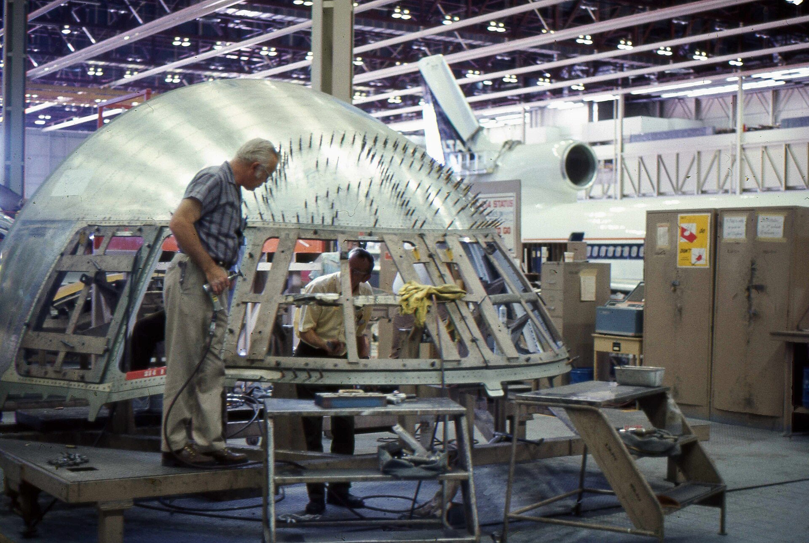
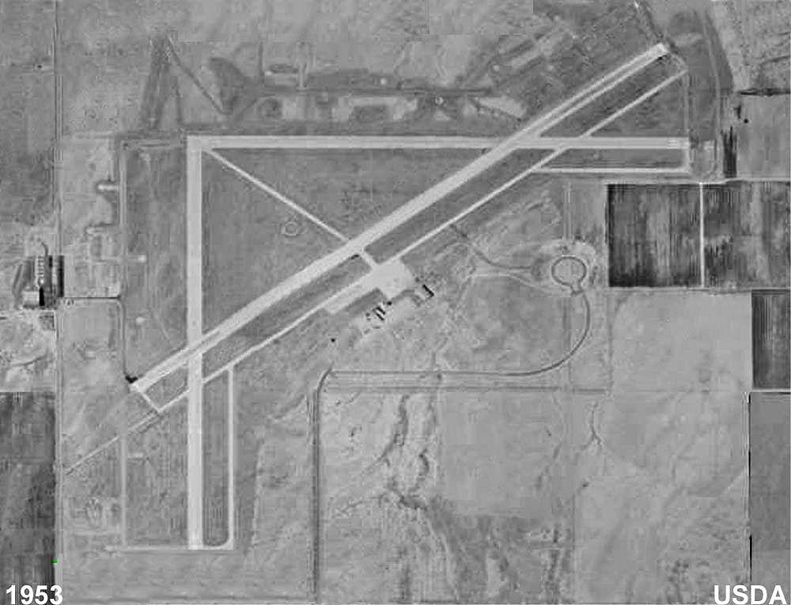
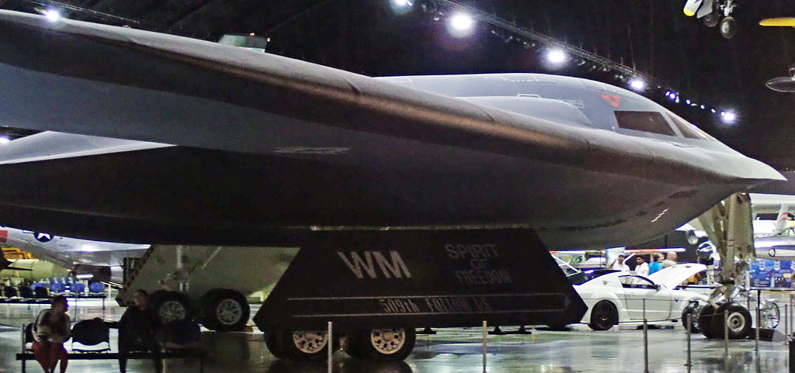

38 years ago today, November 22, 1988, crowds gathered at United States Air Force Plant 42 in Palmdale, California, to witness military history. For the first time, the United States Air Force publicly rolled out the prototype of the B-2 Spirit stealth bomber, ending nearly a decade of intense Cold War secrecy.

## A Secret Born in the Cold War

The origins of the B-2 Spirit began in the mid-1970s, when military aircraft designers identified new concepts to defeat hostile radar systems. In 1974, DARPA requested technical information from American aviation firms regarding aircraft radar cross-sections that could stay virtually invisible to detection networks. By building airframes with specialized geometry to deflect radar signals and coating surfaces with radar-absorbing materials, an aircraft could slip through defensive shields that relied on radar tracking.

In 1979, the Carter administration formally launched the Advanced Technology Bomber program as a highly classified black project. The promise of this revolutionary stealth technology contributed directly to the cancellation of the Mach 2-capable B-1A bomber program. For years, engineers worked in deep security, aiming to deliver a nuclear-capable strategic bomber that could penetrate the most sophisticated air defenses of the Soviet Union.

## Palmdale: The Stage for the Rollout

The setting for the bomber's historic debut was Palmdale, California, a desert community located in northern Los Angeles County's Antelope Valley. Separated from the Los Angeles Basin by the San Gabriel Mountains, Palmdale had transformed over decades from an agricultural settlement into a renowned aviation center.

In 1952, the federal government purchased the local airport and established United States Air Force Plant 42. Major aerospace companies, including Lockheed in 1953, established manufacturing and flight test facilities in the valley. Known widely as the Aerospace Capital of America, Palmdale provided the specialized security, vast hangars, and runway infrastructure needed to bring the military's most classified aerospace project into public view.

*Lockheed Palmdale 02 — Photo: Piergiuliano Chesi / CC BY-SA 3.0*

## The Mysterious Flying Wing Emerges

On November 22, 1988, hangar doors at Plant 42 opened to reveal an aircraft unlike anything the public had ever seen. The B-2 Spirit discarded the traditional aircraft profile of a central fuselage and vertical tailfins. Instead, it was designed as a sleek, four-engined flying wing featuring a distinctive lambda wing geometry.

Prime contractor Northrop had developed the bomber alongside principal subcontractors Boeing, Hughes Aircraft Company, and Vought. Operated by a flight crew of two to three, the subsonic aircraft was engineered to deliver massive firepower while presenting minimal radar reflection. It was built to carry conventional and thermonuclear payloads, including up to eighty 500-pound class Mk 82 GPS-guided bombs or sixteen 400-kiloton B61 nuclear bombs.

*Palmdale Army Airfield - California — Photo: United States Department of Agriculture / Public domain*

## Budget Battles and a Shrinking Fleet

Despite its technological achievements, the B-2 project faced intense political debate. Technical hurdles caused delays, and the megaproject's immense development and operating costs drew heavy scrutiny from lawmakers in the United States Congress.

Originally, the Air Force intended to purchase 132 stealth bombers. However, the end of the Cold War significantly diminished the strategic need for deep nuclear penetration strikes inside the former Soviet Union. By the 1990s, Congress reduced the total production run to just 21 aircraft. By 1996, the total program cost reached $44.7 billion, representing an average cost of $2.13 billion per aircraft, which included research, testing, development, and production.

*United States Air Force - Northrop Grumman B-2 Spirit Stealth Bomber 18 — Photo: James St. John / CC BY 2.0*

## Global Reach and Combat Operations

The B-2 officially entered operational service in 1997, becoming the nation's second operational stealth aircraft after the Lockheed F-117 Nighthawk. The bomber boasted formidable flight capabilities, including a service ceiling of 50,000 feet, an unrefueled flight range exceeding 6,900 miles, and the ability to fly more than 12,000 miles with a single midair refueling.

Although conceived primarily as a strategic nuclear deterrent, the B-2 made its combat debut delivering conventional munitions during the Kosovo War in 1999. In the decades that followed, the aircraft flew long-range combat missions in Iraq, Afghanistan, Libya, and Yemen, as well as strikes on Iran in 2025 and operations in the 2026 Iran war.

## The Stealth Legacy Today

Headquartered at Whiteman Air Force Base in Missouri, the B-2 fleet utilizes specialized climate-controlled hangars, with operational deployments extending to RAF Fairford in the United Kingdom, Andersen Air Force Base on Guam, and Naval Support Facility Diego Garcia in the Indian Ocean.

Of the 21 airframes originally built, 19 remained in military service as of 2024, following a crash in 2008 and a subsequent retirement after accident damage in 2022. The Air Force intends to keep these iconic bombers operational until 2032, when they will be replaced by the Northrop Grumman B-21 Raider. Decades after that November morning in Palmdale, the B-2 remains an enduring symbol of American stealth aviation.

### Sources

- <https://en.wikipedia.org/wiki/Palmdale%2C_California>
- <https://commons.wikimedia.org/wiki/File:B2_bomber_initial_rollout_ceremony_1988.jpg>
- <https://commons.wikimedia.org/wiki/File:Lockheed_Palmdale_02.jpg>
- <https://commons.wikimedia.org/wiki/File:Palmdale_Army_Airfield_-_California.jpg>
- <https://www.flickr.com/photos/47445767@N05/53992017843>
