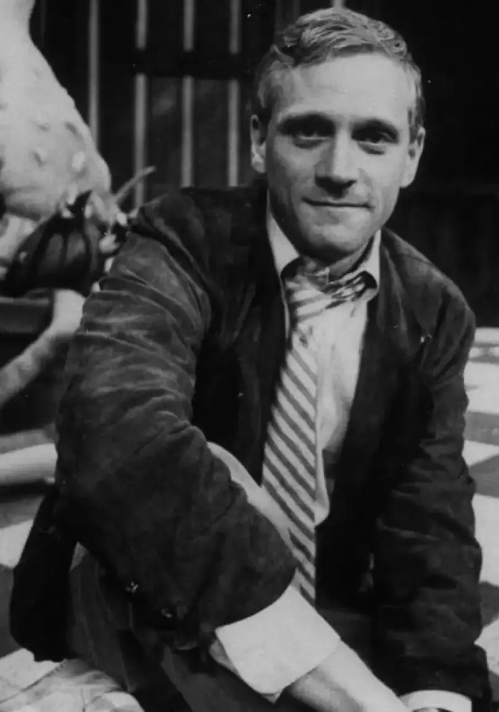
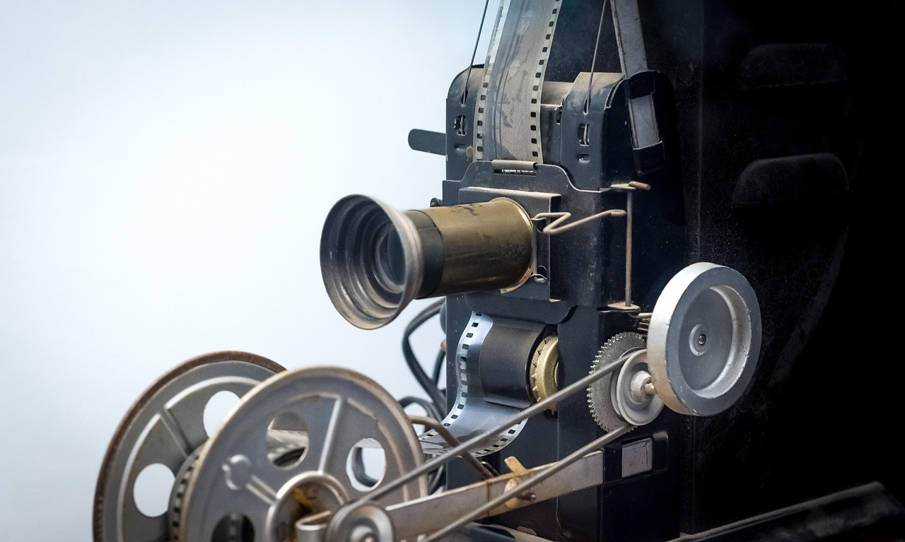

35 years ago today, November 22, 1991, Walt Disney Feature Animation released Beauty and the Beast in theaters nationwide. The studio's 30th animated feature film swept across the country, captivating both family audiences and serious film critics alike.

## A Decades-Long Vision Finally Realized

Walt Disney had originally explored adapting the classic French fairy tale 'Beauty and the Beast' into an animated project during the 1930s, and then reconsidered it during the 1950s. On both occasions, story teams struggled to find an approach that worked for the screen, and the concept was set aside. Following the breakout success of The Little Mermaid in 1989, the studio revived the idea and hired Richard Purdum to create a non-musical period adaptation. However, Disney executive Jeffrey Katzenberg was dissatisfied with that early dramatic treatment and ordered the entire project dismantled and rebuilt from the ground up.

## The Musical Genius of Ashman and Menken

Katzenberg decided that the story needed to follow the musical tradition of Broadway. He enlisted the lyricist Howard Ashman and composer Alan Menken, who had already revitalized Disney animation with their vibrant songs for The Little Mermaid. First-time directors Gary Trousdale and Kirk Wise stepped in to guide the production, working alongside screenwriter Linda Woolverton. Under Woolverton's pen, Beauty and the Beast became the very first Disney animated film developed from a completed screenplay prior to the storyboarding phase. Ashman worked closely with the creative team to give each character a distinct musical identity, even as his health was failing. Ashman died from complications of AIDS in March 1991, eight months before the movie hit theaters, and the finished film closed with an emotional dedication honoring his gift.

*NOT FROM THE EVENT · 1987 — Photo: Larry Crewell / Public domain*

## Groundbreaking Technology and the Grand Ballroom

Beyond its storytelling and score, Beauty and the Beast represented an immense technological leap for the studio. It was only the second feature film produced using Disney's Computer Animation Production System, known as CAPS. This system allowed animators to seamlessly integrate traditional, hand-drawn character artwork with three-dimensional computer-generated environments. The crowning achievement of this process was the ballroom dance sequence, where Belle, voiced by Paige O'Hara, and the Beast, voiced by Robby Benson, sweep across an ornate, digitally rendered hall while Angela Lansbury sings the title song. The swooping camera angles and shimmering chandelier stunned audiences who had never seen hand-drawn animation move with such cinematic freedom.

*Not a photo of the event itself · NOT FROM THE EVENT · Stock image — Photo: ClickerHappy / Pixabay Content License*

## A Box Office Sensation That Rewrote the Rules

An unfinished work-in-progress version of the film had already received a standing ovation when it screened at the New York Film Festival on September 29, 1991. When the completed movie officially opened in wide release on November 22, lines wrapped around city blocks. The film earned 331 million dollars worldwide during its original theatrical run, finishing as the third highest-grossing film of 1991 across any genre. Crucially, it became the first animated movie ever to surpass 100 million dollars in domestic box office ticket sales in the United States, proving that animation could stand shoulder to shoulder with Hollywood's biggest live-action blockbusters.

*Not a photo of the event itself · NOT FROM THE EVENT · Stock image — Photo: niekverlaan / Pixabay Content License*

## Historic Academy Award Recognition

The critical reception for Beauty and the Beast reached unprecedented heights during the 1991 awards season. It took home the Golden Globe Award for Best Motion Picture in the Musical or Comedy category, becoming the first animated feature to earn that honor. Even more remarkably, when the Academy of Motion Picture Arts and Sciences announced its nominations, Beauty and the Beast secured a spot in the prestigious Best Picture lineup. Up to that point in Oscar history, no animated production had ever received a Best Picture nomination. The feat cemented animation as a sophisticated art form capable of competing directly with traditional cinema.

## A Lasting Legacy in American Popular Culture

The legacy of Beauty and the Beast only expanded in the years following its 1991 release. Subsequent special re-releases in IMAX in 2002 and in 3D in 2012 eventually lifted its worldwide box office haul to 451 million dollars. Supporting voice performances from Jerry Orbach as Lumiere, David Ogden Stiers as Cogsworth, and Richard White as the villain Gaston helped cement the characters as permanent fixtures of American entertainment. Today, thirty-five years after Belle and the Beast first arrived on theater screens, the film stands as an enduring milestone that transformed Hollywood animation forever.

### Sources

- <https://en.wikipedia.org/wiki/Walt_Disney_Animation_Studios>
- <https://commons.wikimedia.org/wiki/File:Howard_Ashman_on_set_of_Little_Shop_of_Horrors.webp>
- <https://commons.wikimedia.org/wiki/File:Howard_Ashman_on_set_of_Little_Shop_of_Horrors_(cropped).webp>
- <https://pixabay.com/photos/film-35mm-vintage-projector-1365334/>
- <https://pixabay.com/photos/projector-film-exhibition-show-422145/>
