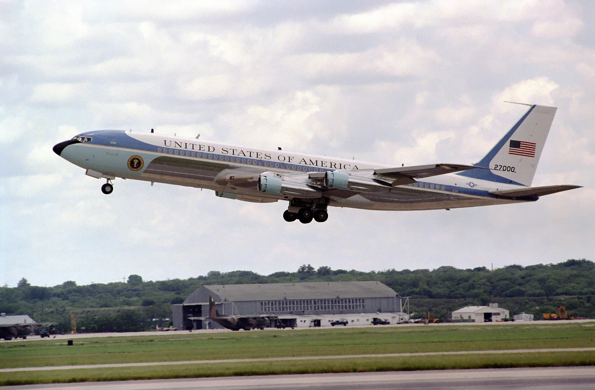
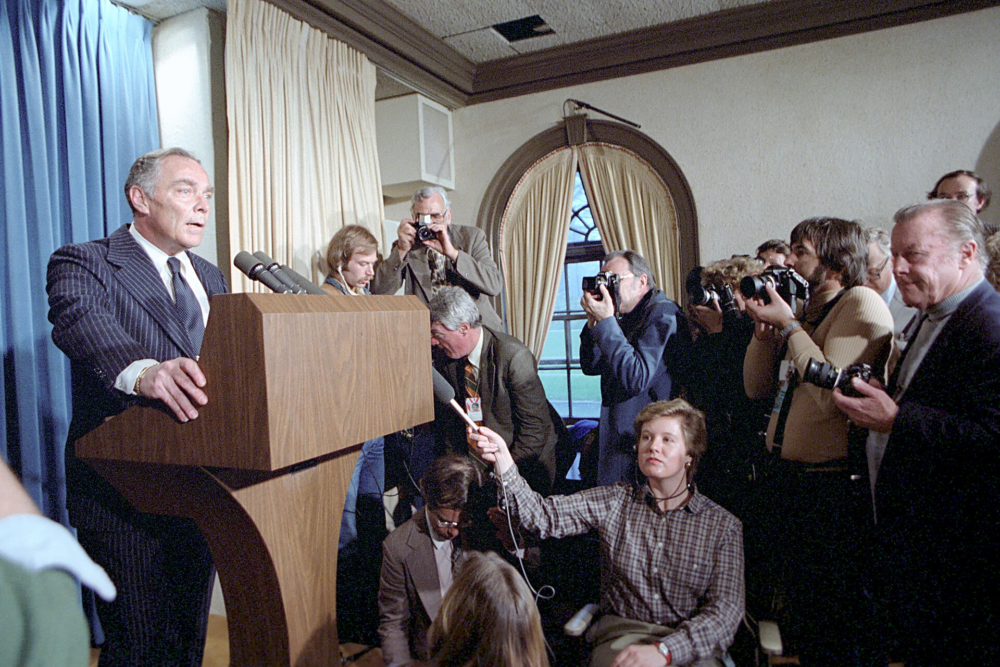
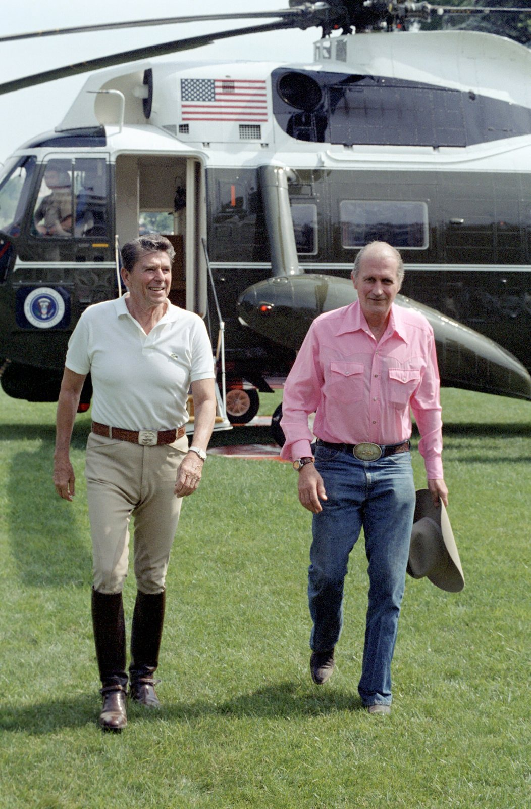

45 years ago today, November 23, 1981, President Ronald Reagan signed top-secret National Security Decision Directive 17. The classified order granted the Central Intelligence Agency the formal authority to recruit, finance, and equip Contra rebels fighting against the Sandinista government in Nicaragua, inaugurating a clandestine campaign that would later shake American governance to its core.

## A New Cold War Front in Central America

When Ronald Reagan assumed the presidency on January 20, 1981, his foreign policy team sought a firm shift away from Cold War détente. In Latin America, the administration watched with deep apprehension as the Sandinista revolutionary movement consolidated power in Nicaragua. In response, armed anti-Sandinista factions known as the Contras began staging cross-border guerrilla incursions from camps in neighboring Honduras.

To the White House, supporting the Contras was seen as an essential line of defense against the spread of Soviet and Cuban influence in the Western Hemisphere. National Security Decision Directive 17, finalized on November 23, 1981, transformed that strategic priority into covert action, handing CIA operatives the mandate and resources to organize Contra fighters into a formidable paramilitary force.

## Congress Draws the Line with the Boland Amendments

As covert operations expanded throughout Central America, lawmakers on Capitol Hill grew alarmed over unchecked executive intervention abroad. Seeking to prevent the United States from becoming entangled in an undeclared foreign conflict, Congress intervened by passing legislative restrictions known as the Boland Amendments between 1982 and 1984.

The most stringent restriction, the second Boland Amendment, took effect in October 1984. It flatly barred the CIA, the Department of Defense, or any other intelligence agency from expending appropriated funds to directly or indirectly support military or paramilitary activities in Nicaragua. Stripped of official congressional appropriations, the administration's program faced an immediate operational dead end.

*Air Force One Taking Off from Kelly Air Force Base in San Antonio During Trip to Texas - DPLA - 1b101acfb1172639831ddcf92011855e — Photo: President (1981-1989 : Reagan). White House Photographic Off / Public domain*

## The Covert Pipeline to Tehran

Faced with strict legislative prohibitions, senior national security officials chose not to abandon the Contras, but rather to sustain them through secret, non-appropriated funding streams. This illicit financial mechanism soon collided with another pressing foreign policy crisis in the Middle East, where seven American hostages were being held captive in Lebanon by Hezbollah, an Iranian-backed militant group.

Despite having championed Operation Staunch in 1983 to prevent international arms transfers to Iran during its war with Iraq, the administration pursued back-channel overtures proposed by Iranian arms dealer Manucher Ghorbanifar. Officials secretly arranged clandestine shipments of American weapons and spare parts to Tehran in exchange for assistance in releasing American hostages, then diverted the cash profits directly into secret accounts earmarked for the Nicaraguan Contras.

*Alexander Haig Speaking at Podium with During Remarks on The Assassination Attempt and The President'S Health with The Press in The Press Room - DPLA - 2e26526ea869945851fc84ffee0491d8 — Photo: President (1981-1989 : Reagan). White House Photographic Off / Public domain*

## Exposure and Congressional Reckoning

The highly compartmentalized operation collapsed in November 1986 when the Lebanese magazine Ash-Shiraa exposed the weapon deliveries to Iran. The revelations sparked an immediate international storm, forcing President Reagan to address the American public on national television. While Reagan initially maintained that the United States had not traded arms for hostages, investigators soon uncovered evidence of the illicit money trail linking Tehran and Central America.

In the West Wing, aides rushed to shred and withhold classified documents before federal investigators could secure them. In December 1986, Lawrence Walsh was appointed independent counsel to lead a sweeping criminal inquiry into the conspiracy, alongside parallel investigations conducted by congressional committees and the presidentially appointed Tower Commission.

*Arrival at White House of President and Malcolm Baldrige Aboard Helicopter Marine One After Trip to Marine Corps Air Facility Quantico Virginia After Horseback Riding - DPLA - 65d581b68b810959e00fe5ab7725d7fd — Photo: President (1981-1989 : Reagan). White House Photographic Off / Public domain*

## Indictments, Pardons, and the Legacy of NSDD-17

In a televised speech in March 1987, President Reagan accepted full responsibility for the fallout, conceding that what had begun as a strategic opening toward Iran had deteriorated into an exchange of arms for hostages. Over the subsequent years, Independent Counsel Walsh indicted several dozen administration figures, including Defense Secretary Caspar Weinberger and Lieutenant Colonel Oliver North. While eleven individuals were convicted, only one defendant served prison time, as appeals and last-minute presidential pardons issued by George H. W. Bush in late 1992 closed the legal chapter.

Independent Counsel Walsh delivered his final report in August 1993, detailing widespread deception and executive branch overreach. What ended as one of the most contentious constitutional crises of the late twentieth century began on this day in 1981, inscribed in a brief, top-secret directive meant to fight a hidden war in Central America.

### Sources

- <https://en.wikipedia.org/wiki/Iran%E2%80%93Contra_affair>
- <https://commons.wikimedia.org/wiki/File:President_Ronald_Reagan_Addresses_the_Nation_from_the_Oval_Office_on_Tax_Reduction_Legislation_-_DPLA_-_c671d512e3601137f56b068779ab6e2b.jpg>
- <https://commons.wikimedia.org/wiki/File:Air_Force_One_Taking_Off_from_Kelly_Air_Force_Base_in_San_Antonio_During_Trip_to_Texas_-_DPLA_-_1b101acfb1172639831ddcf92011855e.jpg>
- <https://commons.wikimedia.org/wiki/File:Alexander_Haig_Speaking_at_Podium_with_During_Remarks_on_The_Assassination_Attempt_and_The_President%27S_Health_with_The_Press_in_The_Press_Room_-_DPLA_-_2e26526ea869945851fc84ffee0491d8.jpg>
- <https://commons.wikimedia.org/wiki/File:Arrival_at_White_House_of_President_and_Malcolm_Baldrige_Aboard_Helicopter_Marine_One_After_Trip_to_Marine_Corps_Air_Facility_Quantico_Virginia_After_Horseback_Riding_-_DPLA_-_65d581b68b810959e00fe5ab7725d7fd.jpg>
