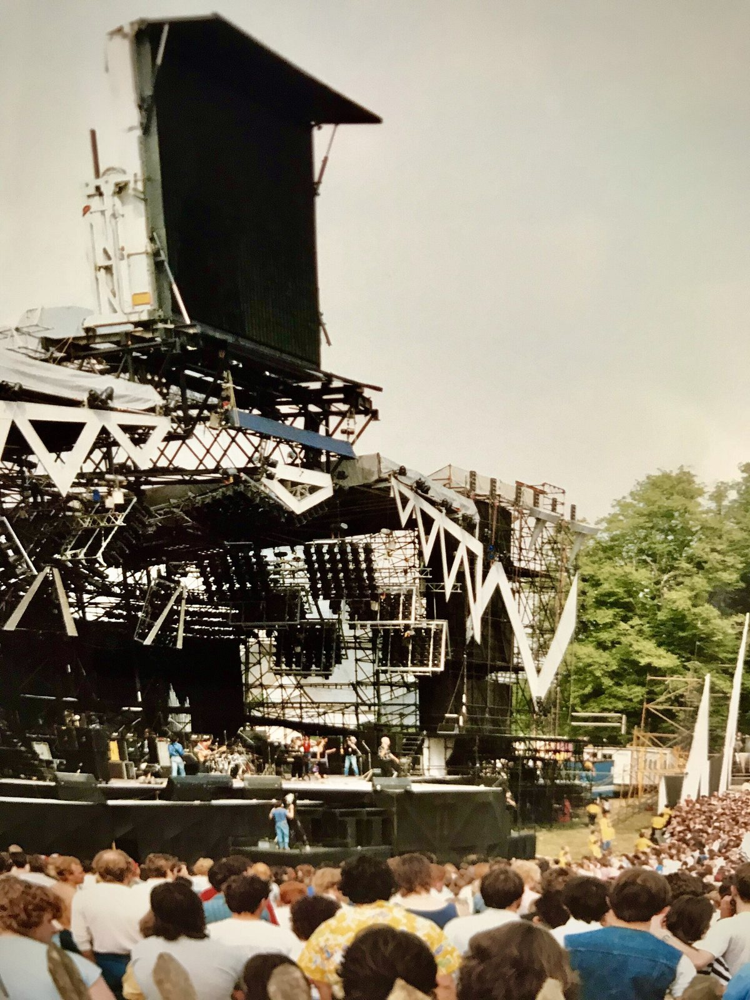
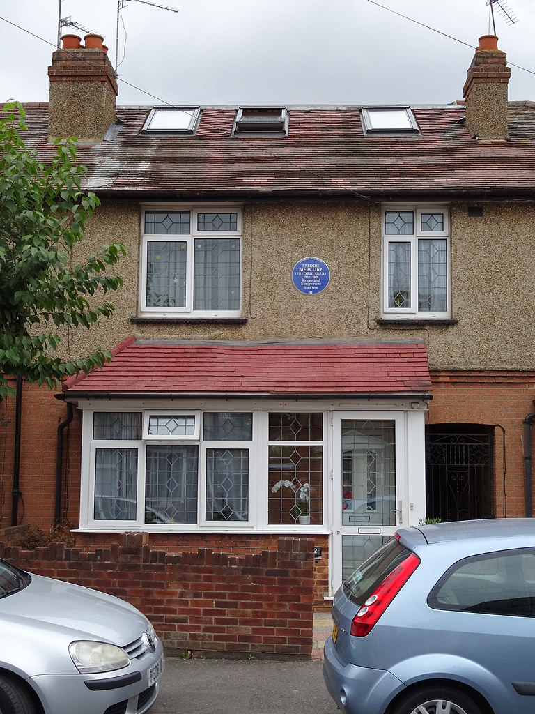
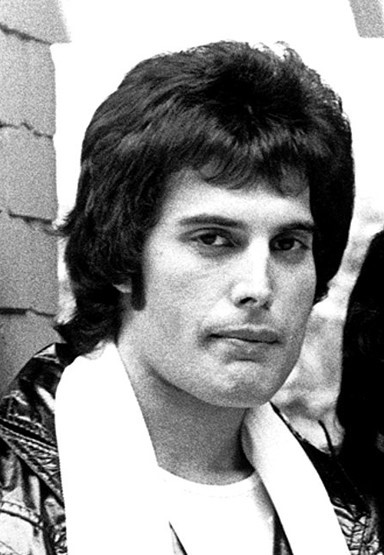

35 years ago today, on November 23, 1991, Freddie Mercury released an official statement to the world confirming that he had been diagnosed with AIDS. For years, the charismatic lead singer of Queen had kept his health condition strictly private, but on this day, he chose to address the public directly. Less than twenty-four hours after the statement was made public, the rock world was shattered when Mercury passed away at the age of 45.

## The Rise of Queen and a Global Frontman

Freddie Mercury, born Farrokh Bulsara in Zanzibar in 1946, moved to England with his family in 1964. In London in 1970, Mercury joined guitarist Brian May and drummer Roger Taylor, who had previously played together in the band Smile. With the addition of bassist John Deacon in February 1971, the classic Queen lineup was complete.

The band recorded their self-titled debut album during late-night downtime at Trident Studios and De Lane Lea Studios, releasing it in 1973. Through groundbreaking releases like Queen II and Sheer Heart Attack in 1974, and their 1975 masterpiece A Night at the Opera—which featured the nine-week UK number-one hit "Bohemian Rhapsody"—Queen transformed into an international sensation. Mercury's operatic four-octave vocal range, theatrical flair, and songwriting genius stood at the core of the band's artistic identity.

## Commanding the World's Biggest Stages

Throughout the late 1970s and 1980s, Queen became one of the biggest stadium rock acts in history. Their 1977 album News of the World introduced sports anthems "We Will Rock You" and "We Are the Champions," while the 1980 release The Game spawned "Another One Bites the Dust," which became their best-selling single.

Mercury's peerless ability to connect with audiences was celebrated worldwide. At the historic Live Aid concert in July 1985, Queen delivered a performance that has since been ranked among the greatest in rock history, commanding the vast Wembley crowd with effortless charisma. In August 1986, Mercury performed his final live concert with Queen at Knebworth in England, closing out an era of monumental stadium tours.

*NOT FROM THE EVENT · 1986 — Photo: Londonmusicinfo / CC BY-SA 4.0*

## A Secret Battle and the Statement of November 23

Behind closed doors, Mercury faced an agonizing battle. He was diagnosed with AIDS in 1987. Despite his declining physical condition, he chose to keep working in the studio, recording albums such as The Miracle in 1989 and Innuendo in 1991. The band protected his privacy fiercely as tabloid rumors swirled relentlessly around his health.

By late November 1991, Mercury felt the time had come to speak out. On November 23, he issued an official press release stating that he had tested HIV-positive and had AIDS. He explained that he had kept the information private to protect those around him, but expressed his hope that everyone would join him, his doctors, and the world in the fight against this terrible disease. The following day, November 24, 1991, Mercury died of bronchopneumonia, a complication of AIDS.

*NOT FROM THE EVENT — Photo: Spudgun67 / CC BY 2.0*

## Connection to American Listeners and Global Impact

For fans across the United States, Mercury's announcement and sudden passing brought profound shock. Queen's debut had been released in America on Elektra Records in September 1973, and American listeners had long embraced their boundary-pushing style. Their 1981 Greatest Hits compilation was certified 9× Platinum in the United States by the RIAA, demonstrating the massive footprint they held in American households.

Mercury's public acknowledgment came at a crucial time when the global AIDS epidemic was still surrounded by widespread stigma. By putting his name and legendary stature behind the battle, Mercury focused international attention on the urgent need for medical research, compassionate care, and public education.

*Freddie Mercury (1977 Press Kit Photo) — Photo: Christopher Hopper; distributed by Elektra Records / Public domain*

## An Enduring Legacy That Transcends Generations

In the spring of 1992, surviving bandmates Brian May and Roger Taylor organized a massive tribute concert at Wembley Stadium to honor Mercury's memory and raise funds for AIDS awareness. Queen's remaining recordings featuring Mercury's vocals were later compiled into the 1995 album Made in Heaven.

Today, Queen's worldwide record sales are estimated between 250 million and 300 million, making them one of the most successful musical acts of all time. Mercury was posthumously inducted into the Rock and Roll Hall of Fame in 2001, the Songwriters Hall of Fame in 2003, and the UK Music Hall of Fame in 2004. More than three decades after that solemn November day, Freddie Mercury's voice and theatrical spirit continue to inspire audiences around the globe.

### Sources

- <https://en.wikipedia.org/wiki/Queen_(band)>
- <https://commons.wikimedia.org/wiki/File:Konzert_Barcelona_1988.jpg>
- <https://commons.wikimedia.org/wiki/File:Belouis_Some_Knebworth_9_August_%2786._Queen_Magic_Tour_jpeg.jpg>
- <https://www.flickr.com/photos/24701549@N07/29428849595>
- <https://commons.wikimedia.org/wiki/File:Freddie_Mercury_(1977_Press_Kit_Photo).jpg>
