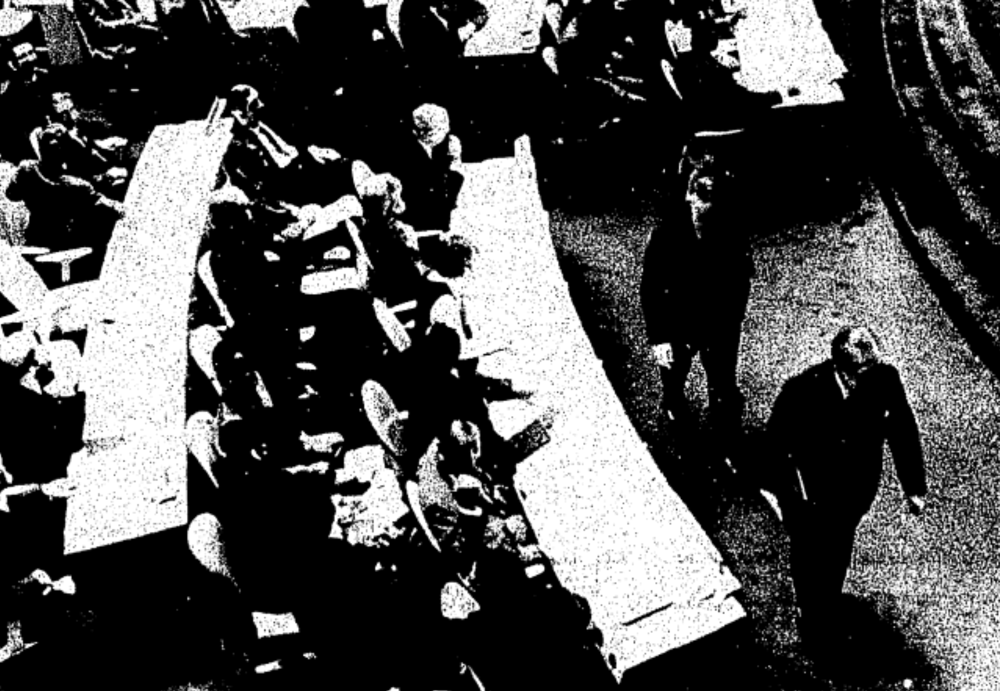
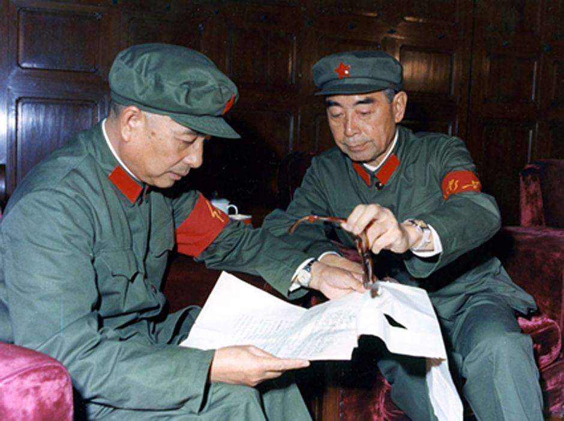
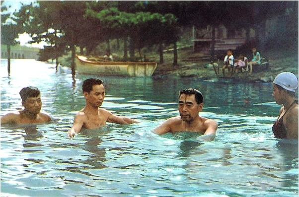

55 years ago today, on November 23, 1971, representatives of the People's Republic of China attended the United Nations Security Council for the very first time. Their appearance in the council chamber at United Nations headquarters in New York marked the culmination of a dramatic diplomatic shift that transformed global politics during the Cold War.

## Founding Seats and Postwar Realities

When the Charter of the United Nations was signed on 26 June 1945, the Republic of China was recognized as one of the victorious Allies of World War II. It joined the organization as an original member state and received one of five permanent seats on the United Nations Security Council, alongside the United States, the Soviet Union, the United Kingdom, and France. However, the resumption of the Chinese Civil War soon upended that arrangement.

In 1949, the Chinese Communist Party established the People's Republic of China on the mainland. The government of the Republic of China retreated to the island of Taiwan. Both governments claimed to be the only legitimate government of all China, establishing competing foreign policies that refused any form of dual representation in international organizations.

## Cold War Deadlock and the Fight for Recognition

The People's Republic of China began seeking recognition at the United Nations in the 1950s. Amid the tensions of the Cold War and the Korean War, the United States consistently opposed any attempt to replace the Republic of China with the People's Republic of China. Washington worked closely with its allies to keep Beijing out of the international assembly.

Over the years, resolutions to seat the People's Republic of China were introduced by member states including the Soviet Union, India, and Albania, but these motions were repeatedly defeated. In 1961, the General Assembly adopted Resolution 1668, requiring a two-thirds majority vote for any change in the representation of China. Even as countries such as Canada shifted bilateral recognition toward Beijing, the United States maintained its firm resistance.

*South China Morning Post 27 Oct 1971 — Photo: South China Morning Post / Public domain*

## Secret Overtures and Resolution 2758

The geopolitical dynamic altered substantially at the turn of the decade. Strained relations between Beijing and Moscow, known as the Sino-Soviet split, combined with the ongoing Vietnam War to create new strategic incentives. United States President Richard Nixon sought direct contact with Chinese Communist Party chairman Mao Zedong.

In 1971, National Security Advisor Henry Kissinger made a secret journey to visit Premier Zhou Enlai, opening high-level discussions between Washington and Beijing. Momentum at the United Nations shifted rapidly. On 25 October 1971, a resolution sponsored by 17 nations, led by Albania, was brought to the floor of the General Assembly. Known as General Assembly Resolution 2758, the motion recognized the People's Republic of China as the sole legitimate representative of China to the United Nations. The resolution passed, and the delegates of the Republic of China were formally expelled.

*Zhou Enlai and Tao Zhu 19660915 — Photo: 孟昭瑞 / Public domain*

## A First Appearance in the Council Chamber

Delegates from the People's Republic of China arrived in New York and were officially seated in the United Nations General Assembly on 15 November 1971. Just over a week later, on November 23, 1971, Chinese representatives took their places at the United Nations Security Council for the very first time.

The Security Council serves as the executive organ of the United Nations, with primary responsibility for maintaining international peace and security. Unlike General Assembly resolutions, Security Council decisions carry binding international authority under Chapter VII of the United Nations Charter. By taking the permanent seat, Beijing gained the authority to cast vetoes on substantive resolutions, giving the government direct influence over international sanctions, peacekeeping missions, and authorizations of force.

*Zhou Enlai studying swimming — Photo: Unknown authorUnknown author / Public domain*

## The Strategic Repercussions for Washington

For the American public and political leaders, the seating of the People's Republic of China marked a fundamental turning point. Although Washington had opposed the expulsion of the Republic of China delegates, President Nixon recognized the broader strategic realignment underway. The diplomatic breakthrough paved the way for Nixon to make his historic personal visit to mainland China in 1972, launching the normalization of relations between China and the United States.

For the Republic of China, which controlled territory consisting primarily of Taiwan covering 99% of its governed lands, the loss of the United Nations seat signaled increasing diplomatic isolation. While Taipei maintained its claim as the legitimate government of China until 1988, international bodies increasingly recognized Beijing, and subsequent attempts by Taiwan to rejoin the United Nations, including an application in 2007, were turned away.

## The Security Council in the Modern Era

Today, the United Nations comprises 193 member states, and the Security Council remains centered on its 15 members, including the five permanent powers. Since taking its seat in 1971, the People's Republic of China has made regular use of its veto power, casting it twenty-one times on critical international issues.

The events of November 23, 1971, solidified Beijing's position at the pinnacle of international diplomacy. The decision made in New York that day continues to govern how global crises are debated and decided at the highest levels of international law.

### Sources

- <https://en.wikipedia.org/wiki/China_and_the_United_Nations>
- <https://commons.wikimedia.org/wiki/File:UN2758_zh.JPG>
- <https://commons.wikimedia.org/wiki/File:South_China_Morning_Post_27_Oct_1971.png>
- <https://commons.wikimedia.org/wiki/File:Zhou_Enlai_and_Tao_Zhu_19660915.jpg>
- <https://commons.wikimedia.org/wiki/File:Zhou_Enlai_studying_swimming.jpg>
