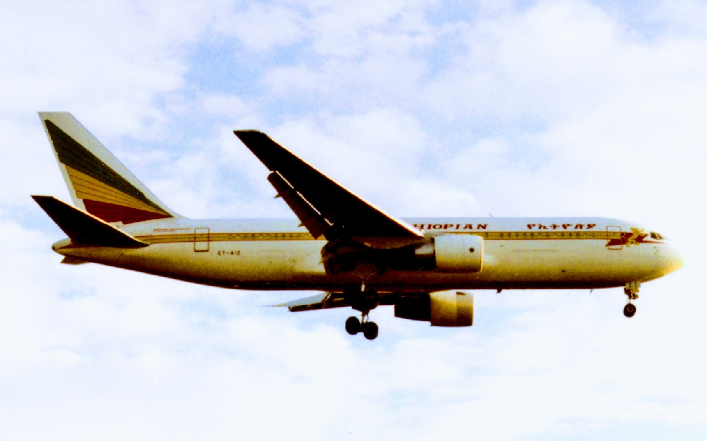
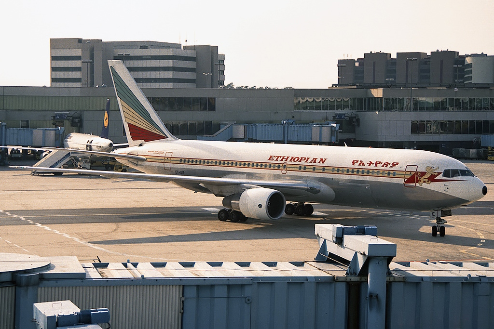
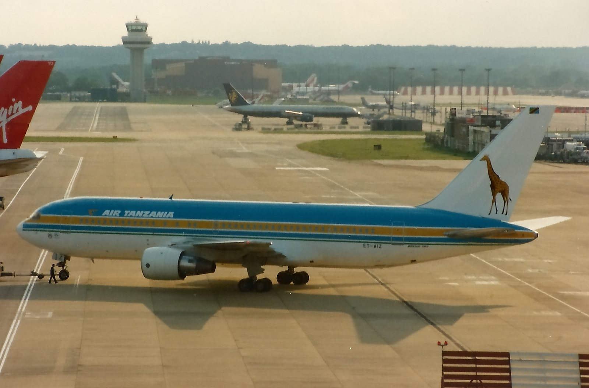

Thirty years ago today, on November 23, 1996, Ethiopian Airlines Flight 961 was hijacked shortly after takeoff from Addis Ababa. Bound for Nairobi on the first leg of a multi-stop flight, the Boeing 767 was forced away from its route by three hijackers who refused to believe the aircraft lacked the fuel to reach Australia. The standoff ended hours later in the waters of the Indian Ocean, marking the first recorded water ditching of a wide-body commercial passenger jet.

## A Routine Morning Departure

Ethiopian Airlines Flight 961 was a scheduled international flight from Addis Ababa to Nairobi, with onward legs to Brazzaville, Lagos, and Abidjan. Operating the route was a Boeing 767-260ER registered as ET-AIZ, delivered new to Ethiopian Airlines on October 22, 1987. The nine-year-old twin-engine jet took off from Addis Ababa at 08:09 UTC after an initial delay to wait for connecting passengers. Onboard the aircraft were 175 people, including 12 crew members.

## Captain Leul Abate and Past Crises

At the controls was 42-year-old Captain Leul Abate, an experienced pilot with over 11,500 total flight hours, including 4,067 hours in the Boeing 757 and 767. Flying alongside him as first officer was 34-year-old Yonas Mekuria, who had logged more than 6,500 flight hours. Captain Leul was remarkably prepared for airborne danger, having already survived two previous hijackings. On April 12, 1992, two hijackers seized his Boeing 727, ending in a five-hour standoff in Nairobi. On March 17, 1995, five hijackers diverted his Boeing 737 to El Obeid, Sudan. In both prior events, the aircraft remained undamaged and no one was injured or killed.

*Archive, 1996 — Photo: 拾叁个仙人掌人 / CC BY-SA 3.0*

## An Impossible Demand for Australia

About 20 minutes into the flight, at roughly 08:29 UTC, three Ethiopian men charged the cockpit using an axe and a fire extinguisher. Ethiopian state-operated radio later identified them as Alemayehu Bekeli Belayneh, Mathias Solomon Belay, and Sultan Ali Hussein. The hijackers assaulted first officer Yonas Mekuria and forced him into the passenger cabin. Over the intercom, they announced in Amharic, French, and English that they had a bomb and claimed there were 11 hijackers on the aircraft. Investigators later found that the purported bomb was actually a covered bottle of liquor. The men demanded to be flown to Australia to seek asylum. Captain Leul tried to explain that the plane had only taken on fuel for the sector to Nairobi and could not make even a quarter of the trip. But the hijackers pointed to the airline's in-flight magazine, which stated that the maximum flying time of the Boeing 767 was 11 hours, and refused to believe him.

*NOT FROM THE EVENT · 1994 — Photo: Pedro Aragão / CC BY-SA 3.0*

## Dual Engine Failure Over the Ocean

Instead of heading east towards Australia across the Indian Ocean, Captain Leul followed the African coastline southward. When the hijackers realized that land was still visible, they forced him to steer east. Leul secretly navigated toward the Comoro Islands, located between Mozambique and Madagascar. As the airliner neared the archipelago, it was nearly out of fuel. At 11:41 UTC, the right engine flamed out. While the lead hijacker stepped out to confer with his accomplices, Leul used the public address system to announce that the plane was out of fuel and facing an imminent crash landing. The hijacker rushed back and knocked the microphone from his hand, and moments later, the left engine flamed out as well, forcing the Boeing 767 to glide.

*NOT FROM THE EVENT · 1991 — Photo: simon butler / CC BY 2.0*

## Ditching off Le Galawa Beach

Captain Leul attempted an emergency landing at Prince Said Ibrahim International Airport on Grande Comore, but a fight with the hijackers inside the cockpit caused him to lose his visual point of reference. Unable to locate the runway, Leul aimed for shallow waters 500 yards off Le Galawa Beach Hotel, near Mitsamiouli on the northern end of the island. He attempted to ditch parallel with the waves at more than 175 knots. Just before contacting the water, the aircraft banked left about 10 degrees. The left engine and wingtip struck the water first, hitting an underwater coral reef that dragged the aircraft violently. The Boeing 767 cartwheeled and broke apart on impact.

## The Grim Toll and Aviation History

The crash of Flight 961 marked the first recorded instance of the ditching of a wide-body passenger aircraft. Of the 175 people onboard, 125 died in the ditching, including all three hijackers and six of the 12 crew members. Both Captain Leul Abate and first officer Yonas Mekuria survived the impact. The tragedy off the coast of the Comoros remains one of commercial aviation's most dramatic hijacking encounters, remembered for the pilot's desperate attempt to bring a powerless airliner down in the sea.

### Sources

- <https://en.wikipedia.org/wiki/Ethiopian_Airlines_Flight_961>
- <https://commons.wikimedia.org/wiki/File:ET-AIZ,_at_London_Heathrow,_England_July_1996.jpg>
- <https://commons.wikimedia.org/wiki/File:ET-AIZ_LHR_11.08.96.jpg>
- <https://commons.wikimedia.org/wiki/File:Boeing_767-260(ER),_Ethiopian_Airlines_JP174644.jpg>
- <https://commons.wikimedia.org/wiki/File:ET-AIZ_Boeing_767_Air_Tanzania_(2).jpg>
