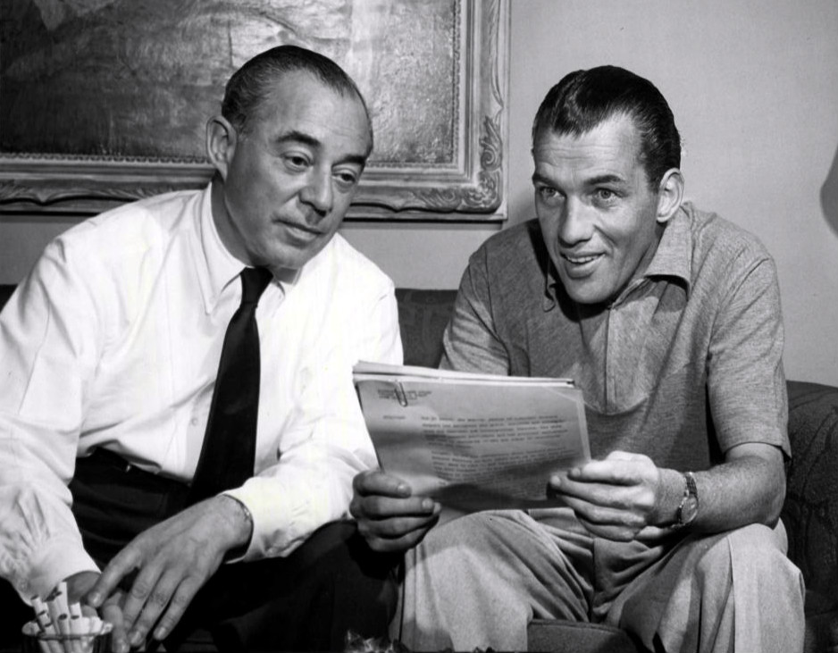
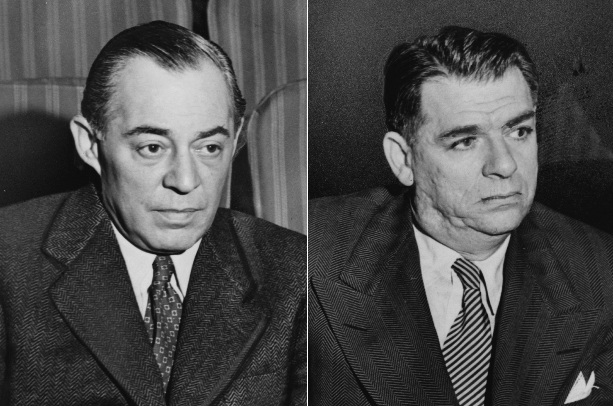
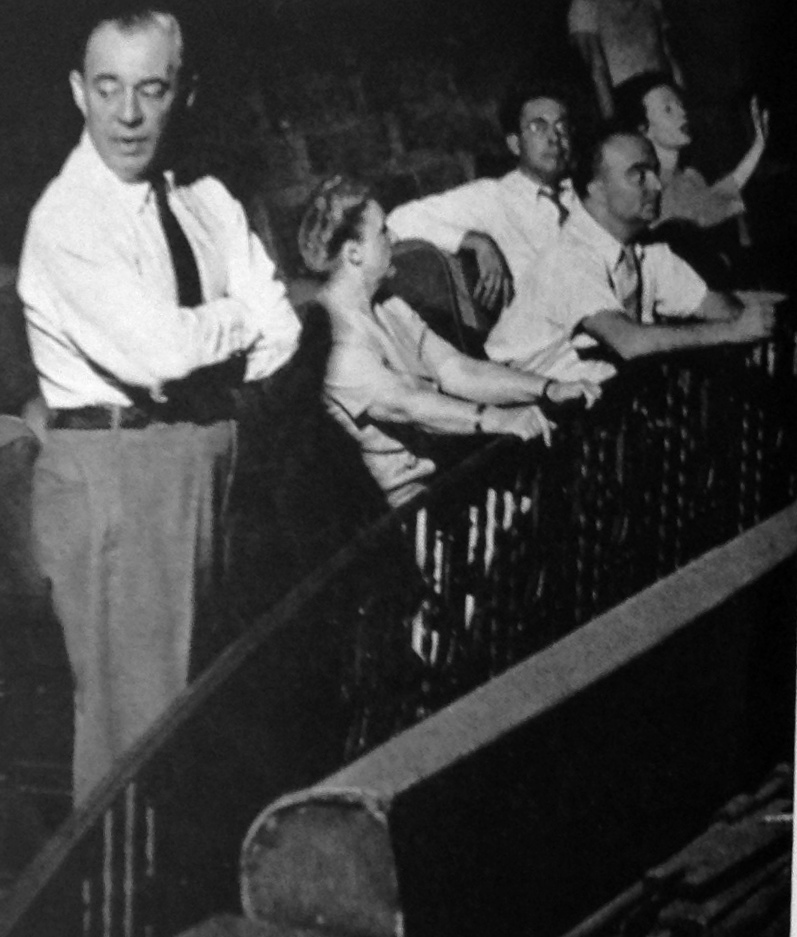

Fifty-six years ago today, on November 23, 1970, the television network CBS broadcast the network premiere of Rodgers and Hammerstein's landmark musical Oklahoma! Telecast as a three-hour Thanksgiving special, the event marked the first time the acclaimed 1955 film version was shown to nationwide television audiences at home.

## An Unlikely Partnership Born From Crisis

Before creating Oklahoma!, composer Richard Rodgers and lyricist Oscar Hammerstein II were each established Broadway hitmakers working with other partners. Rodgers had composed dozens of musicals with lyricist Lorenz Hart, while Hammerstein had achieved major triumphs such as Show Boat with Jerome Kern. By the early 1940s, however, Hart had sunk deeper into alcoholism and personal turmoil. When producer Theresa Helburn of the Theatre Guild proposed turning Lynn Riggs's 1931 play Green Grow the Lilacs into a musical, Hart found the rural frontier setting unappealing and declined to participate. Rodgers then reached out to Hammerstein, who had independently considered adapting the very same play after Kern turned it down. The unexpected pairing would become the most influential writing partnership in the history of American musical theater.

## The 1943 Broadway Revolution

The production was originally titled Away We Go! and opened its tryout run at the Shubert Theatre in New Haven on March 11, 1943. Before arriving in New York, the creators made pivotal revisions, including deleting a number titled 'Boys and Girls Like You and Me', replacing it with a reprise of 'People Will Say We're in Love', and adding the rousing anthem 'Oklahoma!', which inspired the show's final title. Opening at Broadway's St. James Theatre on March 31, 1943, the production chose not to rely on established headliners. Instead, a cast featuring Alfred Drake as Curly, Joan Roberts as Laurey, Celeste Holm as Ado Annie, and Howard Da Silva as Jud Fry carried the narrative. Oklahoma! seamlessly integrated song, dance, and serious dramatic tension into what became known as the modern book musical, earning a special Pulitzer Prize in 1944 and running for an unprecedented 2,212 performances before closing in May 1948.

*Richard Rodgers Ed Sullivan 1952 — Photo: CBS Television / Public domain*

## From Broadway Stage to Widescreen Cinema

The show's music resonated so deeply with listeners that Decca Records gathered the original Broadway cast to record the score with its authentic orchestrations, establishing the modern custom of the original cast recording. In 1955, Hollywood adapted the production into a major motion picture directed by Fred Zinnemann, starring Gordon MacRae as Curly and Shirley Jones as Laurey. The movie achieved distinction as the very first feature film photographed in the innovative Todd-AO 70-millimeter widescreen process. The adaptation earned multiple Academy Awards, while its soundtrack album surged to Number 1 on the national album charts in 1956.

*Rodgers & Hammerstein 1948 NYWT&S — Photo: Al Aumuller, World Telegram staff photographer / Public domain*

## A Three-Hour Holiday Event on CBS

Although the film had been a massive box office success, American television audiences had to wait fifteen years to see it broadcast over the public airwaves. On Monday evening, November 23, 1970, CBS presented the film as a three-hour Thanksgiving special. Airing just days before the national holiday, the broadcast gathered families together to experience the frontier romance set outside Claremore, Indian Territory. Songs like 'Oh, What a Beautiful Mornin'', 'The Surrey with the Fringe on Top', and 'I Cain't Say No' echoed through living rooms from coast to coast, offering millions of viewers an intimate look at a cinematic milestone.

*Rodgers Allegro — Photo: Unknown authorUnknown author / Public domain*

## A Legacy That Defined the Golden Age

Oklahoma! inaugurated what historians regard as the Golden Age of musical theater, paving the way for Rodgers and Hammerstein classics such as Carousel, South Pacific, The King and I, and The Sound of Music. Together, the duo's projects garnered thirty-four Tony Awards, fifteen Academy Awards, two Grammy Awards, and two Pulitzer Prizes. The CBS telecast in the autumn of 1970 demonstrated that these classic American melodies had transcended theatrical stages and movie palaces to become a timeless holiday tradition in the living rooms of ordinary families.

### Sources

- <https://en.wikipedia.org/wiki/Rodgers_and_Hammerstein>
- <https://commons.wikimedia.org/wiki/File:Richard_Roberts_and_Shirley_Jones.jpg>
- <https://commons.wikimedia.org/wiki/File:Richard_Rodgers_Ed_Sullivan_1952.JPG>
- <https://commons.wikimedia.org/wiki/File:Rodgers_%26_Hammerstein_1948_NYWT%26S.jpg>
- <https://commons.wikimedia.org/wiki/File:Rodgers_Allegro.jpg>
