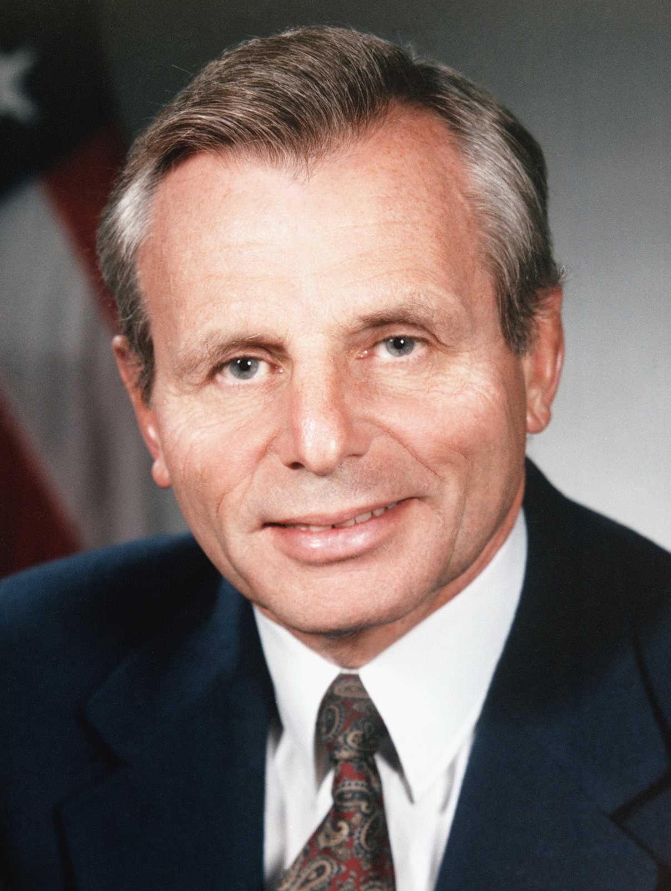
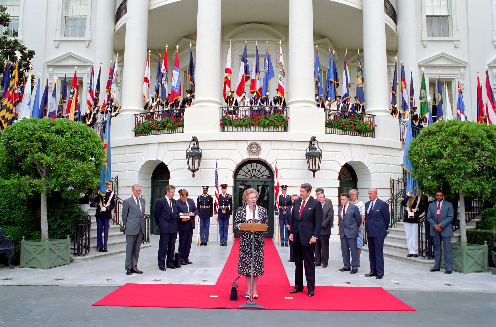
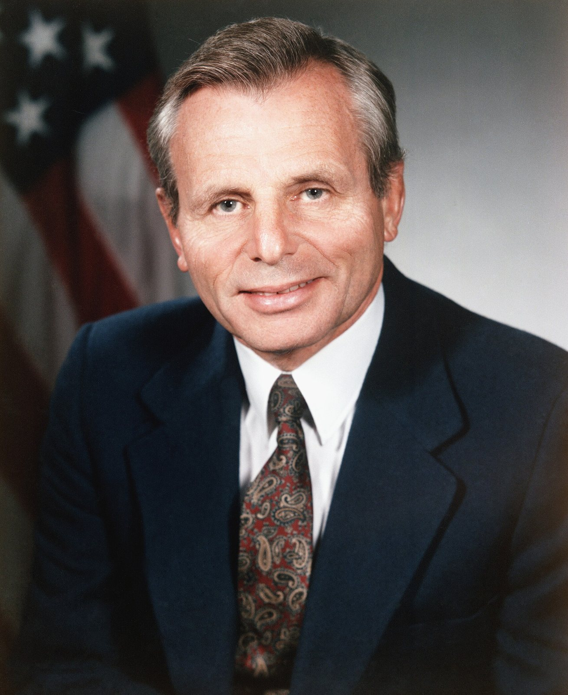

39 years ago today, November 23, 1987, Frank Carlucci was officially sworn in as the United States Secretary of Defense. Taking the helm at the Pentagon during a defining period of the late Cold War, Carlucci brought decades of high-level diplomatic, intelligence, and administrative experience to the nation's top military post.

## A Sudden Departure at the Pentagon

Carlucci's elevation to the Cabinet came after the unexpected resignation of Caspar Weinberger, who had served as Ronald Reagan's Secretary of Defense since 1981. Weinberger stepped down from the demanding post to care for his wife, Jane Weinberger, who was suffering from disabling back pain. Weinberger had overseen a sweeping military buildup and maintained a steadfast hard line against the Soviet Union.

With Weinberger's departure, President Reagan required a seasoned administrator capable of immediately managing the Department of Defense. Carlucci, who had already served as Reagan's Deputy Secretary of Defense and was then serving as National Security Advisor, was the natural choice to ensure stability across the armed forces.

## From Princeton to Diplomatic Frontlines

Born in Scranton, Pennsylvania, Frank Charles Carlucci III was the son of an insurance broker, Frank Charles Carlucci Jr., and Roxann Bacon. His grandfather had emigrated from Santomenna, Italy, making Carlucci the first Italian American to serve as Secretary of Defense. Carlucci attended Wyoming Seminary before heading to Princeton University, where he roomed with future Defense Secretary Donald Rumsfeld and graduated from the Woodrow Wilson School of Public and International Affairs in 1952.

After serving as a U.S. Navy officer and studying at Harvard Business School, Carlucci joined the U.S. Foreign Service in 1956. In 1961, while serving as second secretary at the American embassy in the Congo during the tumultuous Congo Crisis, Carlucci forged a close bond with Congolese politician Cyrille Adoula. Later, when Adoula visited the White House to meet President John F. Kennedy, he immediately opened the meeting by asking, "Où est Carlucci?" Kennedy's startled response—"Who the hell is Carlucci?"—prompted Secretary of State Dean Rusk to track down the young diplomat, marking the beginning of Carlucci's rapid ascent.

*Archive, 1987 — Photo: Ron Hall / Public domain*

## The Trusted Crisis Manager

Throughout the 1960s and 1970s, Carlucci repeatedly took on difficult federal assignments. In 1969, when President Richard Nixon convinced Donald Rumsfeld to direct the Office of Economic Opportunity, Rumsfeld brought Carlucci over to lead the Community Action Program. Carlucci later became Undersecretary of Health, Education and Welfare under Caspar Weinberger.

In June 1972, when Hurricane Agnes unleashed catastrophic flooding across northeastern Pennsylvania's Wyoming Valley, Nixon appointed Carlucci to oversee the federal emergency response. At the time, Agnes was the costliest tropical cyclone in American history, and Carlucci earned praise from local and commonwealth leaders for his hands-on coordination. Later assignments included serving as Ambassador to Portugal from 1974 to 1977 following the 1975 coup, and Deputy Director of the Central Intelligence Agency from 1978 to 1981 under Admiral Stansfield Turner.

*Archive, 1987 — Photo: President (1981-1989 : Reagan). White House Photographic Off / Public domain*

## Leading the Pentagon in the Late Cold War

Carlucci's swearing-in on November 23, 1987, placed him second only to the commander-in-chief in the military chain of command. Under U.S. law, the Secretary of Defense exercises direct operational and administrative authority over the Department of Defense, balancing military leadership with strict civilian control.

As Secretary of Defense, Carlucci strongly supported President Reagan's defense strategy, including the Strategic Defense Initiative. Carlucci advocated for modernizing military readiness and maintaining strategic pressure to hasten an end to the Cold War. Before taking over the Pentagon, Carlucci had served as Reagan's National Security Advisor, where he chose Colin Powell as his deputy. Powell would later succeed Carlucci as National Security Advisor.

*Archive, 1987 — Photo: Ron Hall / Public domain*

## A Legacy of Public and Private Leadership

Carlucci served as Secretary of Defense through the conclusion of the Reagan administration on January 20, 1989. Following his government career, he transitioned to the private sector, becoming the inaugural chairman of the Carlyle Group from 1992 to 2003 and later serving on numerous corporate boards, including General Dynamics, Westinghouse, and Quaker Oats.

His decades in government left lasting honors, from Lisbon—where both the Carlucci American International School and the U.S. Ambassador's official residence bear his name—to the halls of the Pentagon. Carlucci's tenure demonstrated how a career diplomat and crisis manager could step into the nation's highest defense office and steer American military policy through a decisive global transition.

### Sources

- <https://en.wikipedia.org/wiki/United_States_Secretary_of_Defense>
- <https://commons.wikimedia.org/wiki/File:Frank_Carlucci_official_portrait.JPEG>
- <https://commons.wikimedia.org/wiki/File:Frank_Carlucci_official_portrait_(cropped).jpg>
- <https://commons.wikimedia.org/wiki/File:Margaret_Thatcher_Makes_Departure_Remarks_at_The_Diplomatic_Entrance_While_President_Ronald_Reagan_Caspar_Weinberger_Frank_Carlucci_Rozanne_Ridgway_Howard_Baker_Antony_Acland_and_Cd_-_DPLA_-_ab90ee4052a7d2073a7ebc50c08429fe.jpg>
- <https://commons.wikimedia.org/wiki/File:Frank_Carlucci_official_portrait_(cropped).JPEG>
