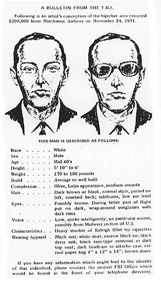
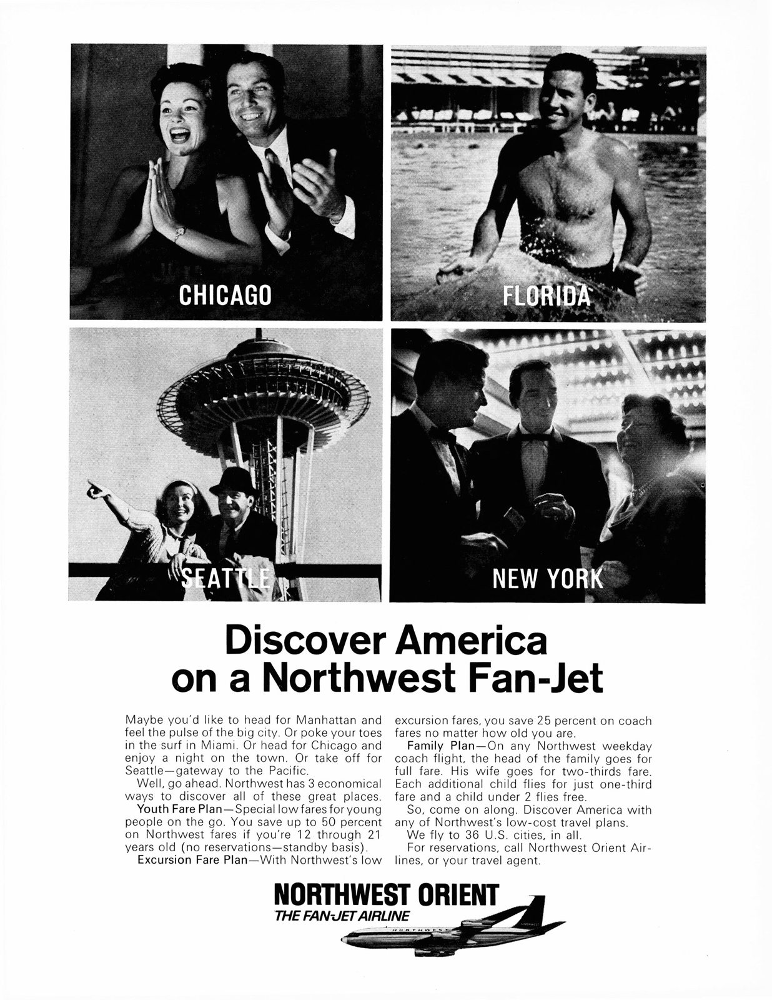
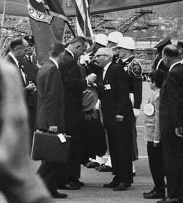

55 years ago today, November 24, 1971, a man identifying himself as Dan Cooper hijacked Northwest Orient Airlines Flight 305 between Portland, Oregon, and Seattle, Washington. After securing 200,000 dollars in cash and four parachutes, he released his passengers and ordered the Boeing 727 back into the sky, leaping out into a blinding thunderstorm over the Pacific Northwest.

## A Ticket Bought with Cash on Thanksgiving Eve

The holiday travel rush was underway on the afternoon of November 24, 1971, when a neatly dressed man approached the Northwest Orient Airlines counter at Portland International Airport. Using cash, he purchased a one-way ticket for Flight 305, a short 30-minute flight scheduled to land at Seattle-Tacoma International Airport. On the passenger manifest, he gave his name simply as Dan Cooper.

Witnesses described Cooper as a quiet white man in his mid-40s, wearing a dark business suit, a white collared shirt, a narrow black necktie, a black raincoat, and brown dress shoes. He carried a dark attaché case and a brown paper bag. Taking seat 18-E in the rear row of the Boeing 727-100, he ordered a bourbon and 7-Up while waiting for takeoff.

## A Whispered Warning and a Briefcase Bomb

Flight 305 departed Portland at 2:50 pm with 36 passengers and a crew of six on board. Shortly after becoming airborne, Cooper handed a folded note to flight attendant Florence Schaffner, who was seated in the jump seat directly behind him. Schaffner initially assumed the traveler was slipping her his telephone number and placed the paper inside her purse unopened.

Cooper leaned toward her and spoke quietly: 'Miss, you'd better look at that note. I have a bomb.' Opening the paper, Schaffner read carefully printed felt-pen lettering instructing her to sit beside him. When she asked to see the device, Cooper clicked open his briefcase. Schaffner looked inside and saw a large cylindrical battery connected by wires to two rows of four red sticks that appeared to be dynamite.

*Archive, 1971 — Photo: U.S. Federal Government / Public domain*

## Two Hours Circling Puget Sound

Cooper outlined his demands through Schaffner and flight attendant Tina Mucklow. He required 200,000 dollars in negotiable American currency packed into a knapsack by 5:00 pm, along with two back parachutes and two front reserve parachutes. By requesting four parachutes, Cooper signaled that he might force a crew member to jump with him, preventing authorities from providing sabotaged gear.

Northwest Airlines president Donald Nyrop authorized full cooperation and instructed that the ransom be paid. For roughly two hours, Captain William Scott flew Flight 305 in a holding pattern above Puget Sound while the Seattle Police Department and the FBI assembled the cash and parachutes. Throughout the wait, Cooper remained remarkably composed, chatting calmly with Mucklow and correctly identifying landmarks such as Tacoma through the aircraft windows.

*NOT FROM THE EVENT · 1966 — Photo: This file was contributed to Wikimedia Commons by Hennepin C / Public domain*

## The Hostage Release and Second Departure

At 5:39 pm, the aircraft touched down at Sea-Tac. Cooper directed that fuel trucks meet the airliner and ordered all passengers to remain seated while the ransom and parachutes were brought aboard. Once the knapsack of currency and four parachutes were delivered to the cabin, Cooper kept his promise, allowing all 36 passengers and flight attendant Schaffner to safely leave the plane.

With fuel tanks replenished, Cooper instructed the remaining flight crew—Captain Scott, First Officer Bill Rataczak, flight engineer Harold Anderson, and flight attendant Mucklow—to fly toward Mexico City with a scheduled refueling stop in Reno, Nevada. He gave specific aerodynamic instructions, demanding that the plane maintain a low altitude under 10,000 feet and fly at a slow airspeed with the flaps set.

*Seattle Mayor Braman greeting President Johnson at Sea-Tac Airport, 1966 - cropped — Photo: Seattle Municipal Archives from Seattle, WA. Cropped by Jmab / CC BY 2.0*

## The Leap into the Washington Wilderness

Shortly after taking off into the darkening evening, Cooper directed Mucklow to join the rest of the crew inside the closed cockpit. Cooper remained alone in the cabin. Sometime around 8:00 pm, a cockpit warning light indicated that the rear entrance door had been opened and the Boeing 727's aft airstair had been extended.

Facing freezing temperatures, sub-zero wind chills, and a heavy driving rainstorm, Cooper stepped off the stairs into the night sky over the densely forested terrain of southwestern Washington. Military fighter jets trailing the airliner did not spot him leaving the aircraft. When Flight 305 landed safely in Reno, Nevada, searchers confirmed that Cooper, the ransom money, and two parachutes were gone.

## The Legacy and Unsolved Mystery

Due to an early wire service miscommunication, the press mistakenly named the suspect 'D. B. Cooper,' an alias that permanently entered American folklore. In 1980, the case saw its only physical breakthrough when a boy discovered 6,000 dollars of the water-damaged ransom bills buried along the banks of the Columbia River near Vancouver, Washington. The rest of the cash and Cooper's remains have never surfaced.

The brazen skyjacking immediately reshaped airport security across the United States. Commercial airports mandated metal detectors, luggage searches, and closer scrutiny for passengers purchasing one-way tickets with cash. After 45 years of active pursuit and thousands of interviewed leads, the FBI officially suspended its investigation in 2016, leaving Dan Cooper's Thanksgiving jump as the only unsolved air piracy case in commercial aviation history.

### Sources

- <https://en.wikipedia.org/wiki/Washington_(state)>
- <https://commons.wikimedia.org/wiki/File:Crew_of_Northwest_Airlines_Flight_305_after_D._B._Cooper_hijacking.jpg>
- <https://commons.wikimedia.org/wiki/File:DB_Cooper_Wanted_Poster.jpg>
- <https://commons.wikimedia.org/wiki/File:Greater_Minneapolis,_August,_1966,_Volume_18,_Number_8_-_DPLA_-_d824945eae652390698b0ab95fa31c3a_(page_14).jpg>
- <https://commons.wikimedia.org/wiki/File:Seattle_Mayor_Braman_greeting_President_Johnson_at_Sea-Tac_Airport,_1966_-_cropped.jpg>
