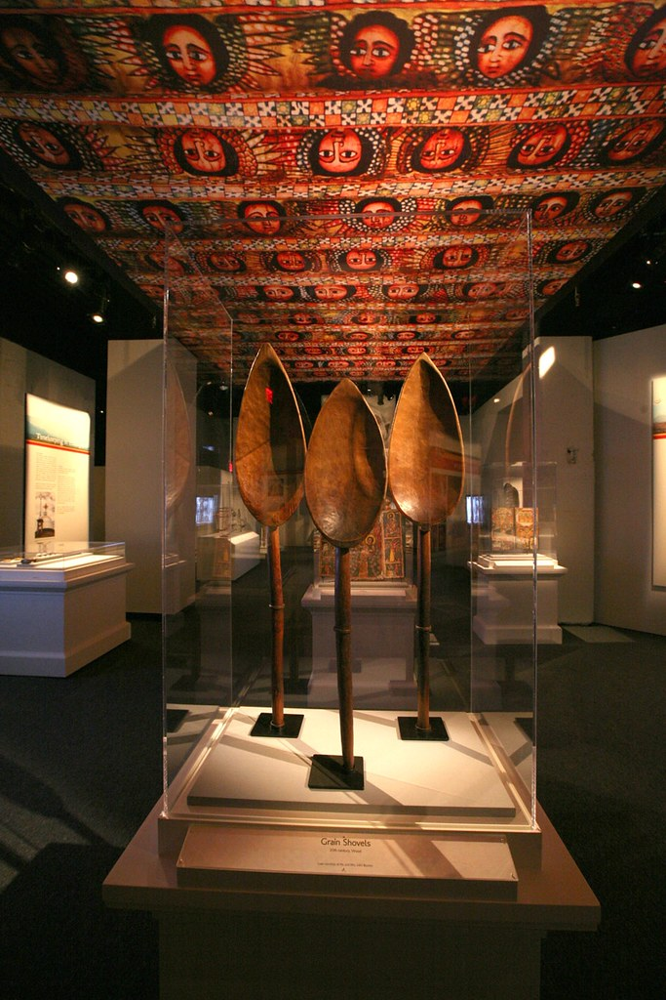
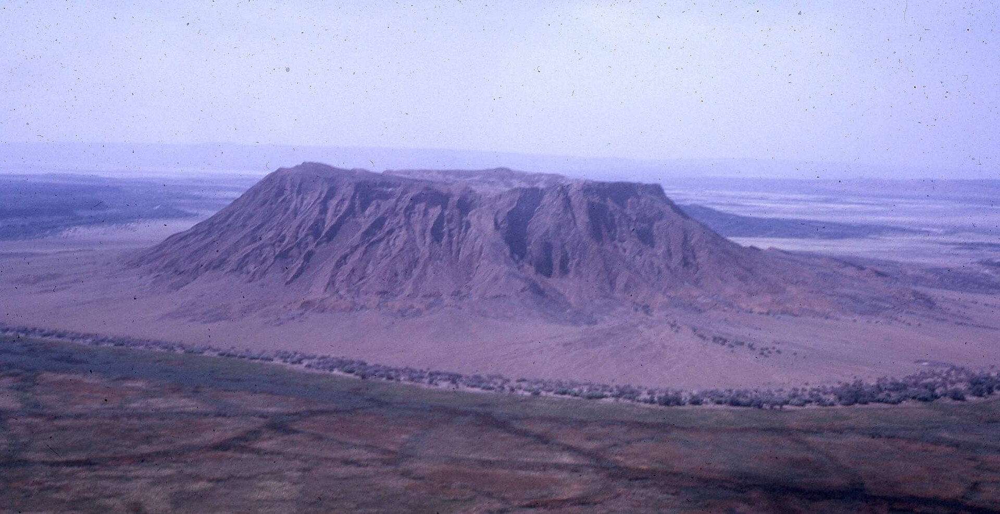

52 years ago today, November 24, 1974, American paleoanthropologist Donald Johanson made a discovery that reshaped human origins. While walking through a barren ravine in Hadar, Ethiopia, he found the fossilized remains of an early ancestor who walked upright more than three million years ago.

## An Unexpected Detour in the Afar Depression

On the morning of November 24, 1974, Donald Johanson had planned to stay in camp catching up on fieldwork notes. He was an associate professor of anthropology at Case Western Reserve University and co-leader of the International Afar Research Expedition alongside French geologists Maurice Taieb and Yves Coppens. Graduate student Tom Gray convinced Johanson to join him for a quick, spur-of-the-moment survey of an area known as Locality 162 in the Afar Triangle.

The expedition had been searching the Awash Valley since 1972, knowing the ancient Pliocene sediments held great potential. For two hours, Johanson and Gray searched the dry, sun-baked landscape without finding anything unusual. It was only as they prepared to walk back to their Land Rover that Johanson glanced over his right shoulder and saw something white reflecting in the dirt.

## The Moment of Discovery in the Gully

Lying on the slope of a small gully was a fragment of a hominin arm bone. Johanson knelt down to inspect it closely and recognized it almost immediately. Looking just a few feet up the slope, Johanson and Gray began spotting other fossilized pieces resting on the eroded surface: a piece of a skull, parts of a thigh bone, several vertebrae, ribs, and pieces of a pelvis.

Fossils of early hominins had been discovered since the 1930s, but they were nearly always isolated teeth or partial jaws crushed by millions of years of pressure. To find so many skeletal elements belonging to a single individual was unheard of in paleoanthropology. The two researchers carefully marked the site and returned to camp to summon the rest of the research team.

*NOT FROM THE EVENT — Photo: Tadias Magazine / CC BY 2.0*

## How an Ancient Ancestor Received a Pop Name

The expedition spent three weeks meticulously screening the sediment around the gully to recover every available fragment. In all, they retrieved several hundred bone fragments, representing roughly 40 percent of an entire skeleton. It was officially cataloged in scientific records as AL 288-1.

That evening in the Ethiopian desert, the research camp was filled with excitement. A cassette tape of The Beatles' 1967 album Sgt. Pepper's Lonely Hearts Club Band was playing on repeat, with the song 'Lucy in the Sky with Diamonds' filling the night air. Pamela Alderman, a member of the expedition, suggested that the fossil should be called Lucy. The name caught on instantly among the team and soon became a household name across the globe.

*Awash river volcano — Photo: Rowanhs / CC BY-SA 4.0*

## What Lucy Taught Science About Human Evolution

Lucy stood roughly 105 centimeters tall—about three and a half feet—and weighed an estimated 25 to 37 kilograms (55 to 82 pounds). In 1978, Johanson and his colleagues formally described the species as Australopithecus afarensis, an extinct hominin that lived between 3.9 and 2.9 million years ago.

Lucy's anatomy resolved one of the greatest debates in physical anthropology: whether early human ancestors first developed large brains or upright walking. Lucy's skull was small and ape-like, but her pelvic bones and knees demonstrated conclusively that she walked upright on two feet. Her bipedalism supported the earlier theories of anatomist Raymond Dart, while her curved finger bones indicated that she was still comfortable climbing in trees.

*Sunset in Afar region, Ethiopia — Photo: jeanotr / CC BY 2.0*

## The First Family and a Lasting American Legacy

Johanson's work in Ethiopia did not end with Lucy. In 1975, at a nearby site designated AL 333, his team discovered the 'First Family,' a collection of prehistoric teeth and bones belonging to at least thirteen individuals of the same species, dating back 3.2 million years.

In 1981, Johanson founded the Institute of Human Origins, which later relocated to Arizona State University, ensuring ongoing research into early human evolution for American students and scientists. Together with Maitland Edey, he published 'Lucy: The Beginnings of Humankind' in 1981, winning a U.S. National Book Award in Science. Five decades after her discovery in the Ethiopian desert, Lucy remains the touchstone of human evolutionary history.

### Sources

- <https://en.wikipedia.org/wiki/Donald_Johanson>
- <https://www.flickr.com/photos/38891445@N07/3675493399>
- <https://www.flickr.com/photos/38891445@N07/3675495041>
- <https://commons.wikimedia.org/wiki/File:Awash_river_volcano.jpg>
- <https://www.flickr.com/photos/62669993@N07/16960289468>
