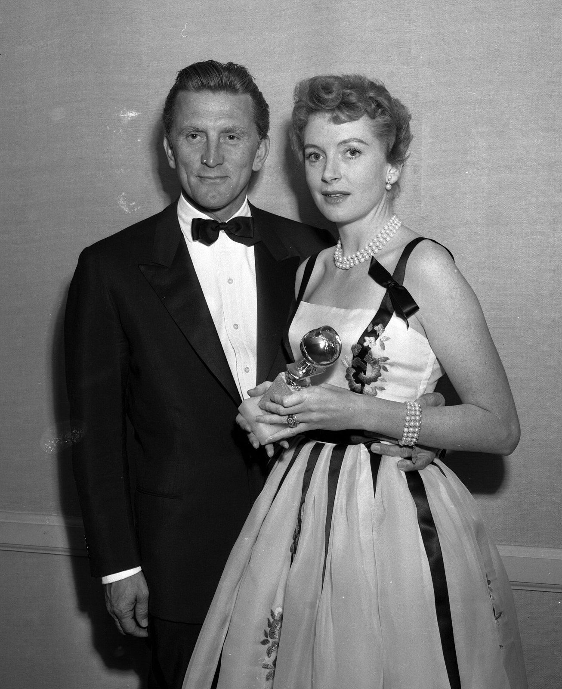
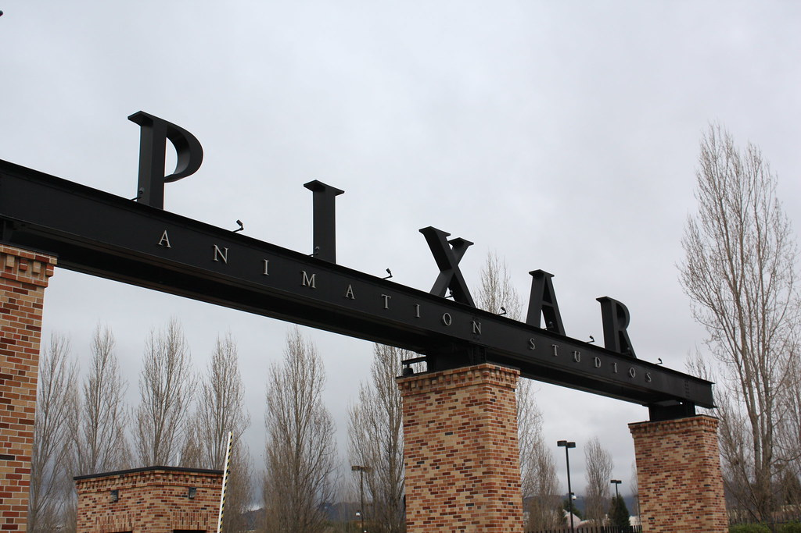
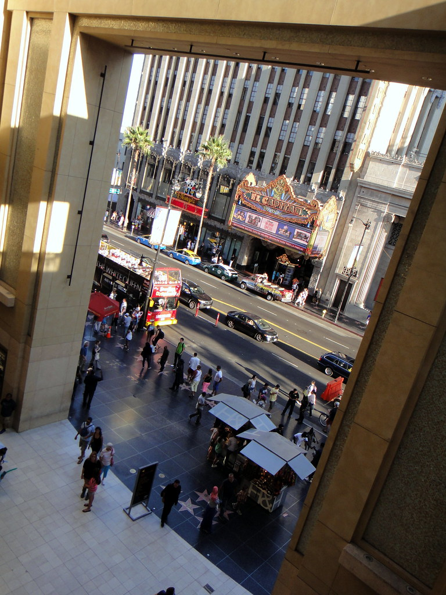

27 years ago today, November 24, 1999. Pixar Animation Studios and Walt Disney Pictures released Toy Story 2 in theaters across North America. The film arrived as the eagerly awaited sequel to 1995's groundbreaking Toy Story, reuniting audiences with Woody, Buzz Lightyear, and Andy's toy box.

## From Direct-to-Video Plan to Theatrical Ambition

When work on a sequel first began, Disney did not intend for Toy Story 2 to play in movie theaters. Instead, Disney envisioned the project as a modest direct-to-video sequel, a standard distribution format for animated follow-ups during that era. Production initially kicked off on a small scale inside a separate building, away from Pixar's main Emeryville campus, because the primary creative and technical staff was completely occupied with completing their second feature film, A Bug's Life, released in 1998.

As early reels and character test sequences began to take shape, Disney executives saw immense commercial potential. Recognizing that the material had theatrical appeal, the studio decided to upgrade Toy Story 2 to a full theatrical release. However, this sudden promotion came with enormous creative challenges that nearly derailed the entire endeavor.

## The Weekend Rewrite by John Lasseter

When director John Lasseter and Pixar's core creative team reviewed the existing version of the film, they were deeply unsatisfied with its narrative quality. They felt the characters lacked emotional depth and the story failed to live up to the standard established by the 1995 original. Pixar's leadership believed that releasing a subpar film would damage the studio's hard-earned reputation for artistic excellence.

Faced with a mounting crisis, Lasseter and his story team took drastic action. Over the course of a single, grueling weekend, Lasseter, Andrew Stanton, and their collaborators completely dismantled and redeveloped the film's entire plot. They introduced new emotional weight, exploring Woody's fear of abandonment, Jessie's heartbreak over being outgrown by her owner Emily, and Woody's dilemma between returning to Andy or preserving himself forever in a Tokyo toy museum.

*Kirk Douglas and Deborah Kerr, 1957 Golden Globe Awards — Photo: Los Angeles Times / CC BY 4.0*

## Nine Months Against an Unmovable Deadline

While typical computer-animated feature films at the studio required several years of rigorous development and digital rendering, the theatrical release date for Toy Story 2 was completely non-negotiable. Disney had already locked in marketing partnerships, distribution agreements, and toy licensing contracts for late November 1999. The date could not be postponed under any circumstances.

As a result, the entire production schedule was compressed into an astonishing nine months. Animators, lighters, and technical directors worked around the clock using Pixar's RenderMan software to meet the deadline. The vocal cast also returned, led by Tom Hanks as Woody and Tim Allen as Buzz Lightyear, supported by Don Rickles, Wallace Shawn, John Ratzenberger, Annie Potts, and Jim Varney. The film would become Varney's final appearance as the loyal voice of Slinky Dog before his untimely death the following year.

*Pixar Animation Studio — Photo: superstrikertwo / CC BY-SA 2.0*

## Enormous Box Office and Universal Acclaim

Following a gala premiere at the El Capitan Theatre in Hollywood on November 13, 1999, Toy Story 2 made its official nationwide theatrical debut on November 24, 1999. The film was an instant commercial juggernaut, earning 511 million dollars worldwide against a production budget of 90 million dollars. It finished the year as the third-highest-grossing film of 1999.

Critics praised the film with universal acclaim, awarding it a rare 100 percent rating on Rotten Tomatoes. Reviewers marveled that the sequel matched and in many ways surpassed the technical artistry and storytelling of its predecessor. At the 57th Golden Globe Awards, the movie captured the award for Best Motion Picture in the Musical or Comedy category, an extraordinary honor for an animated feature.

*El Capitan Theatre, Hollywood Boulevard — Photo: mattk1979 / CC BY-SA 2.0*

## The Lasting Benchmark for Animated Storytelling

The triumph of Toy Story 2 proved that computer animation was not simply a fleeting technical novelty, but a legitimate medium capable of rich, sophisticated cinema. The movie established a standard of perfectionism that would define Pixar throughout the 2000s, paving the way for future Academy Award-winning works such as Finding Nemo, The Incredibles, and Toy Story 3.

More than a quarter of a century later, the film remains a fixture on critical lists of the greatest animated works ever produced. What began as a rushed direct-to-video assignment became a cinematic triumph that demonstrated the power of creative courage under pressure.

### Sources

- <https://en.wikipedia.org/wiki/Pixar>
- <https://commons.wikimedia.org/wiki/File:Pixar_White_House_1998.jpg>
- <https://commons.wikimedia.org/wiki/File:Kirk_Douglas_and_Deborah_Kerr,_1957_Golden_Globe_Awards.jpg>
- <https://www.flickr.com/photos/14876067@N00/4495446802>
- <https://www.flickr.com/photos/24879135@N04/9712843379>
