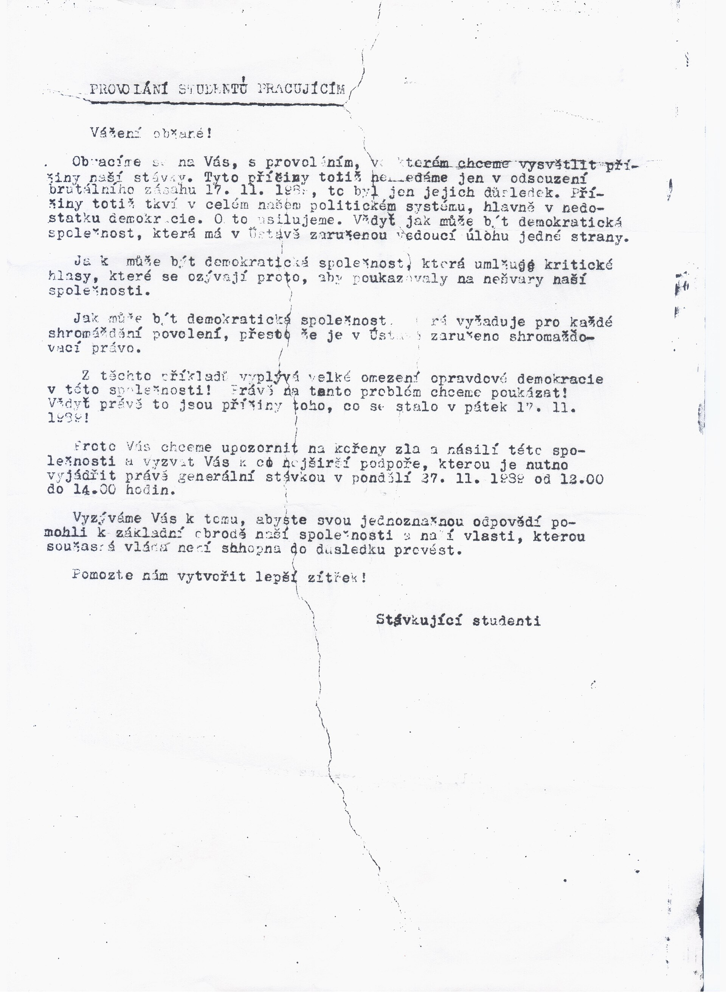
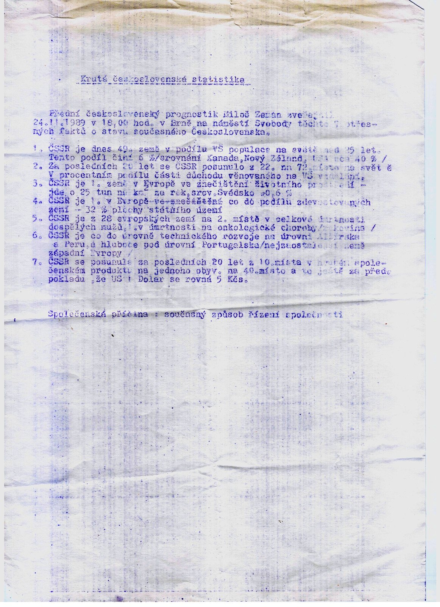
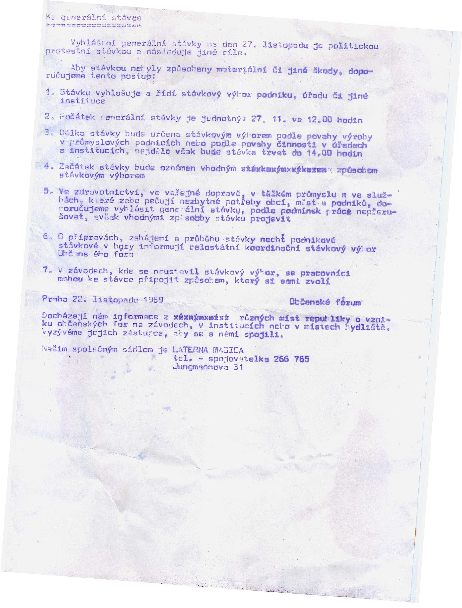

37 years ago today, November 24, 1989, the communist regime that had held power in Czechoslovakia for more than four decades collapsed from the top. General Secretary Miloš Jakeš and every member of the party Presidium announced their collective resignation before an astonished public.

## Four Decades of One-Party Rule

The Communist Party of Czechoslovakia, or KSČ, had held uncontested control over the country since seizing power in a coup d'état on February 25, 1948. Modeled after the Soviet system, the party nationalized private industry, instituted a strictly planned economy, and banned genuine political opposition. Those who opposed the authorities were closely monitored by secret police, barred from higher education, or fired from their jobs. When Alexander Dubček attempted reform during the 1968 Prague Spring, Warsaw Pact forces invaded to crush the movement. For the two decades that followed, the regime carried out sweeping purges and enforced ideological compliance.

## The Spark of November 17

The spark that ignited the final collapse arrived on November 17, 1989, observed as International Students' Day. Students gathered in Prague to commemorate the 50th anniversary of a brutal 1939 Nazi raid on Prague University. The peaceful student march transformed into a demonstration calling for political freedom and human rights. Riot police met the crowd with truncheons, blocking the streets and violently suppressing the gathering. Rather than intimidating the population, reports of the police brutality galvanized citizens across the nation to take a stand against state repression.

*Samet-vyzva-studenti — Photo: Alpatron / CC BY-SA 4.0*

## A Half-Million Citizens in the Streets

Within days, the student protest became a nationwide uprising known as the Velvet Revolution. On November 20, the number of protesters filling central Prague surged from 200,000 on the previous day to an estimated 500,000 people. Dissidents, artists, workers, and students joined hands in daily rallies, jingling keys to signal the end of the communist monopoly. Civil society groups like Charter 77 and the newly formed Civic Forum coordinated public pressure. General Secretary Miloš Jakeš, who had consistently refused dialogue with independent civic groups, found his administration completely isolated.

*Samet-ceskoslovenska-statistika — Photo: Alpatron / CC BY-SA 4.0*

## The Resignation of November 24

On the evening of November 24, 1989, under mounting pressure and facing an impending general strike, the leadership of the Communist Party met in an emergency session. In an admission of total political defeat, Miloš Jakeš and the entire Politburo resigned from their offices. The announcement sent waves of relief and celebration through the crowds gathered in the cold streets of Prague. The sudden departure of the party hierarchy signaled that the hardline apparatus had lost its will and capacity to use force against its own citizens.

*Samet-vyzva-obcanske-forum — Photo: Alpatron / CC BY-SA 4.0*

## The Peaceful Transition to Democracy

The collapse of the Politburo marked the turning point of the Velvet Revolution. On November 27, millions of citizens observed a two-hour general strike, and the following day the party formally announced it would relinquish power. Parliament soon struck down the constitutional clause that guaranteed the party's leading role in society, and border barricades alongside West Germany and Austria were dismantled. By late December 1989, Alexander Dubček was chosen as speaker of parliament, and playwright Václav Havel was inaugurated as president. In June 1990, the country held its first free democratic elections since 1946.

### Sources

- <https://en.wikipedia.org/wiki/Velvet_Revolution>
- <https://commons.wikimedia.org/wiki/File:Call_of_Czechoslovak_students_for_support_during_1989_velvet_revolution.jpg>
- <https://commons.wikimedia.org/wiki/File:Samet-vyzva-studenti.jpg>
- <https://commons.wikimedia.org/wiki/File:Samet-ceskoslovenska-statistika.jpg>
- <https://commons.wikimedia.org/wiki/File:Samet-vyzva-obcanske-forum.jpg>
