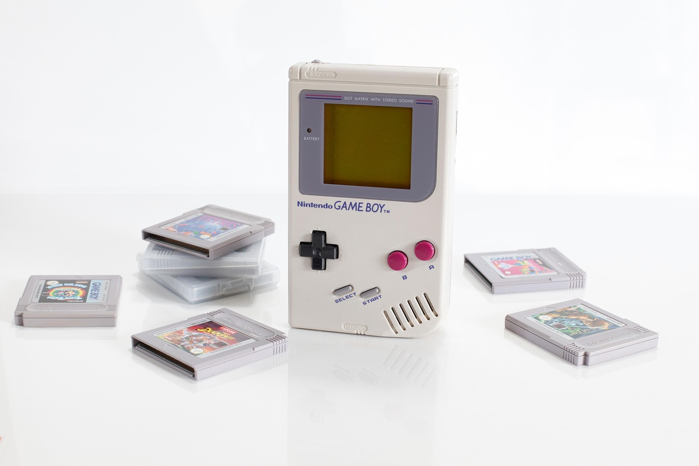
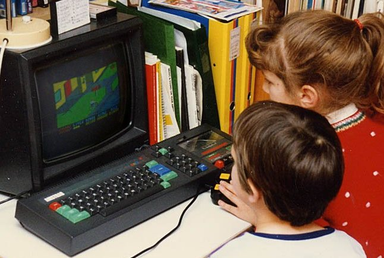

34 years ago today, November 24, 1992, Sega launched the blockbuster platform video game Sonic the Hedgehog 2 across North America for the Sega Genesis. Supported by a massive nationwide marketing push, the game brought faster speeds, expansive levels, and a new two-tailed companion to living rooms across the United States.

## The 16-Bit Battle for Living Rooms

By the start of the 1990s, the video game market in North America was dominated by Nintendo. Sega sought to carve out a foothold with its 16-bit home console, the Sega Genesis. Early marketing efforts under Sega of America leadership attempted to challenge Nintendo with bold campaigns, but Sega president Hayao Nakayama recognized that the company needed a signature mascot and a flagship franchise capable of competing directly with Nintendo's Mario.

That answer arrived in 1991 with the release of Sonic the Hedgehog. Developed by programmer Yuji Naka, artist Naoto Ohshima, and designer Hirokazu Yasuhara, the game demonstrated the processing power of the Genesis hardware with blistering speed and fluid animation. The original game proved to be a massive commercial triumph, establishing the Genesis as a genuine competitor and setting the stage for an ambitious sequel.

## A Cross-Pacific Collaboration in California

Following the tremendous success of the first game, Sega directed Mark Cerny, the founder of the California-based Sega Technical Institute (STI), to initiate work on Sonic the Hedgehog 2 in November 1991. The production brought together creative talent from both sides of the Pacific. Key members of the original Japanese development team, including Yuji Naka and Hirokazu Yasuhara, moved overseas to California to collaborate with American artists and programmers.

The project was designed to be significantly faster and more expansive than its predecessor. Development was not without hurdles, as the team navigated cultural differences between the Japanese and American staff. Under tight production deadlines and strict quality standards, several planned stages had to be cut from the final release. Meanwhile, Masato Nakamura, a member of the popular Japanese band Dreams Come True, returned to compose another memorable soundtrack for the adventure.

*Not a photo of the event itself · NOT FROM THE EVENT · Stock image — Photo: ptra / Pixabay Content License*

## New Mechanics, Larger Worlds, and the Debut of Tails

When Sonic the Hedgehog 2 arrived, it delivered an array of major technical and gameplay innovations. The storyline once again pitted the blue hero against the villainous Doctor Robotnik, a mad scientist attempting to gather the Chaos Emeralds to power his orbital space station, the Death Egg, while trapping the animal inhabitants of West Side Island inside mechanical contraptions.

To counter Robotnik, Sonic gained a crucial new ability known as the spin dash. By crouching in place and charging momentum, players could launch Sonic forward at maximum speed without needing a running start. The game also introduced Sonic's loyal sidekick, Miles "Tails" Prower, an anthropomorphic fox with twin tails that allowed him to fly. Tails accompanied Sonic throughout the main adventure, giving a second player the option to plug in a controller and play along simultaneously, or compete in a split-screen multiplayer mode.

*Cpc464.computer.750pix — Photo: Adrian Pingstone / Public domain*

## Scale and Spectacle on the Sega Genesis

Sonic the Hedgehog 2 doubled the visual variety of the first installment, featuring 11 distinct zones divided into 20 acts. The level architecture was substantially larger, filled with steep inclines, loop-de-loops, corkscrews, hidden pathways, springs, and bottomless hazards. Most zones concluded after two acts rather than three, culminating in a confrontation against one of Doctor Robotnik's specialized mechanical bosses.

The game also pushed visual boundaries with its special stages. Whenever players passed a checkpoint with enough collected gold rings, they could enter a high-speed half-pipe challenge rendered with pre-rendered pseudo-3D graphics. Navigating these courses required dodging obstacles and collecting designated quotas of rings to secure the coveted Chaos Emeralds.

*Photograph of the Living Room of Mr. and Mrs. August Vogel - NARA - 558314 — Photo: Gary Truman / Public domain*

## The Ten Million Dollar Launch and Lasting Legacy

Anticipation for the release was unprecedented. Sega backed the game with an aggressive 10 million dollar promotional campaign, making the November 1992 rollout one of the most prominent retail events in consumer entertainment up to that point. Gamers rushed to retail stores nationwide to purchase the cartridge, fueling immediate box office-style buzz.

Sonic the Hedgehog 2 became an overwhelming critical and commercial triumph. Reviewers celebrated its refined control scheme, expansive level design, vibrant graphics, and energetic musical score, awarding the title multiple honors, including two Golden Joystick Awards. By 2006, the game had sold six million copies and grossed more than 450 million dollars, ranking as the second-bestselling cartridge in the history of the Sega Genesis, behind only the original Sonic release.

The success of Sonic 2 firmly established Sonic as an enduring worldwide media property. It cemented Sega's standing during the peak of the 16-bit console wars and paved the way for sequels like Sonic the Hedgehog 3 and Sonic & Knuckles in 1994, as well as modern mobile remakes, compilation ports, and Hollywood film adaptations decades later.

### Sources

- <https://en.wikipedia.org/wiki/Sonic_the_Hedgehog_2>
- <https://pixabay.com/photos/video-game-console-video-game-play-2202528/>
- <https://pixabay.com/photos/game-boy-nintendo-tetris-3912103/>
- <https://commons.wikimedia.org/wiki/File:Cpc464.computer.750pix.jpg>
- <https://commons.wikimedia.org/wiki/File:Photograph_of_the_Living_Room_of_Mr._and_Mrs._August_Vogel_-_NARA_-_558314.jpg>
