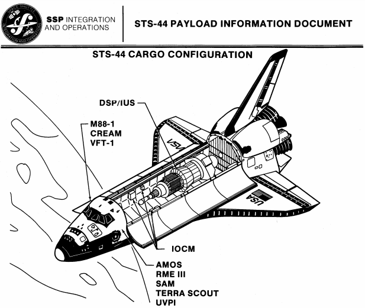
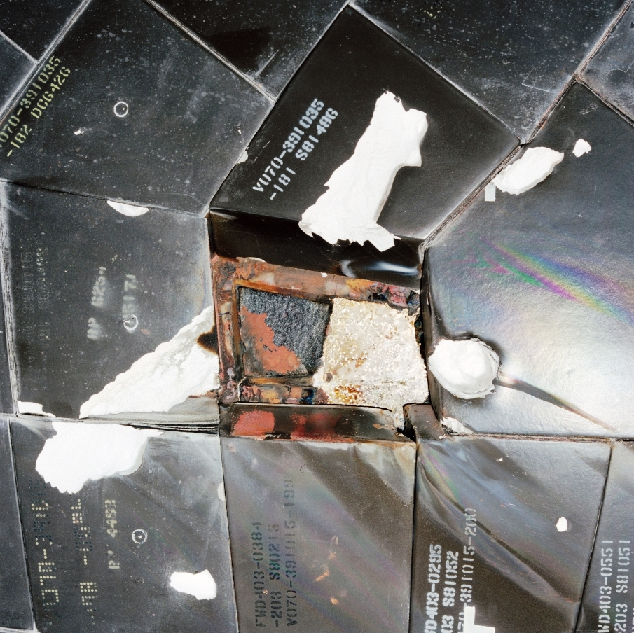
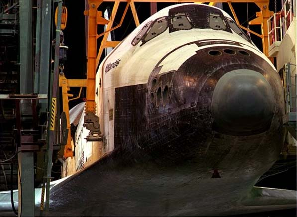

35 years ago today, November 24, 1991, Space Shuttle Atlantis lifted off from Florida on mission STS-44. Operating on a classified flight for the United States Department of Defense, the orbiter carried vital national security payloads into low Earth orbit.

## A Proven Workhorse in the Shuttle Fleet

Space Shuttle Atlantis was the fourth operational orbiter built for NASA. Constructed by Rockwell International in Southern California, it was delivered to the Kennedy Space Center in Eastern Florida in April 1985. Atlantis weighed 68,635 kilograms, making it nearly 3.5 short tons lighter than Space Shuttle Columbia, and was completed in roughly half the time Columbia required.

From its earliest flights, Atlantis established a reputation for rapid turnarounds and demanding assignments. In late 1985, it flew STS-61-B just 50 days after returning from its maiden voyage, setting the record for the shortest turnaround time between missions in shuttle history. In 1989, it became the first shuttle to launch an interplanetary probe when it deployed Magellan toward Venus, followed months later by the Galileo mission to Jupiter.

## Pre-Launch Hurdles and Launch Night Holds

The STS-44 mission was scheduled to carry a Defense Support Program satellite, designated DSP-16, attached to an Inertial Upper Stage booster known as IUS-14. Originally scheduled to lift off on November 19, 1991, the countdown was halted when technicians detected a malfunction in a redundant inertial measurement unit on the booster.

The launch was rescheduled for November 24, 1991. Even on launch night, controllers had to pause the countdown by 13 minutes. The hold allowed an orbiting spacecraft to clear the flight path and gave ground crews time to finish liquid oxygen replenishment following repairs to a valve on the mobile launcher platform. Atlantis finally lifted off into the night sky at 23:44:00 UTC at a total launch weight of 117,766 kilograms (259,630 pounds).

*STS-44 Cargo Configuration — Photo: SSP Integration and Operations / Public domain*

## Deploying Defense Payloads into Orbit

Once safely in low Earth orbit, the primary objective was carried out on flight day one. The crew deployed the heavy DSP-16 satellite and its booster out of the cargo bay, sending the defense spacecraft toward its operational post.

Beyond the primary satellite deployment, the shuttle middeck and payload bay served as a flying laboratory for several secondary defense and scientific experiments. These included Terra-Scout, the Military Man in Space project, the Interim Operational Contamination Monitor, and monitors tracking cosmic radiation effects. Medical investigations were also conducted under the Extended Duration Orbiter Medical Project to study astronaut health during lengthy spaceflights.

*Archive, 1988 — Photo: NASA / Public domain*

## Sensor Failure and an Early Homecoming

Although STS-44 was planned as a ten-day mission, unexpected hardware trouble arose in orbit. On November 30, 1991, one of the three orbiter inertial measurement units failed. These units provided critical navigational guidance for flight control and atmospheric reentry.

Because flight safety rules required sufficient navigation redundancy, mission managers decided to shorten the flight and bring Atlantis home early. Rather than landing at Florida's Kennedy Space Center on December 4 as planned, the orbiter was directed to the alternative landing site in the Mojave Desert.

*Space Shuttle Atlantis under construction — Photo: NASA / Public domain*

## The Final Dry Lake Bed Runway Touchdown

On December 1, 1991, Atlantis fired its orbital maneuvering engines and descended through the atmosphere. The orbiter touched down on Runway 5 at Edwards Air Force Base in California at 22:34:44 UTC, weighing 87,918 kilograms.

Atlantis rolled out across the dry lake bed surface for 3,411 meters (11,191 feet) over 107 seconds, using minimal braking as part of landing test procedures. This touchdown proved historic: it was the final space shuttle landing ever conducted on a dry lake bed runway. One week later, on December 8, Atlantis was ferried back to Florida.

## The Enduring Journey of Atlantis

STS-44 was only one chapter in an extraordinary career. Over its lifetime, Atlantis went on to perform historic dockings with the Russian space station Mir, delivered key components including the Destiny module and Columbus laboratory to the International Space Station, and carried out the final Hubble Space Telescope servicing mission.

Atlantis flew the final flight of the entire Space Shuttle program, STS-135, in July 2011. By the time it touched down for the last time, it had completed 33 missions, orbited Earth 4,848 times, and logged over 126 million miles—more than 525 times the distance from Earth to the Moon. Today, the retired spacecraft remains preserved on public display at the Kennedy Space Center Visitor Complex in Florida.

### Sources

- <https://en.wikipedia.org/wiki/Space_Shuttle_Atlantis>
- <https://commons.wikimedia.org/wiki/File:S44-77-096_-_STS-044_-_Earth_observations_taken_during_the_STS-44_mission_-_DPLA_-_729be081f82a93ded9f0d9848f09b431.jpg>
- <https://commons.wikimedia.org/wiki/File:STS-44_Cargo_Configuration.png>
- <https://commons.wikimedia.org/wiki/File:STS-27metalmelt.jpg>
- <https://commons.wikimedia.org/wiki/File:Space_Shuttle_Atlantis_under_construction.jpg>
