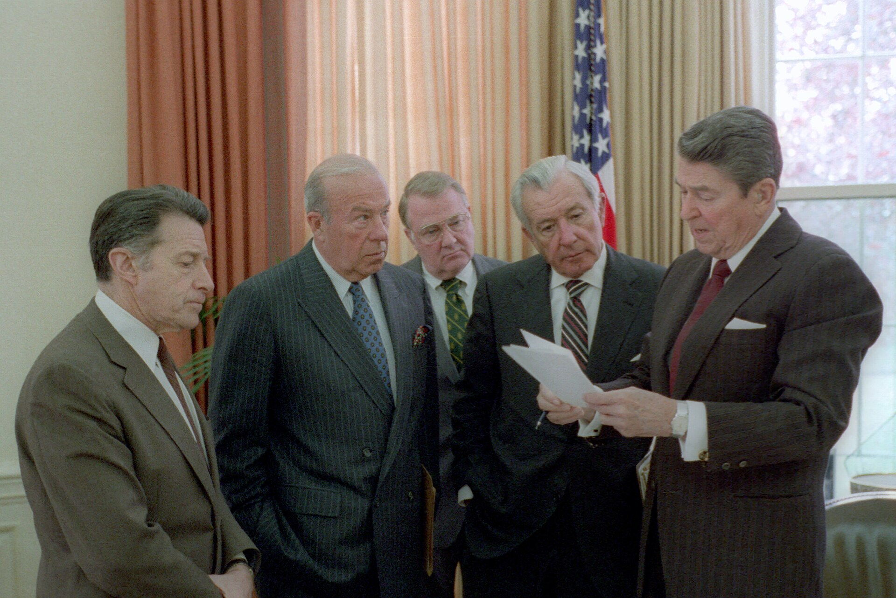
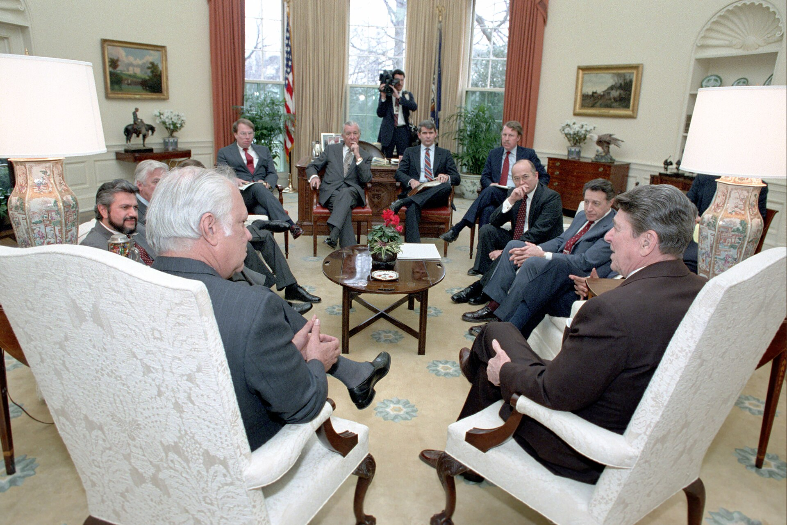

40 years ago today, November 25, 1986, United States Attorney General Edwin Meese stepped before reporters in Washington and confirmed what many had feared was true. Profits generated from covert weapon sales to Iran had been secretly diverted to finance the anti-communist Contra rebels fighting in Nicaragua. The disclosure instantly turned a simmering controversy into the defining political crisis of the Reagan administration.

## A Diplomatic Embargo and a Hostage Crisis

The roots of the operation went back to the late 1970s and early 1980s. Following the 1979 Iranian Revolution and the seizure of 66 American hostages at the United States Embassy in Tehran, Washington had placed an embargo on arms sales to Iran. When Iraq invaded Iran in September 1980, Tehran faced severe shortages of spare parts for its predominantly American-made military hardware. In the spring of 1983, the Reagan administration launched Operation Staunch, an international diplomatic campaign pressuring nations around the world to cut off weapons supplies to Iran.

At the same time, seven American citizens were being held hostage in Lebanon by Hezbollah, a paramilitary organization with ties to Iran. In an effort to secure their freedom, senior administration officials began exploring backchannels. An expatriate Iranian arms dealer named Manucher Ghorbanifar suggested that providing military equipment to Iran could encourage Tehran to exert its influence over Hezbollah and win the hostages' release.

## The Congressional Ban and Nicaragua

Across the globe in Central America, another foreign policy battle was raging. Since taking office in 1981, President Ronald Reagan had sought to assist the Contras, an armed rebel group fighting to overthrow the left-wing Sandinista government of Nicaragua. However, lawmakers in Congress grew increasingly alarmed by the covert war and passed the Boland Amendments between 1982 and 1984.

The second Boland Amendment imposed a comprehensive prohibition, explicitly forbidding any entity of the United States involved in intelligence activities from spending funds to support military or paramilitary operations in Nicaragua. Faced with this legal ban, members of the National Security Council staff sought alternative ways to keep the Contras armed and financed without congressional appropriations.

*Archive, 1986 — Photo: Series: Reagan White House Photographs, 1/20/1981 - 1/20/198 / Public domain*

## The Press Leak That Sparked the Crisis

The covert arrangement began unraveling in early November 1986. Ash-Shiraa, a Lebanese weekly magazine, published a story detailing secret shipments of American weapons to Iran. The report quickly made international headlines, putting the White House under intense public scrutiny.

President Reagan appeared on national television to address the growing uproar. While he acknowledged that weapon transfers had taken place as part of a strategic opening, he adamantly denied that the United States had engaged in a direct swap of arms for hostages. Behind closed doors, investigators inside the Justice Department began examining records and interviewing staff to determine exactly how the operation had been run.

*NOT FROM THE EVENT · 1983 — Photo: Michael Evans / Public domain*

## The November 25 Bombshell

On November 25, 1986, the controversy took an explosive turn. Attorney General Edwin Meese held a televised press conference to present the initial findings of his review. Meese revealed that between the price paid by Iran for the weapons and the cost to the Pentagon, millions of dollars in surplus profits had been generated.

Those surplus funds had not been returned to the United States Treasury. Instead, they had been channeled into secret Swiss bank accounts to purchase weapons, ammunition, and supplies for the Contras in Nicaragua. Lieutenant Colonel Oliver North, a staff member on the National Security Council, was relieved of his duties, and National Security Advisor John Poindexter resigned. The administration's secret mechanism to bypass federal law had been laid bare.

*President Ronald Reagan Meeting to Discuss Proposed Contra Aid Package with Adolfo Calero Arturo Cruz Alfonso Robelo John Poindexter Caspar Weinberger Oliver North Don Regan Don For - DPLA - fc454662eb39e4ea129298c59489e318 — Photo: President (1981-1989 : Reagan). White House Photographic Off / Public domain*

## The Aftermath: Investigations and Indictments

In December 1986, Lawrence Walsh, a former federal judge and deputy attorney general, was appointed as independent counsel to investigate potential criminal conduct. Congress established special committees that held weeks of televised hearings throughout the summer of 1987, captivating viewers across the country as officials testified under oath.

Investigators uncovered extensive efforts to shred and withhold documents. In March 1987, President Reagan addressed the nation again, accepting full responsibility and acknowledging that what began as a strategic opening had deteriorated into trading arms for hostages. Ultimately, several dozen officials were indicted, including Secretary of Defense Caspar Weinberger and Oliver North, leading to eleven convictions, though several were later overturned or wiped away by presidential pardons.

## A Lasting Debate on Executive Power

Forty years after Edwin Meese stepped to the podium, the Iran-Contra affair remains one of the most significant confrontations between Congress and the executive branch in modern American history. It demonstrated the profound constitutional tension between a president's foreign policy ambitions and the legislative branch's exclusive power of the purse.

For millions of Americans who watched the news unfold in late 1986, November 25 marked the exact moment a quiet diplomatic inquiry became a national crisis. The disclosures made on that autumn afternoon forever changed how the public viewed secret government operations.

### Sources

- <https://en.wikipedia.org/wiki/Iran%E2%80%93Contra_affair>
- <https://commons.wikimedia.org/wiki/File:Photograph_of_President_Reagan_motioning_to_Ed_Meese_during_a_White_House_Press_Briefing_on_Iran-Contra_-_NARA_-_198579.jpg>
- <https://commons.wikimedia.org/wiki/File:President_Ronald_Reagan_meets_with_aides_on_Iran-Contra_(cropped).jpg>
- <https://commons.wikimedia.org/wiki/File:Edwin_Meese_III,_Counsellor_to_the_President_ME784-7.jpg>
- <https://commons.wikimedia.org/wiki/File:President_Ronald_Reagan_Meeting_to_Discuss_Proposed_Contra_Aid_Package_with_Adolfo_Calero_Arturo_Cruz_Alfonso_Robelo_John_Poindexter_Caspar_Weinberger_Oliver_North_Don_Regan_Don_For_-_DPLA_-_fc454662eb39e4ea129298c59489e318.jpg>
