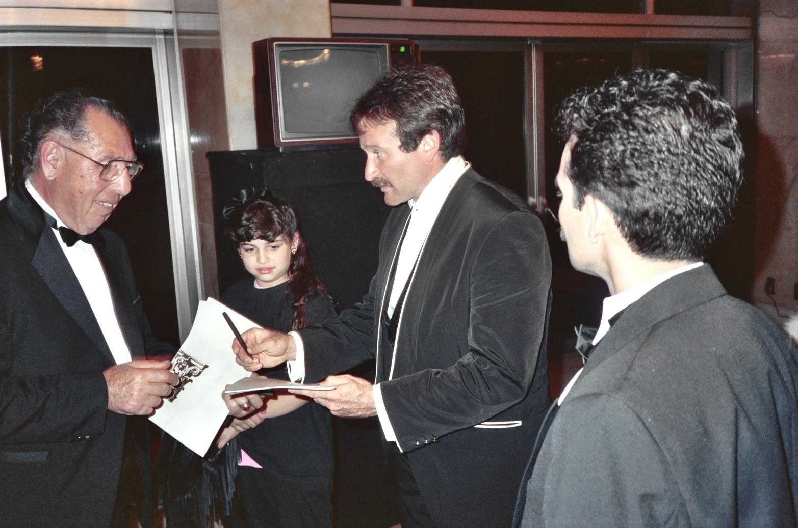

34 years ago today, November 25, 1992, Walt Disney Pictures released its 31st animated feature film, Aladdin, into theaters nationwide. What began as a classic Arabian folk tale quickly transformed into a global phenomenon, rewriting animation history and dominating the worldwide box office.

## An Idea Born from One Thousand and One Nights

The project originated when acclaimed lyricist Howard Ashman pitched the concept of an animated musical adaptation of the folk tale 'Aladdin' from One Thousand and One Nights to Disney studio president Jeffrey Katzenberg. Ashman envisioned a fast-paced musical comedy that paid homage to classic Hollywood style.

Developing the story required time and patience. The screenplay went through three separate drafts before Katzenberg granted final approval for production. Directing and producing partners John Musker and Ron Clements took the reins, co-writing the final screenplay alongside Ted Elliott and Terry Rossio to craft the adventure of an Arabian street urchin dreaming of a better life.

## Crafting the Visuals and the Magic of the Genie

To give the film its distinct look, Disney's animators looked beyond traditional realistic sketches. They based their character designs heavily on the swooping, fluid lines of legendary caricaturist Al Hirschfeld. The production also utilized computer technology to help finish hand-drawn artwork and render intricate three-dimensional sequences, such as the magic carpet's flight.

At the emotional and comedic center of the production stood Robin Williams. Casting Williams as the Genie allowed the filmmakers to marry lightning-fast vocal improvisation with dynamic visual transformation. The voice cast also featured Scott Weinger as Aladdin, Linda Larkin as Princess Jasmine, Jonathan Freeman as the villainous Jafar, Frank Welker, Gilbert Gottfried as Iago, and Douglas Seale as the Sultan.

*Not a photo of the event itself · NOT FROM THE EVENT · Stock image — Photo: niekverlaan / Pixabay Content License*

## A Bittersweet Musical Triumph

The soundtrack played a vital role in the film's identity. Composer Alan Menken collaborated closely with Howard Ashman to produce the score, but tragedy struck the production when Ashman died in 1991. Renowned lyricist Tim Rice was brought in to assist Menken and complete the remaining musical numbers for the soundtrack.

Their work produced six memorable songs, including the romantic centerpiece 'A Whole New World.' Performed as a pop duet by Peabo Bryson and Regina Belle, the track reached number one on the US Billboard Hot 100 chart. The song went on to win the Academy Award for Best Original Song and earned a Grammy Award for Song of the Year, marking the first time a Disney animated feature had achieved that Grammy honor.

*Not a photo of the event itself · NOT FROM THE EVENT · Stock image — Photo: coltsfan / Pixabay Content License*

## A Half-Billion-Dollar Box Office Milestone

When Buena Vista Pictures Distribution rolled out Aladdin under the Walt Disney Pictures banner in November 1992, film critics universally celebrated the film's lively animation and Williams' virtuosic performance. Audiences flocked to theaters in historic numbers.

Aladdin accumulated more than 504 million dollars in worldwide ticket sales, making it the highest-grossing film of 1992 across all genres. It became the very first animated movie in cinema history to reach the half-billion-dollar milestone. At the time of its release, Aladdin ranked as the fifth highest-grossing movie ever made and established a new all-time box-office record for animation, a title it held until Disney released The Lion King two years later in 1994.

*Robin Williams (2105790727) — Photo: Alan Light / CC BY 2.0*

## From Theaters to Living Rooms Across America

The triumph of Aladdin extended well past its theatrical run. When the film arrived on home video, American households embraced it just as warmly. The home VHS release generated approximately 500 million dollars in gross sales, setting retail records across the country and ensuring the film became an everyday fixture in living rooms.

In addition to its two Academy Awards, the film affirmed Walt Disney Feature Animation's position at the forefront of popular entertainment. The studio, which began with brothers Walt and Roy O. Disney in 1923 and produced Snow White and the Seven Dwarfs in 1937, proved that animated storytelling could consistently rival and surpass live-action Hollywood blockbusters.

## A Timeless Treasure That Endures

Decades after that Thanksgiving week release in 1992, Aladdin remains one of the crowning achievements of modern animation. Its songs are still recognized around the world, and Robin Williams' electric portrayal of the Genie continues to introduce new generations to the joy of Disney animation.

More than thirty years later, the street urchin who found an old lamp in the Cave of Wonders still reminds audiences of the magic that happens when artistry, comedy, and unforgettable music come together on the silver screen.

### Sources

- <https://en.wikipedia.org/wiki/Walt_Disney_Animation_Studios>
- <https://pixabay.com/photos/film-35mm-vintage-projector-1365334/>
- <https://pixabay.com/photos/projector-film-exhibition-show-422145/>
- <https://pixabay.com/photos/theatre-seats-old-theater-cinema-2535552/>
- <https://commons.wikimedia.org/wiki/File:Robin_Williams_(2105790727).jpg>
