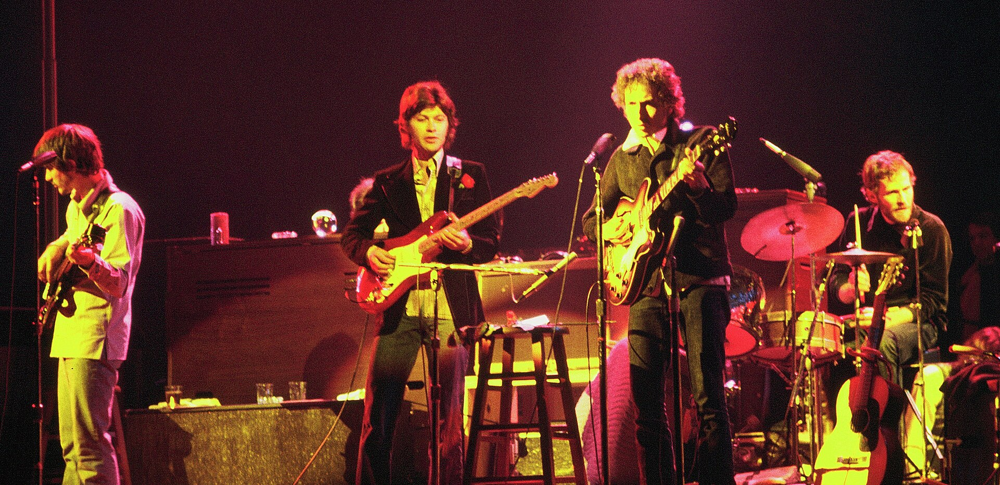
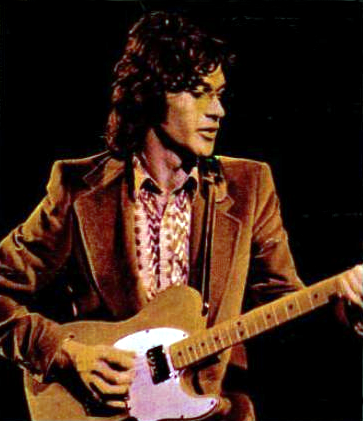
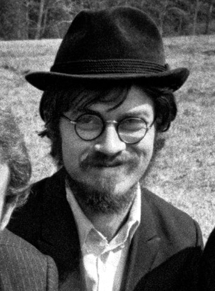

Fifty years ago today, on November 25, 1976, the Winterland Ballroom in San Francisco hosted one of the most momentous evenings in rock and roll history. Billed as the farewell concert appearance of the Canadian-American group The Band, the performance titled 'The Last Waltz' brought together an unprecedented roster of musical legends to celebrate the end of a touring era.

## From the Hawks to Music from Big Pink

The story of The Band began nearly two decades before that fateful Thanksgiving evening. Composed of four Canadians—bassist Rick Danko, keyboardist and multi-instrumentalist Garth Hudson, pianist Richard Manuel, and guitarist Robbie Robertson—along with Arkansas-born drummer Levon Helm, the ensemble first came together between 1958 and 1963 as the Hawks, backing rockabilly singer Ronnie Hawkins around Toronto.

After striking out on their own, the group gained worldwide attention in the mid-1960s when they backed Bob Dylan on his groundbreaking 1966 tour as his first electric backing band. Adopting the simple moniker 'The Band,' they released their landmark debut album 'Music from Big Pink' in 1968, followed by their self-titled album in 1969. With beloved tracks like 'The Weight,' 'The Night They Drove Old Dixie Down,' and 'Up on Cripple Creek,' they blended Americana, folk, rock, R&B, jazz, and country, deeply influencing peers such as George Harrison, Elton John, Eric Clapton, and the Grateful Dead.

## Thanksgiving at the Winterland Ballroom

By 1976, after releasing further albums including 'Stage Fright,' 'Cahoots,' and 'Northern Lights – Southern Cross,' the rigors of touring led the group to plan an exit from the road. They chose American Thanksgiving Day, November 25, 1976, to say goodbye at the Winterland Ballroom in San Francisco.

San Francisco had long stood as a cultural capital of the West Coast, known for its vibrant music scene and countercultural history. Renowned concert promoter Bill Graham took charge of producing and managing the massive event, while the Band's original record producer, John Simon, stepped in as musical director to coordinate the complex arrangements for the night.

*Bob Dylan and The Band - 1974 — Photo: Jim Summaria / CC BY-SA 3.0*

## A Gathering of Legends on One Stage

What set 'The Last Waltz' apart from any ordinary farewell show was the extraordinary lineup of guest artists who arrived to honor The Band. More than a dozen major figures answered the call, representing the wide spectrum of American and roots music.

Their early mentor Ronnie Hawkins joined them on stage, bridging the past and present. Blues icon Muddy Waters delivered a commanding performance alongside Paul Butterfield. Guitar virtuoso Eric Clapton traded solos with Robbie Robertson, while Canadian peers Neil Young and Joni Mitchell delivered haunting vocal contributions. Van Morrison brought theatrical energy, Dr. John added New Orleans rhythm, and Neil Diamond shared the stage with the group. The guest list also featured Bobby Charles, Ringo Starr, and Ronnie Wood, turning the concert into a living anthology of modern music.

*Robbie Robertson (1971) — Photo: Capitol Records / Public domain*

## The Reunion with Bob Dylan and the Final Encore

The emotional pinnacle of the concert came when Bob Dylan joined his longtime collaborators on stage, revisiting the electric chemistry they had forged together on tour a decade earlier. With Dylan leading the ensemble through signature numbers, the audience witnessed the culmination of a musical partnership that had fundamentally changed popular culture.

Backed by an expansive horn section, The Band traversed their own catalog with emotional precision. To bring the long night to a close, the entire collective of musicians took the stage for an encore performance of Marvin Gaye's hit 'Don't Do It.' It was the final song The Band's original five-man lineup would ever play on a concert stage together.

*Robbie Robertson 1969 — Photo: Capitol Records / Public domain*

## Martin Scorsese and the Cinematic Legacy

The entire event was captured on 35mm film by director Martin Scorsese, who was introduced to Robbie Robertson by Rock Brynner at the suggestion of former tour manager and producer Jonathan Taplin. Scorsese brought innovative camera choreography to the ballroom, ensuring that the visual record matched the sonic ambition of the concert.

Released in theaters in 1978, the documentary film 'The Last Waltz' intercut the concert footage with insightful interviews and later soundstage performances featuring Emmylou Harris and the Staple Singers. The film quickly earned acclaim as one of the greatest concert documentaries ever created, opening with the famous advisory: 'This film should be played loud!'

## Preserved in History Five Decades Later

Although Danko, Hudson, Helm, and Manuel briefly reunited in 1983 to tour without Robertson, the original magic of the five founding members remained anchored to that November night in 1976. The Band was inducted into the Canadian Music Hall of Fame in 1989 and the Rock and Roll Hall of Fame in 1994, later receiving a Grammy Lifetime Achievement Award in 2008.

In 2019, the Library of Congress selected 'The Last Waltz' for preservation in the United States National Film Registry, designating it as culturally, historically, or aesthetically significant. Today, fifty years after the lights dimmed at the Winterland Ballroom, the concert stands as a timeless monument to the spirit of American roots music.

### Sources

- <https://en.wikipedia.org/wiki/San_Francisco>
- <https://commons.wikimedia.org/wiki/File:The_Last_Waltz.jpg>
- <https://commons.wikimedia.org/wiki/File:Bob_Dylan_and_The_Band_-_1974.jpg>
- <https://commons.wikimedia.org/wiki/File:Robbie_Robertson_(1971).png>
- <https://commons.wikimedia.org/wiki/File:Robbie_Robertson_1969.jpg>
