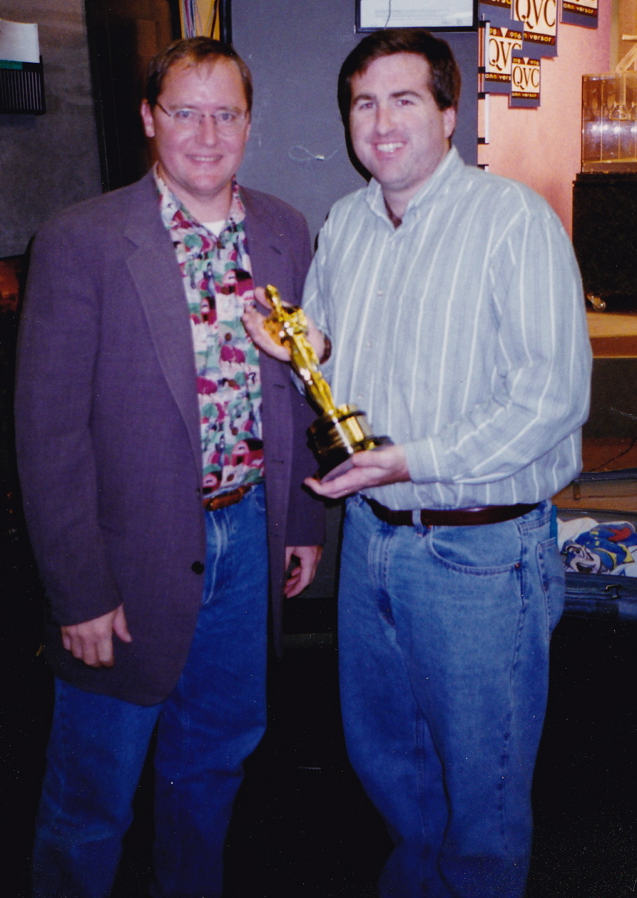
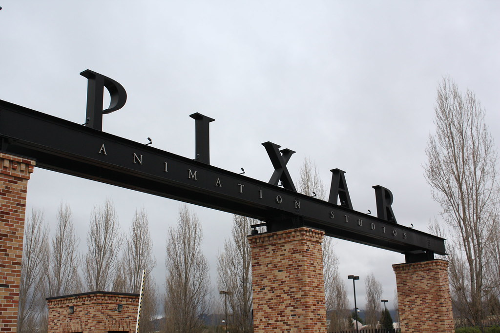

28 years ago today, November 25, 1998, Pixar Animation Studios released its second feature film, A Bug's Life, in theaters across the United States. Following the groundbreaking debut of Toy Story three years earlier, the film proved that computer-generated feature animation was a lasting art form rather than a one-time novelty.

## The Fateful Lunch of 1994

The idea for A Bug's Life took root in the summer of 1994, well before Toy Story had even arrived in theaters. Pixar's core creative team—John Lasseter, Andrew Stanton, Pete Docter, and Joe Ranft—gathered for lunch to discuss where the studio should head next. That single meal proved historic, planting the conceptual seeds not only for A Bug's Life, but also for future classics like Monsters, Inc., Finding Nemo, and WALL-E.

The team wanted to tell a story about insects. Much like plastic toys, insects possessed hard, shiny surfaces that were manageable for the computer hardware and software available in the mid-1990s. Andrew Stanton and Joe Ranft wondered whether they could adapt Aesop's ancient fable The Ant and the Grasshopper. Walt Disney had previously tackled the tale in a 1934 short, but Pixar envisioned an entirely fresh spin on the dynamic between working ants and demanding grasshoppers.

## Pitching to Disney and Launching Production

By early 1995, the story team began actively developing the project. In June 1995, during a test screening of Toy Story in San Rafael, California, the filmmakers pitched the concept to Michael Eisner, the chief executive officer of The Walt Disney Company. Eisner responded warmly to the premise, and by July, Pixar formally submitted a treatment under the preliminary title Bugs.

Once Disney approved production, Lasseter stepped in as director, working alongside screenwriters Andrew Stanton, Donald McEnery, and Bob Shaw. The creative team completely redesigned their insect characters from biological reality to give them appealing, expressive features. Randy Newman joined the production to compose the orchestral score, establishing the playful and energetic musical identity that accompanied the colony's plight.

*Not a photo of the event itself · NOT FROM THE EVENT · Stock image — Photo: niekverlaan / Pixabay Content License*

## Tensions in Hollywood: The Feud with DreamWorks

Production did not proceed without outside conflict. During the film's development, a controversial and highly publicized feud erupted between Pixar leaders Steve Jobs and John Lasseter and DreamWorks co-founder Jeffrey Katzenberg. Katzenberg, a former Disney studio chairman, had launched a parallel computer-animated insect project titled Antz.

The simultaneous production of two insect-themed animated features created enormous media speculation and tension throughout the industry. DreamWorks moved quickly, releasing Antz into theaters in October 1998, one month ahead of Pixar's theatrical window. The creative team at Pixar remained focused on completing their own vision, trusting that their distinct family comedy and vibrant art style would resonate on their own merits.

*John Lasseter, Jim Breslin, 1996 (crop) — Photo: Jim Breslin / CC BY 2.0*

## A Misfit Ant and a Troupe of Circus Bugs

At the heart of A Bug's Life was Flik, voiced by Dave Foley, an eccentric and well-meaning ant whose mechanical inventions frequently brought disaster to Ant Island. Every summer, a menacing gang of grasshoppers led by Hopper, voiced by Kevin Spacey, extorted food offerings from the ant colony. When Flik accidentally knocked the annual offering into the river, Hopper demanded a double tribute under threat of destruction.

Desperate to make amends, Flik traveled to a nearby trash heap under a trailer, dubbed 'the city,' searching for brave warrior insects to defend the hill. Instead, through a comical misunderstanding, he mistakenly hired an unemployed circus troupe including Francis the ladybug, Heimlich the caterpillar, Manny the mantis, and Rosie the black widow. The ensuing clash between genuine bravery, theatrical deception, and the solidarity of the ant colony formed the backbone of the movie's humor and emotional core.

*Pixar Animation Studio — Photo: superstrikertwo / CC BY-SA 2.0*

## Box Office Triumph and a Digital Milestone

A Bug's Life premiered at the El Capitan Theatre in Los Angeles on November 14, 1998, before expanding nationwide on November 25 for the Thanksgiving holiday frame. The film was met with enthusiastic reviews praising its humor, heart, and voice cast, which featured Julia Louis-Dreyfus as Princess Atta, Hayden Panettiere as young Dot, and Phyllis Diller as the Queen.

The film grossed 363 million dollars worldwide, establishing itself as a resounding commercial triumph. Beyond its theatrical receipts, A Bug's Life achieved a notable technological benchmark in home entertainment: it became the very first movie to be digitally transferred frame by frame directly from computer data to the DVD format, preserving pristine visual fidelity without intermediate film scans.

## A Stepping Stone in Pixar's Legacy

For American moviegoers and the animation industry at large, November 25, 1998, answered a vital lingering question. Toy Story had proven that a feature-length computer-animated film was possible, but A Bug's Life proved that Pixar possessed the sustained creative vision, storytelling discipline, and technological innovation to do it repeatedly.

From the Emeryville studio's modest origins in Lucasfilm's computer division to its status as an animation titan, A Bug's Life solidified the foundation on which decades of beloved films were built. More than a quarter of a century later, Flik's stand against Hopper remains an enduring reminder of how imagination and persistence can overcome impossible odds.

### Sources

- <https://en.wikipedia.org/wiki/Pixar>
- <https://pixabay.com/photos/film-35mm-vintage-projector-1365334/>
- <https://pixabay.com/photos/projector-film-exhibition-show-422145/>
- <https://commons.wikimedia.org/wiki/File:John_Lasseter,_Jim_Breslin,_1996_(crop).jpg>
- <https://www.flickr.com/photos/14876067@N00/4495446802>
