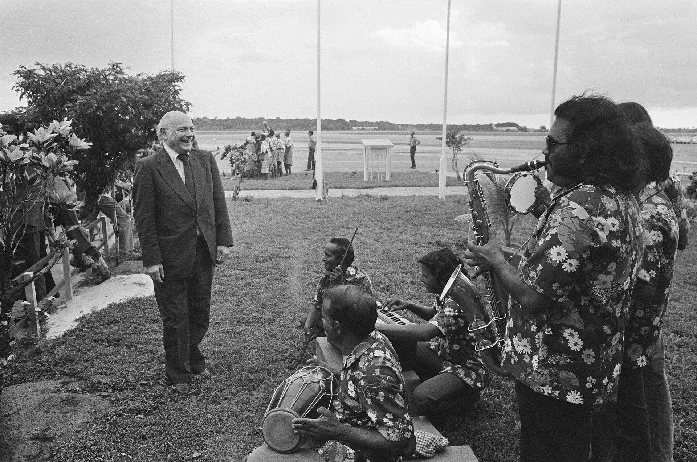
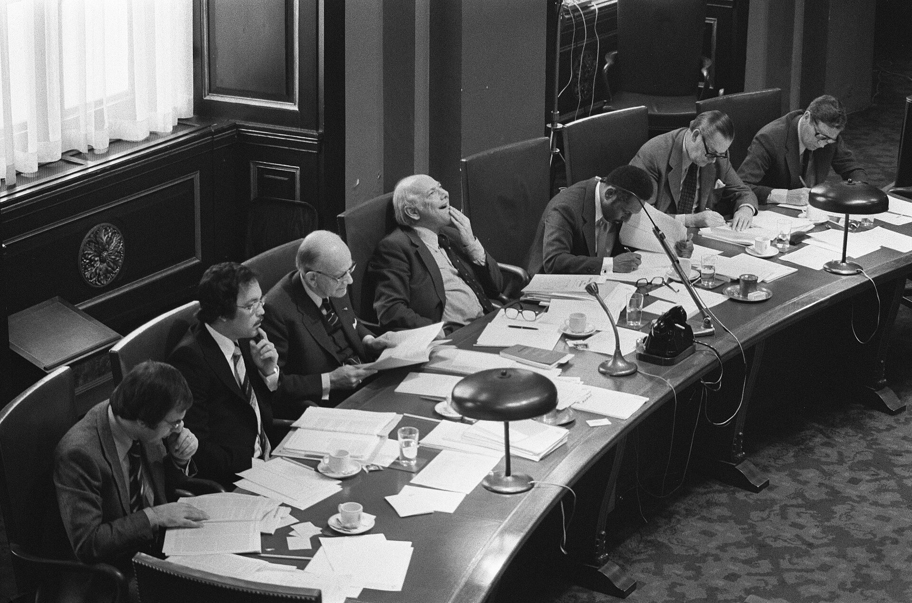
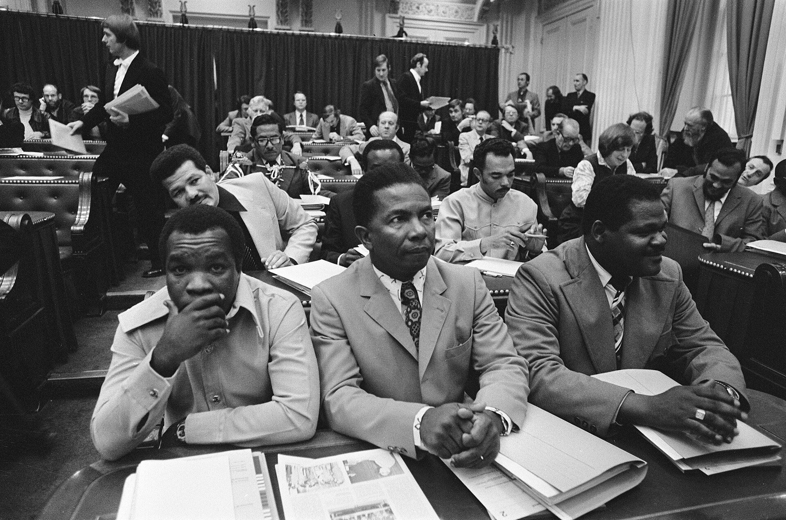

51 years ago today, on November 25, 1975, Suriname officially declared its independence from the Kingdom of the Netherlands. The transition brought an end to more than three centuries of Dutch colonial governance along the northeastern coast of South America. After extensive diplomatic discussions between The Hague and Paramaribo, the former colony stepped onto the world stage as an independent republic.

## From Plantation Colony to Dutch Guiana

European interest in the northern coast of South America began in the 16th century with visits from French, Spanish, and English explorers. In 1630, English settlers established a settlement at Marshall's Creek along the Suriname River, followed by another English colony that lasted from 1650 until 1667. Dutch forces captured the territory on February 26, 1667, during the Second Anglo-Dutch War. Under the Treaty of Breda signed on July 31, 1667, the Dutch retained sovereignty over Suriname while the English kept New Netherland.

Throughout the colonial era, the territory often referred to as Dutch Guiana operated as a lucrative plantation economy centered on sugarcane, cotton, indigo, and later coffee. This system relied heavily on slave labour supplied by the Dutch West India Company from West Africa. Approximately 300,000 enslaved Africans were forcibly brought to Suriname between the mid-1600s and the early 1800s. Slavery was officially abolished on July 1, 1863—a landmark date commemorated as Ketikoti—though formerly enslaved workers were mandated to complete a ten-year transitional period that concluded in 1873. To address labour shortages on plantations, colonial authorities signed an 1870 treaty with the United Kingdom to bring indentured labourers from British India, alongside recruits from the Dutch East Indies.

## The 1954 Charter and Postwar Autonomy

The geopolitical aftermath of World War II reshaped the relationship between European powers and their overseas dependencies. The Atlantic Charter of 1941 had recognized the right of all peoples to choose their form of government, and Queen Wilhelmina of the Netherlands outlined plans for administrative reform in a radio broadcast on December 7, 1942. In 1954, Suriname became a constituent country of the Kingdom of the Netherlands, securing equal status alongside the Netherlands and the Netherlands Antilles.

Under the 1954 framework, Suriname possessed wide-ranging self-governance over its internal domestic affairs. The territory sent a Minister Plenipotentiary to participate in Dutch cabinet meetings in The Hague whenever matters directly affected Suriname. However, the Dutch government retained authority over key national functions, notably foreign policy and defense. While this charter was intended to preserve the kingdom's unity, political sentiment in Europe began shifting rapidly during the 1960s.

*DenUylSurinameVerhoeff1975 — Photo: Bert Verhoeff for Anefo / CC0*

## Shifting Attitudes in The Hague

During the 1950s, Dutch leaders had opposed complete sovereignty for Suriname, preferring the autonomy structure. That stance eroded following international crises and domestic unrest. The 1962 Netherlands New Guinea crisis and the 1969 riots in Curaçao highlighted the geopolitical and administrative liabilities of overseas possessions. Dutch politicians increasingly viewed the Caribbean territories as an expensive fiscal burden that complicated foreign diplomacy.

When the Dutch cabinet led by Prime Minister Joop den Uyl entered office in May 1973, decolonization became an explicit national objective. The Dutch Labour Party argued on moral and ideological grounds that the remnants of colonial administration must be eliminated. Although the government of Surinamese leader Jules Sedney initially cautioned against moving too quickly, the election of Henck Arron changed the dynamic. Arron accepted Den Uyl's proposal to conclude sovereignty by the end of 1975, opening intensive bilateral discussions between the two governments.

*Eerste Kamer debat onafhankelijkheid Suriname Achter de regeringstafel vlnr. , Bestanddeelnr 928-2371 — Photo: Rob Mieremet / Anefo / CC0*

## The Transfer of Sovereignty in 1975

The final negotiations involved resolving complex financial and constitutional arrangements. To help launch the new republic on stable economic footing, the Dutch government agreed to provide a substantial severance package amounting to 3.5 billion Dutch guilders. This financial aid package was designed to assist national development and smooth the transition from colonial dependency.

On November 25, 1975, Suriname officially severed its colonial ties with the Netherlands and proclaimed the Republic of Suriname. In the capital city of Paramaribo, the Dutch flag was lowered, marking the culmination of negotiations that granted full sovereignty over foreign policy and national defense. The peaceful handover transformed the former constituent realm into an independent nation recognized across the international community.

*Debat (Koninkrijksdebat) onafhankelijkheid Suriname v.l.n.r. Derby, Emile Wijnt, Bestanddeelnr 928-2177 — Photo: Hans Peters for Anefo / CC0*

## A Unique Nation in South America

Following independence, Suriname emerged as the smallest sovereign country in South America by both land area and population. Bordered by the Atlantic Ocean to the north, French Guiana to the east, Brazil to the south, and Guyana to the west, its territory spans roughly 165,940 square kilometres. Over 95 percent of this terrain is blanketed by dense tropical rainforest, representing the second-highest proportion of forest cover of any nation on Earth.

Suriname quickly engaged with global institutions, securing membership in the United Nations, the Organization of American States, the Caribbean Community, and the Organisation of Islamic Cooperation. Its national economy developed around valuable natural commodities, specifically bauxite, gold, petroleum, and agriculture, providing crucial foreign exchange for the young republic.

## The Enduring Cultural Legacy

Decades after gaining independence, Suriname retains deep historical connections to its colonial past while celebrating an exceptionally diverse demographic heritage. It remains the only sovereign state outside Europe where Dutch serves as the official and prevailing language in government, education, business, and media, spoken natively by approximately 60 percent of the population. Alongside Dutch, Sranan Tongo, an English-based creole, functions as a widespread lingua franca.

Centred around the capital city of Paramaribo, where nearly half of the nation's 612,985 inhabitants live as recorded in 2021, Suriname possesses no single ethnic majority. Descendants of African slaves and Asian indentured labourers have built a multicultural society with some of the largest Muslim and Hindu populations proportionally in the Americas. November 25, 1975, remains the defining milestone that allowed this unique South American society to chart its own destiny.

### Sources

- <https://en.wikipedia.org/wiki/Suriname>
- <https://commons.wikimedia.org/wiki/File:Arron_Lachmon_Suriname_vlag.jpg>
- <https://commons.wikimedia.org/wiki/File:DenUylSurinameVerhoeff1975.jpg>
- <https://commons.wikimedia.org/wiki/File:Eerste_Kamer_debat_onafhankelijkheid_Suriname_Achter_de_regeringstafel_vlnr._,_Bestanddeelnr_928-2371.jpg>
- <https://commons.wikimedia.org/wiki/File:Debat_(Koninkrijksdebat)_onafhankelijkheid_Suriname_v.l.n.r._Derby,_Emile_Wijnt,_Bestanddeelnr_928-2177.jpg>
