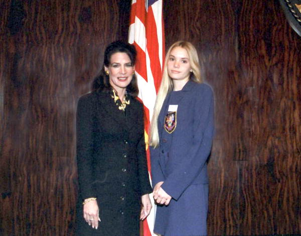
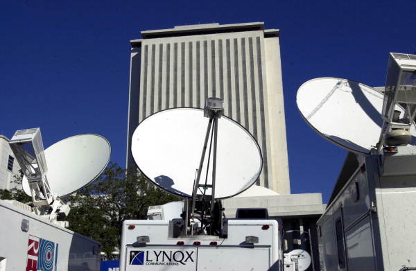
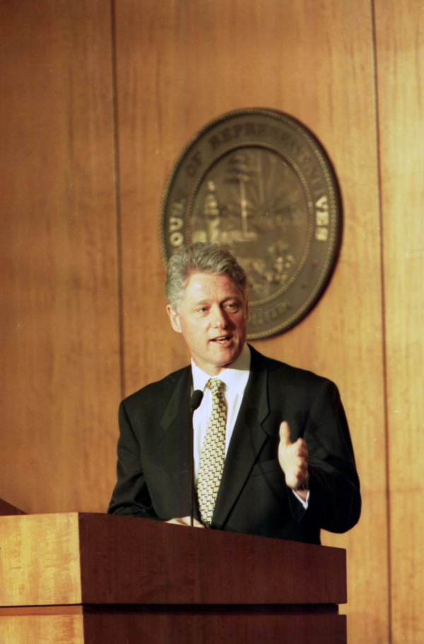

26 years ago today, on November 26, 2000, Florida Secretary of State Katherine Harris officially certified Texas governor George W. Bush as the winner of Florida's electoral votes. The announcement came during an unprecedented post-election standoff that held the United States and the world in suspense. With that single certification, Bush gained the electoral votes needed to capture the presidency, despite losing the national popular vote.

## The Tightest Presidential Race in Modern History

The presidential election held on November 7, 2000, pitted Republican nominee George W. Bush and his running mate Dick Cheney against Democratic incumbent Vice President Al Gore and Connecticut senator Joe Lieberman. President Bill Clinton was ineligible to seek a third term under the Twenty-second Amendment. Both campaigns focused heavily on domestic matters such as tax relief, the budget, and federal social insurance programs.

When the ballots were counted nationwide, Gore won the popular vote by 543,895 votes, a margin of 0.52%. It marked the first time since 1888 that the winner of the presidential election lost the national popular vote, and only the fourth time in United States history up to that point. By the number of votes capable of shifting the ultimate outcome, it remains the closest presidential contest the nation has ever seen.

## All Eyes on the Sunshine State

On election night, television networks swung back and forth, unable to declare a clear winner as the outcome stalled in Florida. Bush had flipped 11 states that voted Democratic in 1996, including Arkansas, Arizona, Kentucky, Louisiana, Missouri, Nevada, New Hampshire, Ohio, Tennessee, and West Virginia. However, neither candidate could cross the threshold of 270 electoral votes without Florida.

A total of 5.96 million ballots had been cast across Florida. As the initial tallies concluded, Bush held a paper-thin advantage of just 537 votes, representing a margin of only 0.009%. That microscopic difference triggered automatic reviews, legal actions, and intense scrutiny over the state's voting procedures.

*Katherine Harris standing with an unidentified Senate page — Photo: Unknown authorUnknown author / Public domain*

## Katherine Harris Steps into the Spotlight

The responsibility for overseeing and certifying the state's election fell directly upon Katherine Harris, Florida's Secretary of State. Harris, a Republican who had served in the Florida Senate from 1994 to 1998 before taking statewide office in 1999, suddenly found herself at the center of international attention. A constitutional revision in 1998 had made the position an appointed role in the future, making Harris the last person ever elected to the post.

Over the weeks following the election, Florida became the scene of intense political conflict. Manual recounts in several counties were started and halted, accompanied by demonstrations and dueling court filings from both political parties. Harris insisted on following strict statutory deadlines to bring finality to the count.

*Election2000news — Photo: Foley, Mark T. / Public domain*

## The Official Certification on November 26

On November 26, 2000, Harris formally certified the Florida results, declaring George W. Bush the winner of the state by 537 votes. The certification awarded Florida's electors to the Republican ticket, giving Bush a total of 271 electoral votes.

That total was exactly one vote more than the 270 required to win the presidency in the Electoral College. Although the Democratic ticket continued its legal challenges to contested ballots, Harris's official declaration provided the Bush campaign with crucial legal standing and momentum.

*Bill Clinton addressing a joint session of the Florida Legislature in Tallahassee — Photo: Dughi, Donn(Donald Gregory), 1932-2005 / Public domain*

## From Bush v. Gore to the White House

The battle over Florida's ballots did not end immediately with Harris's certification. The dispute moved through state and federal courts, ultimately reaching the United States Supreme Court in the historic case Bush v. Gore. The Supreme Court's ruling halted further recounts, effectively ensuring that the certified Florida results stood.

With Florida secured, Bush was confirmed as the 43rd president of the United States, taking office in January 2001. The eldest son of former president George H. W. Bush, he would serve two terms in the White House from 2001 to 2009. The certification on November 26 stood as the pivotal turning point of that contentious election season.

## A Moment Etched in American Memory

The events of November 2000 fundamentally transformed how the public viewed election administration and ballot counting in America. The image of election workers examining individual ballots and state officials standing before television cameras became defining symbols of the era.

For millions of Americans who watched the drama unfold live on television, the certification announced by Katherine Harris remains an unforgettable memory. It was the moment when a contest decided by just 537 votes effectively determined the leadership of the nation.

### Sources

- <https://en.wikipedia.org/wiki/George_W._Bush>
- <https://commons.wikimedia.org/wiki/File:Five_former_Governors_joining_Governor_Jeb_Bush_at_the_Florida_Governors_Forum.jpg>
- <https://commons.wikimedia.org/wiki/File:Katherine_Harris_standing_with_an_unidentified_Senate_page.jpg>
- <https://commons.wikimedia.org/wiki/File:Election2000news.jpg>
- <https://commons.wikimedia.org/wiki/File:Bill_Clinton_addressing_a_joint_session_of_the_Florida_Legislature_in_Tallahassee.jpg>
