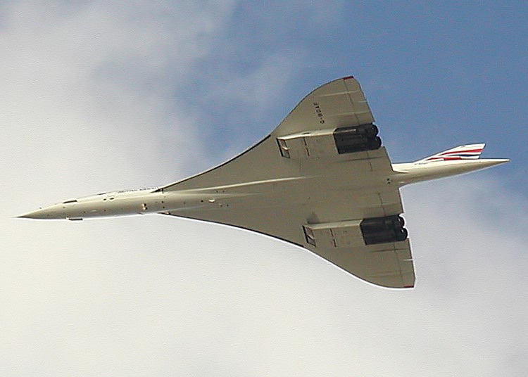
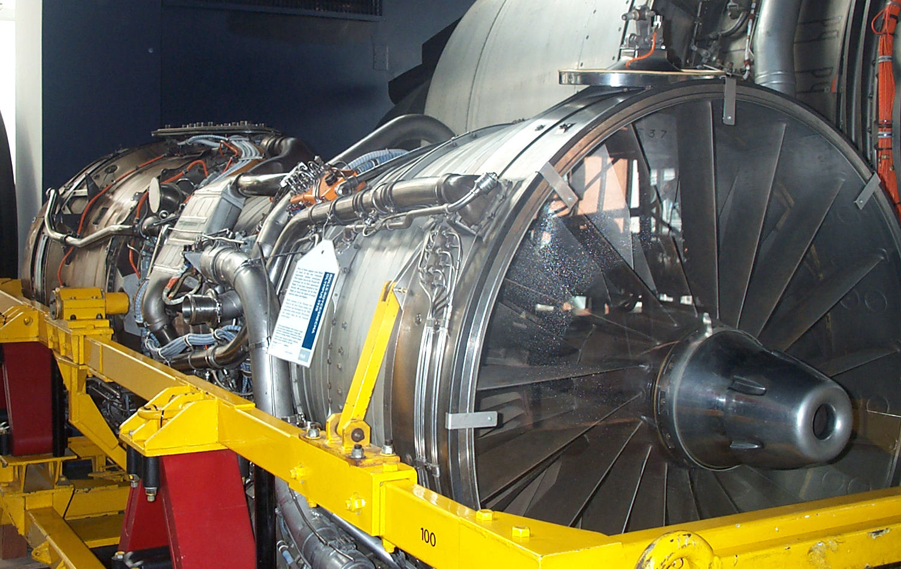
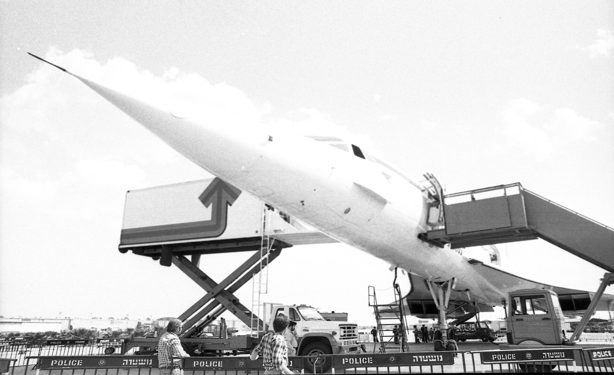

23 years ago today, November 26, 2003, the legendary supersonic airliner Concorde flew through the skies for the very last time. The aircraft made its farewell flight over Bristol, England, drawing crowds who looked up to catch a final glimpse of commercial aviation's most famous profile. For aviation enthusiasts and travelers alike, the journey marked the formal close of a 27-year era in which passengers routinely traveled faster than the speed of sound.

## A Farewell Flight Over Bristol

On November 26, 2003, Concorde took off on its final journey, charting a route across South West England before descending over Bristol. Bristol, bordered by Gloucestershire to the north and Somerset to the south, held deep ties to the aircraft through its aerospace industry. As the graceful jet soared over the River Avon and the Bristol Channel, crowds gathered below to watch the supersonic icon complete its operational life.

The final landing marked an emotional homecoming. Concorde had been jointly developed and produced by the British Aircraft Corporation alongside France's Sud Aviation, with critical assembly and flight test operations tied directly to the Bristol region. When the wheels touched the runway on that late November afternoon, commercial aviation bid goodbye to the only supersonic passenger transport that had sustained decades of regular airline service.

## The Bold Ambition of Supersonic Flight

The road to Concorde began in the early 1950s, when aviation engineers first envisioned passenger aircraft flying beyond the sound barrier. In February 1954, Arnold Hall, director of the Royal Aircraft Establishment, asked Morien Morgan to assemble a committee to explore supersonic transport. Their initial study, completed in April 1955, examined short-span trapezoidal wing designs similar to those planned for the Avro 730 strategic bomber, but discovered they required enormous engine thrust and runway lengths.

Breakthrough aerodynamic studies soon changed the equation. Researchers Johanna Weber and Dietrich Küchemann introduced the slender delta concept, showing that sharp delta wings generated strong upper vortices at high angles of attack. Encouraged by these findings, Britain and France signed a joint treaty in 1962 to develop the airliner. Although early estimates anticipated a program cost of 70 million pounds, intense technical demands and delays drove development costs to between 1.5 and 2.1 billion pounds by 1976.

*Archive, 2003 — Photo: User Arpingstone on en.wikipedia / Public domain*

## Engineering a Mach 2 Marvel

Concorde was an extraordinary triumph of aeronautical engineering. The aircraft was constructed primarily from aluminium and featured an ogival delta wing alongside a distinctive droop nose that lowered to improve pilot visibility during approach and touchdown. Its narrow fuselage accommodated between 92 and 128 passengers arranged in four-abreast seating, offering an exclusive cabin atmosphere.

To propel the airliner across oceans at twice the speed of sound, engineers equipped Concorde with four Rolls-Royce Snecma Olympus 593 turbojet engines featuring variable intake ramps and reheat capability. It became the first airliner in the world to adopt analogue fly-by-wire flight controls. Once airborne, Concorde was capable of supercruising at Mach 2 for roughly 75 percent of its transatlantic journey, cutting standard travel times between Europe and North America by more than half.

*Rolls Royce-SNECMA Olympus — Photo: Timitrius from Great Britain / CC BY-SA 2.0*

## Transatlantic Links to Washington and New York

Commercial operations officially commenced on January 21, 1976, when British Airways launched flights from London Heathrow and Air France began services from Paris-Roissy. The prime market for Concorde quickly became transatlantic luxury travel, connecting European capitals directly with the United States. Regular supersonic service to Washington Dulles began on May 24, 1976, followed by scheduled flights to New York JFK on October 17, 1977.

Competing supersonic programs struggled to challenge Concorde's position. In the United States, Boeing had proposed the 2707 supersonic transport, but the project was cancelled in 1971 before any prototypes were built. The Soviet Union's Tupolev Tu-144 entered passenger service in November 1977, but was withdrawn after a crash in May 1978. Because sonic booms barred supersonic flights over populated landmasses, Concorde survived exclusively on oceanic crossings, operated by British Airways and Air France with seven airframes each.

*The Concord, the supersonic airliner landing in Ben Gurion Airport (FL63499145) — Photo: IPPA photographer / CC BY 4.0*

## Tragedy and the Retirement Decision

For nearly a quarter of a century, Concorde maintained an enviable safety record. That record was shattered on July 25, 2000, when Air France Flight 4590 crashed shortly after takeoff from Paris, killing all 109 occupants on board as well as four people on the ground. The tragedy, the sole fatal accident in Concorde's history, prompted authorities to suspend commercial operations until November 2001.

Although the airliners returned to service with safety enhancements, the economic environment had fundamentally shifted. Escalating maintenance expenses and declining passenger demand placed severe financial strain on operations. In 2003, after 27 years of commercial service, British Airways and Air France jointly decided that Concorde would be permanently retired.

## Preserving the Supersonic Legacy

Even though supersonic passenger flight has vanished from daily airline schedules, Concorde remains an enduring symbol of modern technical daring. Today, 18 preserved Concorde airframes are housed in museums and aviation centers across Europe and North America, allowing visitors to inspect its narrow cabin and sharp delta wings up close.

The final flight over Bristol brought the jet back to the community whose engineers helped pioneer its revolutionary systems. Looking up at the sky on November 26, 2003, spectators understood they were witnessing the end of an incomparable chapter in human flight—one where crossing the Atlantic at twice the speed of sound was a regular reality.

### Sources

- <https://en.wikipedia.org/wiki/Concorde>
- <https://commons.wikimedia.org/wiki/File:Supersonic.arp.750pix.jpg>
- <https://commons.wikimedia.org/wiki/File:Concorde.highup.arp.750pix.jpg>
- <https://commons.wikimedia.org/wiki/File:Rolls_Royce-SNECMA_Olympus.jpg>
- <https://commons.wikimedia.org/wiki/File:The_Concord,_the_supersonic_airliner_landing_in_Ben_Gurion_Airport_(FL63499145).jpg>
