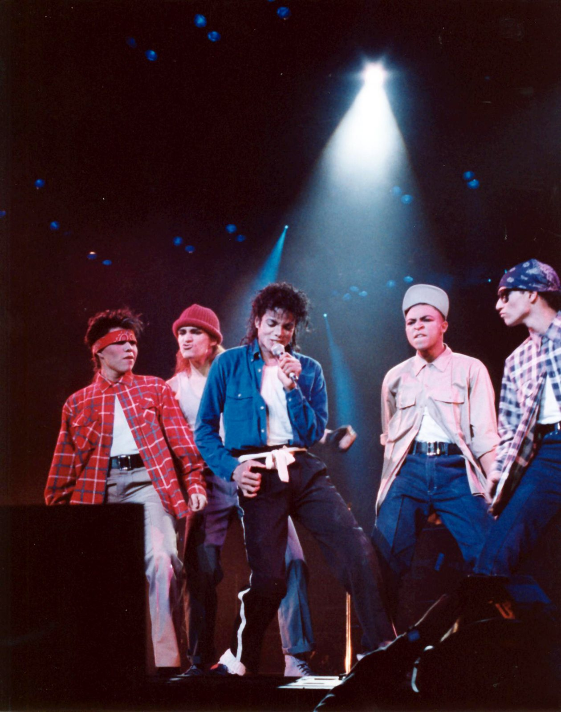
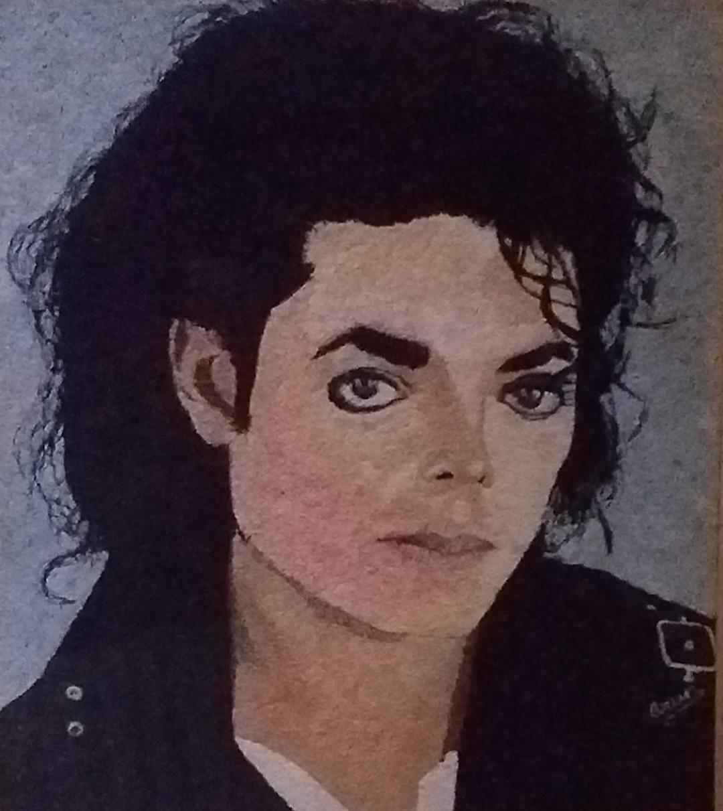
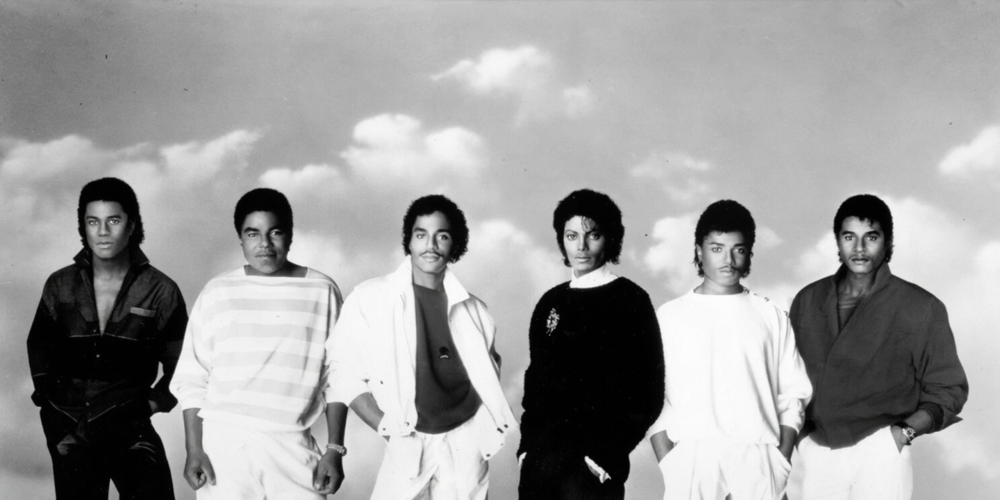

35 years ago today, November 26, 1991, Michael Jackson released his eighth solo studio album, Dangerous. The highly anticipated release ignited record stores across the United States and around the world, selling 5 million copies in its opening week alone.

## Breaking Away from Quincy Jones

Following the monumental success of Bad in 1987, Michael Jackson faced intense industry debate over his creative autonomy. Critics often credited producer Quincy Jones for the sonic perfection of Jackson's biggest triumphs, including Off the Wall and Thriller. Determined to show that his vision was entirely his own, Jackson decided to part ways with Jones. He sought to create a bold, modern record that would capture the evolving pulse of nineties music without relying on the formula that made him a superstar in the previous decade.

## From 'Decade' to a Brand-New Album

The project originally took shape in 1989 as Decade, a greatest hits compilation that was intended to feature only a handful of new tracks. Jackson received a reported 18-million-dollar advance from his label to assemble the collection. However, the singer became overwhelmed by restructuring his management team and pursuing outside film ambitions. In June 1990, during intense dance rehearsals in his home studio, Jackson collapsed from chest pains, dehydration, and inflamed ribs. The health scare forced a rethink. He abandoned Decade completely, deciding that his creative momentum demanded a full-length, original studio album.

*Archive, 1988 — Photo: Drew H. Cohen / CC BY-SA 3.0*

## Two Years Inside Record One

Production shifted into high gear at Record One in Sherman Oaks, Los Angeles, where Jackson secured executive control by paying 4,000 dollars per day. Jackson worked across multiple studios for more than two years, collaborating with a handpicked team of innovators. He re-enlisted engineer and producer Bill Bottrell, who had contributed to Bad, to develop guitar-driven rock songs. Jackson also recruited Bruce Swedien and keyboardist Bryan Loren, maintaining obsessive supervision over every vocal take and drum groove.

*Archive, 1990 — Photo: Anurekhac7 / CC BY-SA 4.0*

## The New Jack Swing Revolution

The defining shift on Dangerous arrived when Jackson enlisted Teddy Riley, the architect of new jack swing. Riley introduced aggressive, syncopated rhythms, industrial percussion, and urban street beats that completely refreshed Jackson's signature pop sound. Jackson also invited outside collaborators to stretch his stylistic range, bringing in Guns N' Roses guitarist Slash for "Black or White" and "Give In to Me," rapper Heavy D for "Jam," and Wreckx-n-Effect. The resulting 14 tracks tackled themes of racial unity, inner-city struggle, romantic temptation, and spiritual redemption.

*The Jacksons Victory publicity photo — Photo: Matthew Rolston, distributed by Epic Records / Public domain*

## A Worldwide Commercial Juggernaut

When Epic Records issued Dangerous, consumer anticipation was staggering. The album moved 5 million copies in its very first week, becoming one of the fastest-selling records in music history. In the United States, it entered the Billboard Top Pop Albums chart at number 1 and held the summit for four straight weeks. Internationally, the record dominated charts in 14 other countries, establishing Jackson as an unmatched global powerhouse. Lead single "Black or White" conquered the Billboard Hot 100, while follow-up tracks like "Remember the Time," "In the Closet," and "Will You Be There" quickly became Top 10 staples.

## Awards and the Hundred-Million-Dollar Tour

The commercial explosion was matched by widespread industry recognition. At the 1993 Grammy Awards, Dangerous secured the trophy for Best Engineered Album, Non-Classical. That same year, the American Music Awards honored Jackson with Favorite Pop/Rock Album and Favorite Soul/R&B Song for "Remember the Time." To support the project, Jackson launched the Dangerous World Tour, an extravagant traveling production that grossed 100 million dollars across international stadiums.

## The Lasting Legacy of a Classic

Dangerous went on to sell 32 million copies worldwide and earned an 8-times platinum certification from the Recording Industry Association of America. Today, music historians view the record as Jackson's final undisputed classic and his most daring creative leap. By embracing hip-hop textures, socially conscious lyrics, and new jack swing, Jackson successfully transitioned into a new musical era entirely on his own terms.

### Sources

- <https://en.wikipedia.org/wiki/Michael_Jackson>
- <https://commons.wikimedia.org/wiki/File:Michael_Jackson_in_1988.jpg>
- <https://commons.wikimedia.org/wiki/File:Michaeljacksonphoto_drewcohen.JPG>
- <https://commons.wikimedia.org/wiki/File:32_Michael_Jackson_1991_by_Arun.jpg>
- <https://commons.wikimedia.org/wiki/File:The_Jacksons_Victory_publicity_photo.jpg>
