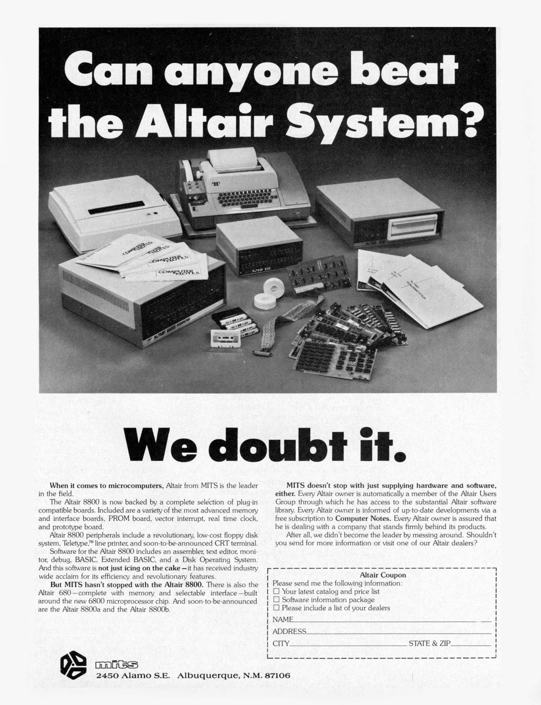
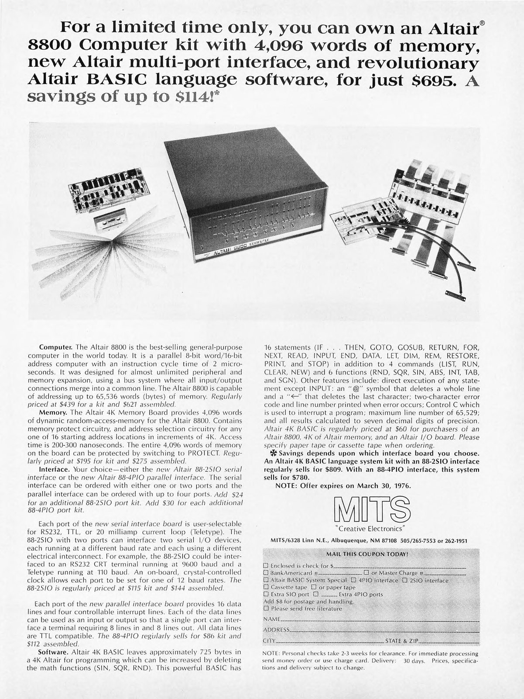
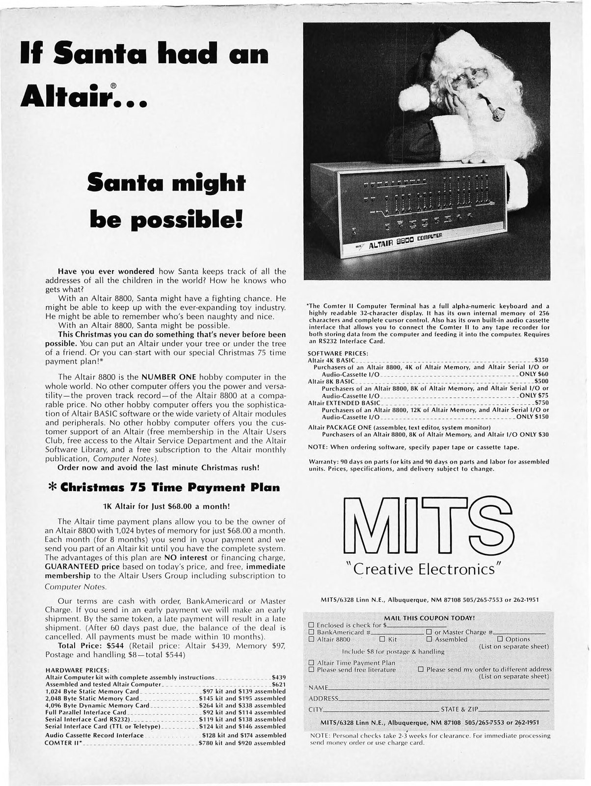

50 years ago today, November 26, 1976, a small computer partnership officially registered its business trade name with the Office of the Secretary of the State of New Mexico. The name filed on the paperwork was Microsoft. At the time, personal computers were mostly built by hobbyists in garages, and the company operated out of Albuquerque far from the major industrial centers of the country.

## Before Microsoft: Traf-O-Data and Childhood Ambitions

The story began years earlier with two childhood friends from Seattle, Bill Gates and Paul Allen. Both shared an intense fascination with computer programming and sought to build a commercial venture together. In 1972, they founded Traf-O-Data, designing a rudimentary computer designed to track and analyze automobile traffic flow. While that project was modest in scope, it gave the young partners hands-on experience in building specialized computer hardware and software.

## The Altair 8800 and a Daring Phone Call

The turning point arrived with the January 1975 issue of Popular Electronics magazine. The cover featured the Altair 8800, a microcomputer built by a company called Micro Instrumentation and Telemetry Systems, or MITS, based in Albuquerque, New Mexico. Seeing the cover, Paul Allen realized that microcomputers would soon become widespread and that they would need software. He urged Gates to help write a BASIC language interpreter for the new machine.

Gates contacted MITS directly and claimed they had already completed a working interpreter for the Altair. In truth, neither young man owned an Altair nor had written the code. When MITS expressed interest and invited them to demonstrate their software, Gates and Allen rushed to produce it. Allen programmed a simulator on a larger computer to mimic the Altair's processor, while Gates developed the interpreter code.

*Altair Computer Ad May 1976 — Photo: MITS staff / Public domain*

## The March 1975 Albuquerque Breakthrough

In March 1975, Allen flew to Albuquerque to demonstrate the software to MITS. It was the first time their code had ever been loaded into a real Altair 8800 microcomputer. Despite the lack of prior testing on actual hardware, the interpreter ran flawlessly during the demonstration.

MITS agreed to license and distribute the product, marketing it as Altair BASIC. Seeing a viable business model in programming for microcomputers, Gates and Allen established their partnership on April 4, 1975, with Gates serving as chief executive officer. Allen suggested the name "Micro-Soft," blending "micro-computer" and "software."

*Altair 8800 Computer kit - Apr 1976 Byte "limited time" advert — Photo: Micro Instrumentation and Telemetry Systems / Public domain*

## November 26, 1976: The Official Registration

Operating out of Albuquerque near MITS headquarters, the young venture began gaining momentum in the fledgling microcomputer sector. On November 26, 1976, the founders filed the necessary legal documents with the Office of the Secretary of the State of New Mexico, officially registering Microsoft as a business entity.

New Mexico was an unusual birthplace for a major corporate enterprise, but Albuquerque provided immediate proximity to their primary hardware client. The registration marked the transition of Microsoft from an informal software-writing partnership into an officially recognized American corporation.

*NOT FROM THE EVENT · 1975 — Photo: Micro Instrumentation and Telemetry Systems / Public domain*

## From Albuquerque to Global Tech Dominance

Microsoft expanded steadily during its New Mexico years. In August 1977, the company signed an agreement with ASCII Magazine in Japan, establishing its first international sales office under the name ASCII Microsoft. Recognizing the need to recruit experienced talent and expand closer to their roots, the company moved its corporate headquarters from Albuquerque to Bellevue, Washington, in January 1979.

Dominance followed in the 1980s. In November 1980, IBM contracted Microsoft to supply an operating system for the upcoming IBM Personal Computer. Microsoft bought an operating system called 86-DOS from Seattle Computer Products and rebranded it as MS-DOS. When the IBM PC debuted in August 1981, Microsoft retained ownership of MS-DOS, allowing it to license the software to compatible PC manufacturers worldwide.

## The Legacy of a 1976 State Filing

In February 1986, Microsoft relocated to Redmond, Washington, and launched its initial public offering on the NASDAQ stock exchange on March 13, 1986. The dramatic rise in share prices created billionaires and turned an estimated 12,000 Microsoft employees into millionaires. Over the decades that followed, the release of Windows, the Office suite, and enterprise cloud software cemented its position as one of the world's most influential and valuable corporations.

Fifty years later, the filing in Santa Fe remains a pivotal milestone in computing history—the moment two young programmers made their desert venture official.

### Sources

- <https://en.wikipedia.org/wiki/Microsoft>
- <https://commons.wikimedia.org/wiki/File:Altair_4K_Static_-_Apr_1976_Byte_advert.jpg>
- <https://commons.wikimedia.org/wiki/File:Altair_Computer_Ad_May_1976.jpg>
- <https://commons.wikimedia.org/wiki/File:Altair_8800_Computer_kit_-_Apr_1976_Byte_%22limited_time%22_advert.jpg>
- <https://commons.wikimedia.org/wiki/File:Altair_8800_-_Nov_1975_Byte_%22Santa%22_advert_01.jpg>
