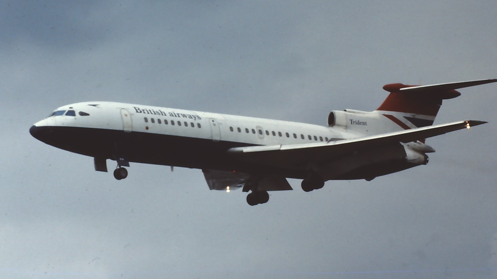
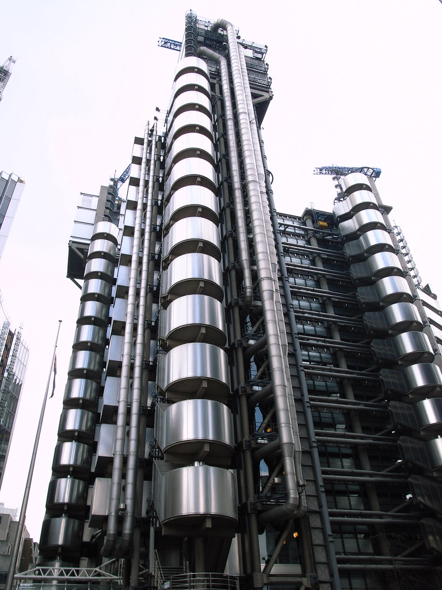
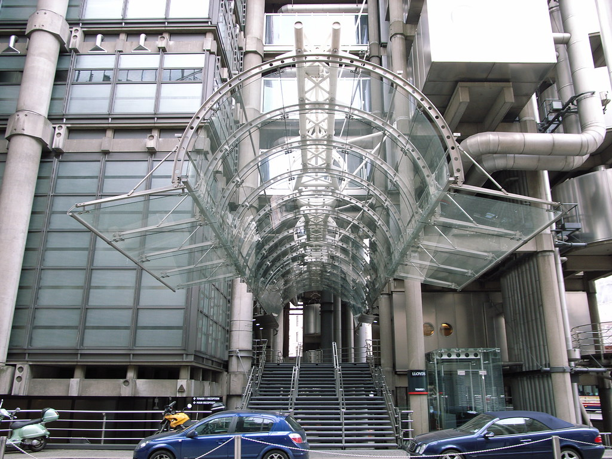

43 years ago today, November 26, 1983, an armed gang broke into an airport warehouse near Heathrow and pulled off what quickly became known as the crime of the century. They walked in expecting modest stacks of foreign currency, but walked out with nearly three tonnes of solid gold bullion.

## An Inside Job at Unit 7

The Brink's-Mat depot sat quietly in Unit 7 of the Heathrow International Trading Estate in West London. Operated as a joint venture between the American security firm Brink's and London-based MAT Transport, the facility handled precious cargo moving through the world's busiest air corridors. Security was supposed to be airtight, but the gang had bypassed the perimeter weeks before striking.

Anthony Black, a security guard stationed inside the warehouse, had agreed to assist the raiders. Black was living with the sister of Brian Robinson, a known figure in London's underworld intelligence files. Black provided Robinson and his partners with wax impressions of keys to the main doors and briefed them thoroughly on shift routines and security protocols.

## A Cold Morning and a Lit Match

At 6:40 in the morning on November 26, 1983, six masked men entered the warehouse. The raid was ruthless and calculated. The robbers swiftly overpowered the staff on duty, tying them up and interrogating them for the combinations to the inner vault doors.

To break the guards' resistance, the gang poured cans of petrol over the hostages and brandished a lit match, threatening to burn them alive if the codes were not handed over immediately. Terrified for their lives, the warehouse employees had no choice but to comply and opened the inner storage chambers.

*NOT FROM THE EVENT · 1980 — Photo: MilborneOne / CC BY-SA 3.0*

## The Unexpected Fortune: 6,800 Gold Bars

The gang had initially planned to steal roughly £1 million in Spanish pesetas, believing the vault held an ordinary shipment of holiday cash. Instead, they were stunned to find row upon row of pure gold bullion stacked right outside the main vault. The bullion was owned by Johnson Matthey Bankers Ltd and had been placed in the warehouse overnight, scheduled for a transfer flight to Hong Kong the following day.

In addition to 6,800 gold bars weighing a staggering three tonnes (96,000 troy ounces), the gang seized platinum, 1,000 carats of diamonds, and $250,000 in American traveler's cheques. The total haul was valued at £26 million—an amount equivalent to approximately £290 million in 2025. It instantly broke records as one of the largest heists in British history.

*Lloyds' Building — Photo: stevecadman / CC BY-SA 2.0*

## The Smelting Fires and Missed Clues

Transporting three tonnes of heavy metal required immense physical effort, but hiding it proved even more complicated. Just two days after the robbery, a couple living near Bath in Somerset spotted a white-hot crucible blazing away in a garden hut on a neighbor's property. Suspicious that it might be connected to the massive London heist, they notified the police immediately.

However, when local officers arrived, they dismissed the tip by claiming the property fell just beyond their territorial jurisdiction, promising to notify the proper district. No immediate follow-up was conducted, and the couple was never called to provide formal statements or evidence. The occupier was later revealed to be John Palmer, a bullion dealer and jeweler.

*Entrance, Lloyds' Building — Photo: stevecadman / CC BY-SA 2.0*

## Swift Arrests, Yet the Fortune Dissolves

Detectives from Scotland Yard's Flying Squad moved rapidly once they connected Anthony Black's family ties to Brian Robinson. Within ten days of the raid, police arrested Robinson and his chief accomplice, Micky McAvoy. Black confessed to his role in December 1983, explaining how he had supplied the entry keys. In December 1984, Robinson and McAvoy were convicted of armed robbery at the Old Bailey and sentenced to 25 years in prison, while Black received six years.

Despite the rapid convictions of the frontline robbers, the gold was already slipping away. McAvoy had entrusted his share to associates Brian Perry and George Francis, who recruited Kenneth Noye, an illicit gold specialist. Noye began systematically melting down the stamped bullion, mixing it with scrap copper coins to disguise its purity and origins before reselling it onto legitimate gold markets.

## The Legacy of a Golden Mystery

The fallout from the heist dragged on for more than a decade through courthouses, financial firms, and criminal networks. Kenneth Noye was eventually placed under heavy surveillance, leading to a violent confrontation in January 1985 in which undercover detective John Fordham was fatally stabbed in Noye's garden. Though acquitted of murder on self-defense grounds, Noye was convicted in 1986 of conspiring to handle the stolen gold and sentenced to 14 years.

Insurance giant Lloyd's of London ultimately covered the immense losses for Johnson Matthey Bankers. Millions of pounds laundered from the bullion fueled the Docklands commercial property boom of the late 1980s. Yet to this day, the vast majority of the 6,800 gold bars has never been recovered, having melted into jewelry, coins, and bank vaults across the globe.

### Sources

- <https://en.wikipedia.org/wiki/Brink's-Mat_robbery>
- <https://commons.wikimedia.org/wiki/File:British_Concorde.jpg>
- <https://commons.wikimedia.org/wiki/File:HS-Trident-516.jpg>
- <https://www.flickr.com/photos/98115025@N00/445356101>
- <https://www.flickr.com/photos/98115025@N00/445354470>
